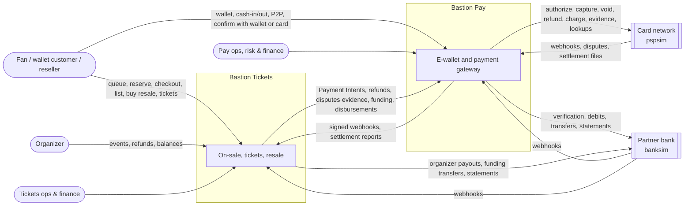
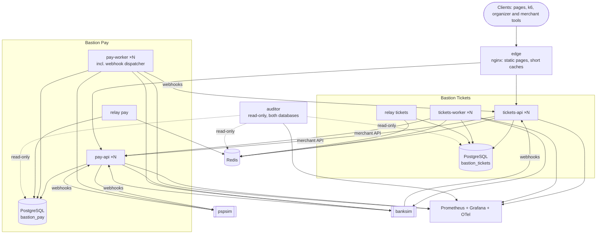
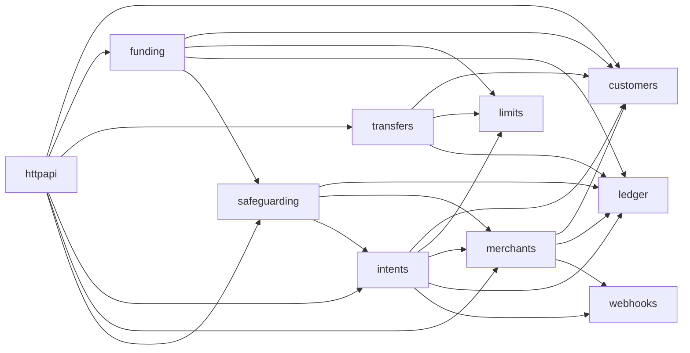
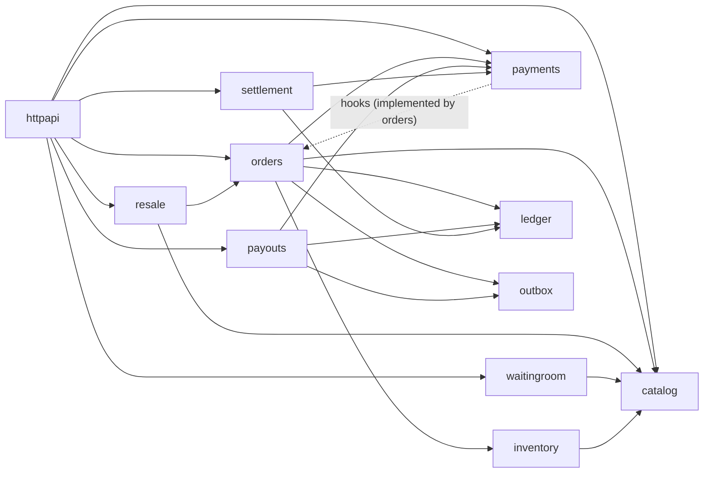
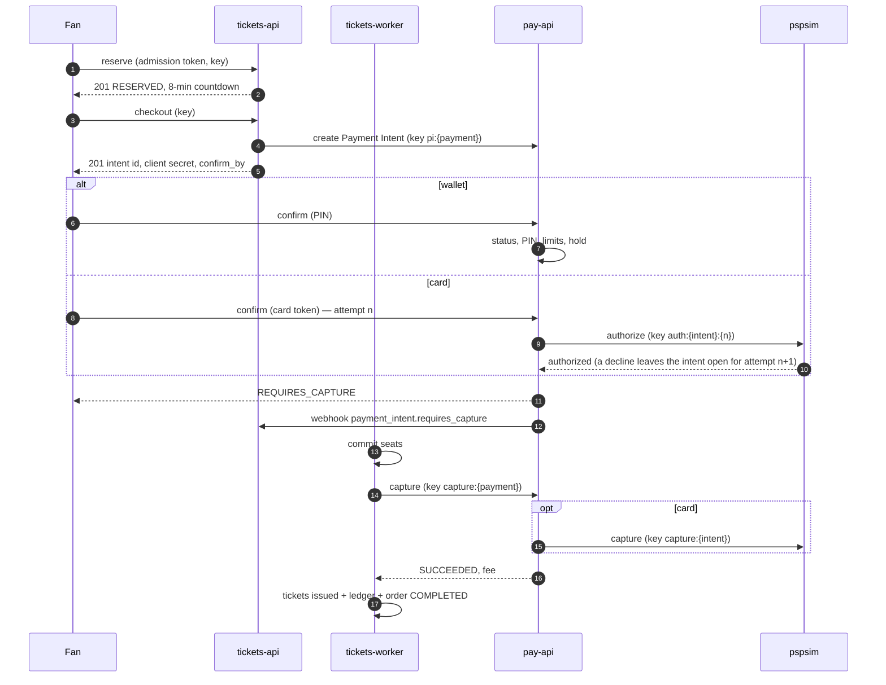
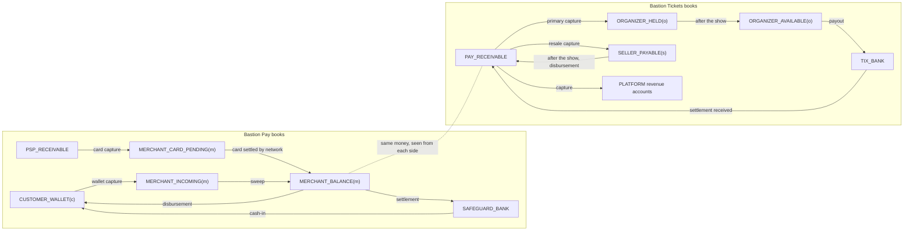

# Bastion — Architecture

| Field | Value |
| --- | --- |
| Document | Architecture Description |
| Status | Draft v4.1, for owner review |
| Last updated | 2026-10-26 |
| Related | [PRD](01-prd.md) · [Technical Design](03-technical-design.md) · [Invariants](04-invariants.md) |

This document describes **how Bastion is structured and why**. For every major choice it records the alternatives that were considered and the price we pay for the one we chose. Implementation detail (schemas, SQL, algorithms, configuration) is in the [Technical Design](03-technical-design.md).

---

## 1. Scope of this document

| Covered here | Covered elsewhere |
| --- | --- |
| Quality-attribute priorities and constraints | Requirements: [PRD](01-prd.md) |
| Principles and prior art | Schemas, SQL, Lua, APIs: [Technical Design](03-technical-design.md) |
| Context, container and module views of both products | Correctness contract: [Invariants](04-invariants.md) |
| Runtime views of the critical flows | |
| Architecture decisions (ADR format) | |
| Deployment view and path to production | |

## 2. Architectural drivers

### 2.1 Quality attributes, in priority order

| # | Attribute | Scenario that defines it |
| --- | --- | --- |
| 1 | **Correctness of money** | In either company, under any load or failure: no money created, lost or moved twice; customer funds always safeguarded; limits never exceeded |
| 2 | **Correctness of seats, tickets and ownership** | No oversell, no seat sold twice, no ticket without payment, exactly one owner per ticket |
| 3 | **Recoverability** | A process dies, or the network between Tickets and Pay or between Pay and the card network drops, mid-payment. Every operation still reaches a valid terminal state without human help. |
| 4 | **Overload resilience and fairness** | 100,000 fans join a queue for 10,000 tickets; thousands confirm payments within seconds; 500 fans click the same resale listing. Both databases stay healthy; outcomes are fair. |
| 5 | **Isolation between the products** | Pay serves its wallet customers while Tickets is overloaded or down; Tickets keeps queueing fans while Pay is degraded. |
| 6 | **Performance** | PRD §10.2 |
| 7 | **Operability and explainability** | Any balance, seat, owner, order or safeguarding figure can be explained from stored history |
| 8 | **Simplicity and cost** | One engineer can build, run and reason about it on one laptop |

Both products carry the same weight: each has its own concurrency problems, ledger, two-phase flows, external integrations, unknown outcomes, reconciliation and disputes (PRD §2.3).

### 2.2 Constraints and assumptions

- One engineer, about 22 weeks at 15–20 h/week; one laptop; Docker Compose; no paid services.
- Simulated card network and bank with reproducible faults.
- Bastion Pay models the Vietnamese e-wallet rules of PRD §2.2. The card network follows Stripe-like semantics. One currency (VND).

## 3. Architectural principles

| # | Principle | What it means in Bastion |
| --- | --- | --- |
| P1 | **Every write is idempotent** | Client keys on every request that moves money, seats, tickets or ownership; derived keys on every outbound call; unique references on every ledger event |
| P2 | **Money moves only through balanced, immutable entries** | One ledger per company; one write path; zero-sum enforced at commit; corrections are reversals |
| P3 | **Customer money is safeguarded, not just recorded** | Escrow separate from operating money; card money pending until it reaches escrow; a conservative surplus floor; daily proof against the bank statement |
| P4 | **Reject early and cheaply; bound everything** | Four-layer admission funnel; limits before holds; bounded queues; deadlines; retry budgets |
| P5 | **Reconcile against independent sources** | Auditor per database; Pay against the bank and the card network; Tickets against Pay and its bank; both against each other |
| P6 | **Database constraints before application checks** | `CHECK`, `UNIQUE`, partial unique indexes, guarded `UPDATE`s, deferred triggers and FSM triggers first |
| P7 | **Hold, then settle** | Seats: reserve → commit. Listings: lock → transfer. Wallets: hold → capture. Cards: authorize → capture. Bank transfers: pending → posted. Organizer and seller money: held until after the show. |
| P8 | **Never guess an external outcome** | "Unknown" is a real state on every call across a company boundary |
| P9 | **A hard boundary between companies** | Two databases; no shared transaction; an API and signed webhooks |
| P10 | **Fairness is designed, not hoped for** | Arrival order cannot be gamed; limits count holds and locks |

## 4. Prior art

The sources below point to six principles: idempotent writes, a zero-sum immutable ledger, safeguarded customer funds, admission control at the edge, fairness by design, and reconciliation against independent sources. Lessons are paraphrased, not quoted.

### 4.1 Payments engineering

| Source | Lesson | Applied in Bastion |
| --- | --- | --- |
| [Stripe — Idempotency](https://stripe.com/blog/idempotency) | A client key lets the server recognize a resend and charge exactly once. | `Idempotency-Key` on every write endpoint of both products. |
| [Amazon — Making retries safe with idempotent APIs](https://aws.amazon.com/builders-library/making-retries-safe-with-idempotent-APIs/) | Record the token with the change; reject parameter mismatches; replay equivalent responses; expire tokens. | One idempotency kit used by both services. |
| [Airbnb — Avoiding double payments](https://medium.com/airbnb-engineering/avoiding-double-payments-in-a-distributed-payments-system-2981f6b070bb) | Persist, call the partner with no transaction open, record the result; read idempotency state from the primary; default to non-retryable. | The three-phase template on every boundary call. |
| [Stripe — Payment Intents lifecycle](https://docs.stripe.com/payments/paymentintents/lifecycle) | An intent tracks a payment through confirmation, an optional `requires_capture` state, success or cancellation; a failed attempt returns it to a retryable state; asynchronous methods pass through `processing`; cancellation releases held funds. | Bastion Pay's merchant contract (AD-26), with `PROCESSING` for card calls in flight. |
| [Stripe — Place a hold on a payment method](https://docs.stripe.com/payments/place-a-hold-on-a-payment-method) | Card holds expire (about 7 days online); partial capture releases the rest; usually one capture. | Card authorization expiry, capture margin, one capture per intent. |
| [Stripe — Webhooks](https://docs.stripe.com/webhooks) | Retries with exponential backoff for up to three days; no ordering guarantee; duplicates happen; HMAC-SHA256 signatures with a timestamp and a 5-minute default tolerance; acknowledge fast, process asynchronously. | Pay's webhook delivery (AD-31) and Tickets' receiver. |
| [Shopify — Resilient GraphQL APIs using idempotency](https://shopify.engineering/building-resilient-graphql-apis-using-idempotency) | Recovery points; resume from the step in progress; `409` for concurrent duplicates. | Order status as the recovery point. |
| [Shopify — 10 tips for resilient payment systems](https://shopify.engineering/building-resilient-payment-systems) | Short timeouts, breakers, Little's Law, reconciliation, simulated providers, time-ordered IDs. | Breakers per dependency; simulators; UUIDv7. |
| [TigerBeetle — Two-phase transfers](https://docs.tigerbeetle.com/coding/two-phase-transfers/) | Pending transfers reserve funds and resolve exactly once: posted, voided, or expired with the full amount returned. | Ledger holds with a resolution table; every card authorization likewise ends captured or voided, never stranded. |
| [Adyen — Capture failure reasons](https://docs.adyen.com/online-payments/capture/failure-reasons) | Some capture refusals are final (expired, cannot be re-captured); after a technical refusal the provider re-captures and later reports success ("Transaction Recaptured"). | Capture refusals classified as final or pending; Tickets releases seats only after Pay reports the authorization dead (AD-07, AD-26). |
| [Hyperswitch — Payment flows](https://docs.hyperswitch.io/learn-more/payment-flows) | An open-source orchestrator separates the payment intent from its attempts, each with its own state machine constrained by the intent's. | Card attempts per intent (AD-26). |
| [Uber — Payments platform](https://www.uber.com/us/en/blog/ubers-payments-platform/) | Immutable money orders; zero-sum before commit; rebuild from history; batching hot entities. | Deferred zero-sum trigger; rebuild tool; sharded, swept merchant accounts. |
| [Airbnb — Rebuilding payment orchestration](https://airbnb.tech/?p=49) | Idempotent steps; append-only events; a job that matches two systems. | State events; the cross-company check (S16). |
| [Amazon — Timeouts, retries and backoff with jitter](https://builder.aws.com/content/3EumjoZascWd1oZiEgL8ORlv3qE/timeouts-retries-and-backoff-with-jitter) | One retry layer, backoff, jitter, token-bucket budgets. | One retry layer per service. |
| [IETF draft — Idempotency-Key header](https://datatracker.ietf.org/doc/draft-ietf-httpapi-idempotency-key-header/) | `400` missing, `409` in progress, `422` mismatch. | Same codes in both APIs. |

### 4.2 E-wallet regulation (Vietnam, as summarized by secondary sources)

| Source | Rule | Applied in Bastion Pay |
| --- | --- | --- |
| Decree 52/2024/ND-CP | Wallets linked to the holder's bank account or debit card; escrow balances not lower than issued wallet balances | Activation after a verified link; W1 |
| [Circular 40/2024/TT-NHNN](https://hoatieu.vn/phap-luat/thong-tu-40-2024-tt-nhnn-ve-hoat-dong-cung-ung-dich-vu-trung-gian-thanh-toan-225818), Art. 26 | 100 million VND per month per customer for transfers and payments through personal wallets | W2 |
| [Circular 41/2025/TT-NHNN](https://luatvietnam.vn/linh-vuc-khac/tong-hop-diem-moi-thong-tu-41-2025-tt-nhnn-ve-vi-dien-tu-883-106022-article.html) | No cash in or out, no credit, no interest | Bank-only funding; wallets never negative |

### 4.3 Ticket on-sales and load

| Source | Lesson | Applied in Bastion Tickets |
| --- | --- | --- |
| [Ticketmaster — The Eras Tour onsale explained](https://business.ticketmaster.com/press-release/taylor-swift-the-eras-tour-onsale-explained/) | Registration screens bots; 3.5 billion requests (about 4× the previous peak); sales slowed to stabilize; validation errors lost carted tickets. | Admission throttled to capacity; the admission token checked once, at reservation. |
| [Queue-it — Why FIFO isn't always the answer](https://www.queue-it.com/blog/first-in-first-out-randomization) | Randomize the pre-queue at sale start, FIFO afterwards. | AD-12. |
| [SeatGeek — High-demand ticket on-sales (QCon London)](https://archive.qconlondon.com/node/142605) | An in-house Go waiting room is the primary component that keeps the site up for a subset of users while the excess is queued. | The waiting room as the entry point of every on-sale. |
| [AWS — Virtual Waiting Room](https://aws.amazon.com/blogs/compute/introducing-aws-virtual-waiting-room/) | Sequence numbers, a serving counter, expiring tokens checked by the target site. | Admission tokens. |
| [Shopify — Flash-sale traffic I](https://engineering.shopify.com/surviving-flashes-of-high-write-traffic-using-scriptable-load-balancers-part-i), [II](https://shopify.engineering/surviving-flashes-of-high-write-traffic-using-scriptable-load-balancers-part-ii) | A bare `429` looks like an outage; random polling is a lottery; admit by spare capacity. | Queue page; positions from tickets; capacity-driven admission. |
| [Alibaba Cloud — Flash sales with Redis](https://help.aliyun.com/en/redis/use-cases/use-apsaradb-for-redis-to-build-a-business-system-that-can-handle-flash-sales) | CDN, a filter before the database, atomic Lua decrements, resync from the DB. | Four-layer funnel; PostgreSQL stays the arbiter. |
| [Amazon — Load shedding](https://builder.aws.com/content/3Eun1EEyX6p2e3VYNyRLSJzLuMV/using-load-shedding-to-avoid-overload), [queue backlogs](https://builder.aws.com/content/3EuRcgkTP1MI0c7zM8W6HL3WIqA/avoiding-insurmountable-queue-backlogs) | Goodput, early rejection, bounded queues, leases, DLQs, per-customer fairness. | Goodput-driven admission; leases; rate-limited refund waves. |
| [Ticketmaster — Sold tickets and cancelled events](https://help.ticketmaster.com/hc/en-us/articles/9715663040785-What-happens-if-I-ve-sold-my-tickets-and-the-event-is-canceled-postponed-or-rescheduled) | Because sellers were already paid, a cancellation charges the seller's card to refund the buyer and returns the tickets to the seller. | Seller proceeds held until after the show instead, so no unwinding is needed (AD-25, AD-38). |
| [Axios — Why StubHub halted refunds (2020)](https://www.axios.com/2020/04/01/why-stubhub-halted-refunds) | Paying sellers before events and refunding buyers before collecting from sellers left the marketplace unable to fund mass refunds. | AD-25, AD-38. |

Stripe's [Ledger](https://stripe.dev/blog/ledger-stripe-system-for-tracking-and-validating-money-movement) article is highly relevant but could not be retrieved, so nothing here relies on it.

## 5. System context



## 6. Container view



| Container | Responsibility | Scaling and coordination |
| --- | --- | --- |
| `edge` | Static pages; caches Tickets' event status (1 s), seat maps (2 s) and resale listings (1 s) | Stateless |
| `pay-api` | Customer API (wallet, funding, P2P, confirmation by wallet or card), merchant API (intents, refunds, disputes, funding, disbursements, balance), ops API, PSP and bank webhooks | Stateless, ≥ 2 |
| `pay-worker` | Resolvers, intent expirer, sweeper, settlement, webhook dispatcher, dispute deadlines, statement and PSP reconciliation, sealer | `SKIP LOCKED` + leases; singletons by advisory lock |
| `tickets-api` | Fan, reseller, organizer and ops API; waiting room; reservations; listings; checkout; Pay and bank webhooks | Stateless, ≥ 2 |
| `tickets-worker` | Payment driver, poller, expirers (reservations, listing locks), recovery, refunds, disputes, cancellation, funds release, payouts, seller disbursements, reconciler, controller, Pay settlement reconciliation, sealer | As above |
| `relay` | Publishes each database's outbox to its stream | One singleton per database |
| `auditor` | Per-company and cross-company checks; never writes | Single instance |
| `pspsim`, `banksim` | Stateful simulators with seeded faults | Single instance each |
| PostgreSQL | One server, two databases with separate roles | Single primary (local) |
| Redis | Derived or rebuildable data only, namespaced per product | Single instance (local) |

## 7. Module view

### 7.1 Repository and boundaries

```
internal/platform    shared technical code
internal/kit         ledger, idempotency, fsm, outbox, webhookin
internal/pay/...     Bastion Pay modules
internal/tickets/... Bastion Tickets modules
internal/audit       independent checks
internal/sim/...     simulators
```

**Rules**, enforced by an architecture test:

1. `pay/**` and `tickets/**` never import each other. Tickets reaches Pay only through `tickets/payments/payclient` over HTTP; Pay reaches Tickets only through webhooks.
2. Both may import `platform` and `kit`; each kit instance owns its schema in its product's database.
3. `audit` imports only `platform`; simulators import no product code.
4. Inside a product, modules use each other's Go APIs with a shared `pgx.Tx`, never each other's tables.

### 7.2 Bastion Pay modules



| Module | Owns | Responsibility |
| --- | --- | --- |
| `customers` | `customers` | Registration, PIN, OTP, linked accounts, wallet status |
| `limits` | `limits` | Daily and monthly usage counters |
| `funding` | `funding` | Cash-in, card top-ups, cash-out, top-up chargebacks; bank and card ports |
| `transfers` | `transfers` | P2P |
| `intents` | `intents` | Payment Intents (wallet and card), card operations (authorize, capture, void, refund), refunds, card disputes |
| `merchants` | `merchants` | Merchant accounts, incoming sweep, pending card funds, debt, settlement and reports, funding, disbursements |
| `webhooks` | `webhooks` | Outgoing events and deliveries |
| `safeguarding` | `safeguarding` | Surplus floor, capital, sweeps, escrow statement and PSP settlement reconciliation, exceptions |

### 7.3 Bastion Tickets modules



| Module | Owns | Responsibility |
| --- | --- | --- |
| `catalog` | `catalog` | Organizers, fans, events, zones, seat maps, lifecycle |
| `waitingroom` | Redis + checkpoints | Queue, shuffle, serving counter, admission tokens, controller |
| `inventory` | `inventory` | Zone counters, seats, quotas, reservations, Redis filter and reconciler, seat-map snapshots |
| `orders` | `orders` | Primary and resale orders, lines, tickets and ownership; the payment saga; refunds; disputes; cancellation; organizer funds release; the Tickets ledger |
| `resale` | `resale` | Listings, locks, price rules, seller payout destinations |
| `payments` | `payments` | Tickets' side of Bastion Pay: intent records, `payclient`, webhook ingestion, captures, refunds, disputes, fundings, disbursements |
| `payouts` | `payouts` | Organizer payouts by bank; seller payouts by Pay disbursement |
| `settlement` | `settlement` | Pay settlement report and bank statement reconciliation |

## 8. Runtime views

### 8.1 Buying a ticket across both products



### 8.2 Wallet operations inside Bastion Pay

| Operation | Locks, in order | Decided by |
| --- | --- | --- |
| P2P | key → both wallet rows (share, id order) → sender's limit rows → ledger accounts | `ACTIVE` guard; `within_cap`; `within_bound` |
| Wallet confirmation | key → intent row → wallet row (share) → limit rows → ledger | Intent status guard; wallet guard; limits; bound (hold) |
| Cash-out | key → cash-out row → wallet row (share) → ledger | Wallet guard; bound (hold) |
| Card top-up | key → top-up row → wallet row (share) → surplus floor → ledger | Floor guard |
| Freeze | wallet row (exclusive) | First to the row wins |

### 8.3 Money between the two companies



Arrows go from the debited account to the credited account. Each company books only its own side. Tickets' `PAY_RECEIVABLE` equals its balances at Pay (incoming + card pending + balance − debt) once in-flight transfers are accounted for (S16). Templates: Technical Design §9 and §20.

### 8.4 Resale purchase

```mermaid
sequenceDiagram
    autonumber
    participant B as Buyer
    participant T as tickets-api
    participant TW as tickets-worker
    participant P as Bastion Pay
    B->>T: POST /v1/listings/{id}/purchase (key)
    T->>T: listing ACTIVE → LOCKED for this buyer (8 min); buyer quota +1 reserved
    T-->>B: 201 resale order RESERVED
    B->>T: checkout → Payment Intent
    B->>P: confirm (wallet or card)
    P->>T: webhook requires_capture
    TW->>TW: commit: listing LOCKED → SELLING (ticket untouched, still the seller's, no QR for anyone)
    TW->>P: capture
    TW->>TW: one transaction: listing SOLD, ticket owner = buyer, owner_version + 1, transfer row, quotas, SELLER_PAYABLE credited, order COMPLETED
```

Ownership moves in the transaction that records the money, as primary tickets are issued. If the capture is refused, Pay voids the authorization and Tickets cancels the listing; the ticket never left the seller.

### 8.5 A dispute across both products

```mermaid
sequenceDiagram
    autonumber
    participant N as pspsim
    participant P as Bastion Pay
    participant T as Bastion Tickets
    N->>P: dispute.created (card payment of an order)
    P->>P: dispute OPENED; merchant balance −(amount + fee), excess → merchant debt
    P->>T: webhook dispute.created
    T->>T: if a payer's ticket is mid-sale (SELLING): 409, Pay redelivers in seconds
    T->>T: cancel listings not yet committed; revoke tickets the payer still owns; recover from organizer or seller proceeds
    T->>P: submit evidence
    P->>N: forward evidence
    N->>P: dispute.won | dispute.lost
    P->>T: webhook dispute.closed
    T->>T: won: reinstate tickets, reverse recoveries · lost: primary VOID, resale back to the seller (one hop)
```

### 8.6 Event cancellation with resales

```mermaid
sequenceDiagram
    autonumber
    participant Ops
    participant TW as tickets-worker
    participant P as Bastion Pay
    participant B as banksim
    Ops->>TW: cancel event
    TW->>TW: close admission; cancel listings; release reservations
    TW->>P: cancel open intents (holds released, authorizations voided)
    TW->>TW: void every valid ticket (ownership left as it is)
    TW->>P: balance? pre-fund if short (bank transfer with reference)
    par every line of every completed order, in any order
      TW->>P: refund resale buyer (from that sale's held seller proceeds)
      TW->>P: refund primary buyer (from organizer held funds)
    end
```

Refunds are independent: each returns one payment from money still held for that same sale, so they commute and may complete in any order. A resale chain A → B → C needs no unwinding.

### 8.7 Failure handling at a glance

| Failure | Where | Response |
| --- | --- | --- |
| Lost response, client retries | Both APIs | Stored response replayed |
| Bank or card call times out after the money moved | Pay | `*_UNKNOWN` / `PROCESSING`; lookup with the same key |
| Merchant API call times out | Tickets → Pay | `*_UNKNOWN`; lookup by key |
| Webhook lost, duplicated, reordered | Both directions | 3-day retries; inbox dedupe; FSM guards; polling |
| Concurrent debits on one wallet / limits at midnight | Pay | Holds and bounds / guarded counters |
| Card settlement delayed | Pay | Card funds stay pending; top-ups refused once the floor is used |
| Card dispute | Pay → Tickets | Merchant debit and debt; tickets revoked; recoveries |
| Two fans on one seat / one listing | Tickets | One guarded winner; `409` for the others |
| Countdown or listing lock ends during payment | Tickets | Not committed or transferred; authorization voided |
| Card declined | Pay | Intent stays open; the customer retries as a new attempt, one at a time |
| Capture refused | Pay → Tickets | Final: Pay voids, Tickets uncommits or cancels the listing automatically; network retrying: wait; capture after cancel: exception |
| Pay degraded | Tickets | Breaker; fail fast; reservations kept; admission slows |
| Process crash | Both | Leases expire; recovery resumes |
| Invariant violation | Auditor | Kill switches: settlements, sweeps, payouts, admission |

## 9. Data architecture and consistency

| Data | System of record | Consistency |
| --- | --- | --- |
| Pay ledger, wallets, limits, intents, disputes, merchants, safeguarding | `bastion_pay` | Strong within Pay |
| Tickets ledger, inventory, orders, tickets, ownership, listings, Pay records | `bastion_tickets` | Strong within Tickets |
| A payment as seen by both companies | Each company's database | Eventually consistent through responses, webhooks, polling and daily reports; checked by S16 |
| Redis counters, claims, queue | Derived | Eventually consistent, always safe |

Every invariant is decided inside one transaction of **one** company. Agreement **between** companies is a protocol: idempotent requests, persisted intents, lookups by key, webhooks with retries, and daily reconciliation.

## 10. Architecture decisions

Format: **Context → Decision → Alternatives → Consequences**. Split into `docs/adr/` in Phase 8. ✱ marks a change relative to the original proposal (including v2.0, v3.0, v4.0 and v4.1).

### AD-01 — Two products, each a modular monolith, in one monorepo with two databases ✱

- **Context:** Bastion Pay and Bastion Tickets are different companies in reality with different obligations. The integration discipline between them should be real.
- **Decision:** Two services, each with API and worker processes and its own database, in one Go module; they talk only through Pay's merchant API and signed webhooks.
- **Alternatives:** one monolith with Pay as a module (hides cross-company protocols and allows impossible transactions); microservices per module (turns local invariants into distributed sagas); two repositories (duplicated kits).
- **Consequences:** ➕ Real cross-company protocols, local ACID within each company, failure isolation. ➖ More processes; eventual agreement between companies, reconciled daily.

### AD-02 — Go

- **Alternatives:** Java/Kotlin + Spring (hidden transactions), Rust (slower iteration), Node.js (weaker concurrency tooling).
- **Consequences:** ➕ Goroutines, `context`, race detector, pgx; used for production waiting rooms and payment backends.

### AD-03 — PostgreSQL as each company's system of record

- **Alternatives:** MySQL (no deferrable constraints, no partial unique indexes), distributed SQL (serializable-only retries on hot rows), document stores.
- **Consequences:** ➕ Most invariants become constraints. ➖ One primary per company; relieved by filtering, admission control and sharding.

### AD-04 — Redis admission filter; PostgreSQL arbiter (Tickets)

- **Alternatives:** Redis as source of truth, PostgreSQL only, per-instance counters, a serialized consumer per zone.
- **Consequences:** ➕ Cheap rejections. ➖ A reconciler; drift safe in both directions.

### AD-05 — Purchase in three steps: reserve, checkout, confirm in Bastion Pay ✱

- **Decision:** Reserve (8-minute countdown) → checkout creates a Payment Intent (deadline 30 s before the countdown ends; countdown extended to ≥ 4 min, ≤ 12 min total) → the fan confirms in Pay by wallet or card.
- **Alternatives:** one request that reserves and pays; server-to-server charging with a stored token (skips customer authentication).
- **Consequences:** ➕ Realistic flow with customer authentication. ➖ Asynchronous outcomes (AD-07); the 12-minute cap stops repeated extensions.

### AD-06 — Two-phase money: authorize → commit → capture

- **Decision detail:** Wallet holds and card authorizations both precede commitment of seats or of a resale listing; tickets are issued and ownership moves only in the transaction that records the capture.
- **Alternatives:** capture at confirmation (a lost reservation means a refund instead of a void).
- **Consequences:** ➕ Lost reservations or locks cost only a void. ➖ Capture windows and authorization expiry to manage.

### AD-07 — Tickets' payment saga is asynchronous ✱

- **Decision:** Orders wait in `PAYMENT_PENDING` without a driver; a webhook or the poller records the authorization; a `payment-driver` job commits, captures and issues or transfers under a lease. Card captures that return `processing` are followed to completion by webhook or poll. Once a capture has been sent, Tickets acts only on **terminal** intent events: `succeeded` completes the order, `canceled` (sent by Pay only after the network confirmed the authorization dead) uncommits the seats or cancels the listing automatically.
- **Alternatives:** holding the fan's request open; a workflow engine (production path).
- **Consequences:** ➕ Fast acknowledgments; recovery is the normal path. ➖ More states; polling safety net.

### AD-08 — In-house double-entry ledger kit, one ledger per company ✱

- **Alternatives:** TigerBeetle (benchmark extension), a hosted ledger, balance columns, balances from postings on every read.
- **Consequences:** ➕ Business state and money commit together in each company. ➖ Locking and hot accounts are ours to get right.

### AD-09 — `READ COMMITTED` + guarded updates + ordered locks

- **Decision:** One pattern for seats, quotas, listings, wallet balances, limits, PIN counters and the surplus floor: guarded `UPDATE` + `CHECK` on one row; global lock order per product for multi-row work; `UNIQUE` for exactly-once; deferred triggers for entries.
- **Alternatives:** `SERIALIZABLE` (Phase 7 benchmark), optimistic versions, Redis locks, read-then-write.
- **Consequences:** ➕ Predictable performance. ➖ Deadlock freedom proven by lock orders (Technical Design §18.1, §28.1) and CC1, CC7, CC12.

### AD-10 — Hot accounts: shard only unbounded accounts; split merchant funds ✱

- **Decision:** A merchant's money at Pay lives in four accounts: `MERCHANT_INCOMING` (wallet captures; unbounded, sharded, swept every second), `MERCHANT_CARD_PENDING` (card captures awaiting network settlement; unbounded, sharded), `MERCHANT_BALANCE` (available; bounded by the refund credit limit; single row) and `MERCHANT_DEBT` (forced debits beyond the limit). Tickets' revenue and receivable accounts are sharded.
- **Alternatives:** a single merchant row (serializes captures); unbounded balances (no protection).
- **Consequences:** ➕ Capture throughput not limited by one row. ➖ Funds become available one sweep or one settlement later (S1, S18).

### AD-11 — Transactional outbox + Redis Streams per company

- **Alternatives:** dual write, Kafka, NATS, CDC, `LISTEN/NOTIFY`.

### AD-12 — Waiting room: shuffled pre-queue, FIFO after, goodput- and inventory-driven admission ✱

- **Alternatives:** bare `429`, random polling, pure FIFO, stateless admission, SaaS.
- **Consequences:** ➕ Fair, explainable. ➖ A controller to tune; the shuffle must test uniform.

### AD-13 — Unknown outcomes resolved by lookup with the same key, on every boundary ✱

- **Decision detail:** Tickets → Pay (create, capture, cancel, refund, funding, disbursement, evidence); Pay → card network (authorize, capture, void, refund, charge, evidence); Pay → bank; Tickets → bank.

### AD-14 — `int64` money; UUIDv7 IDs ✱

### AD-15 — pgx + sqlc + SQL migrations

### AD-16 — REST/JSON on `net/http`

### AD-17 — PostgreSQL-native job loops

### AD-18 — Asynchronous ledger sealer ✱

### AD-19 — Simulators: a card network and a bank with real accounts ✱

- **Decision detail:** `pspsim` supports two-phase card payments, one-step charges, refunds, disputes with evidence and settlement files; `banksim` moves money between real-looking accounts and produces statements.

### AD-20 — Invariants, an independent omniscient auditor, property, chaos and load tests ✱

### AD-21 — Prometheus + Grafana + OpenTelemetry + `slog`, traces across both products

### AD-22 — Inventory: counters for zones, rows for seats ✱

### AD-23 — Orders are all-or-nothing and belong to one event ✱

### AD-24 — Tickets issued in the transaction that records the capture ✱

### AD-25 — Organizer and seller money held until after the show; cancellation pre-funded ✱

- **Decision:** Organizer funds and seller proceeds stay held at Tickets until the show ends + 3 days. Cancellation pre-funds Tickets' Pay balance before refunding.
- **Alternatives:** settlement delayed at Pay by event date; deep negative merchant balances; rolling reserves.
- **Consequences:** ➕ Neither company carries the other's credit risk; every cancellation refund, a resale buyer's included, is funded from money still held for that same sale (AD-38). ➖ Organizers and sellers wait; a cross-company funding flow.

### AD-26 — Payment Intents with manual capture are the merchant contract ✱

- **Decision:** `REQUIRES_CONFIRMATION → (PROCESSING) → REQUIRES_CAPTURE → (CAPTURING) → SUCCEEDED`, or `CANCELED`. Failed confirmations keep the intent open, as in Stripe ("the PaymentIntent's status returns to `requires_payment_method` so that the payment can be retried"); five cancel it. Each card confirmation is an **attempt** with its own derived key; at most one attempt is live, a new one starts only after the previous one definitively failed, and outcomes are recorded on the attempt row first so stale messages cannot reopen the intent. A capture refused for a final reason is followed by an automatic void; a refusal the network retries keeps the intent `processing`; `CANCELED` is emitted only when the authorization is dead. One live intent per merchant reference; refunds and disputes are children.
- **Alternatives:** one authorization per intent (a declined card forces a new intent, and the fan's seats may expire meanwhile); a separate attempts table (Hyperswitch's model; one counter and two partial indexes give the same guarantees here); a terminal `CAPTURE_FAILED` state (v4.0: the authorization stayed on the card and the merchant needed manual recovery); a single charge call (no void path).

### AD-27 — Payment Intents accept wallet and card ✱

- **Context:** v3.0 made intents wallet-only and lost the card two-phase lessons (authorization expiry, failed captures, voids, disputes).
- **Decision:** An intent lists allowed methods. Wallet: ledger hold. Card: network authorization, capture and void through `pspsim`, each a tracked card operation with its own unknown state. Cards also fund wallet top-ups.
- **Alternatives:** wallet-only (v3.0); cards only through a separate gateway product (duplicates Pay).
- **Consequences:** ➕ Both two-phase models in one contract. ➖ More states; card operations need a resolver.

### AD-28 — Safeguarding: escrow, conservative surplus floor, daily proof ✱

- **Decision:** One row holds a conservative lower bound of (escrow − e-wallet balances). Refusable operations that reduce it (card top-ups, sweeps) are guarded by `amount >= x`; adjustments that reflect money already lost (a card settlement netting disputes or fees) are applied unconditionally and page if the floor goes negative. A daily job proves W1 against the statement and resets the floor.
- **Alternatives:** summing all wallets per operation; trusting the ledger without the statement; pre-funding the whole card float.
- **Consequences:** ➕ W1 prevented where possible, proven daily always. ➖ The floor under-counts during the day.

### AD-29 — Limits as guarded counters in the business time zone ✱

### AD-30 — PIN and OTP as simulated strong customer authentication ✱

### AD-31 — Provider-side webhook delivery with retries for up to 3 days ✱

### AD-32 — Cash-in only from verified linked accounts, credited after bank confirmation ✱

### AD-33 — Card funds stay pending until the card network settles them ✱

- **Context:** A card capture credits a merchant before the money reaches escrow. If it counted as e-wallet money, Pay would have to refuse merchant captures to protect W1.
- **Decision:** Card captures credit `MERCHANT_CARD_PENDING`, which is not e-wallet money and not spendable. When the card settlement file includes the capture, the net moves to `MERCHANT_BALANCE` in the same transaction that books the cash into escrow.
- **Alternatives:** treat card captures as available at once (W1 at risk, or captures refused); delay merchant captures (breaks the merchant contract).
- **Consequences:** ➕ W1 is unaffected by card captures; merchants see "pending" vs. "available", as in real gateways. ➖ Card refunds before settlement still debit the available balance (simplicity over precision).

### AD-34 — Card disputes are forwarded to merchants; forced debits beyond the limit become merchant debt ✱

- **Decision:** A dispute debits the merchant's balance for the amount + a dispute fee immediately; whatever exceeds the refund credit limit is booked to `MERCHANT_DEBT`, repaid first from new captures. Merchants receive a webhook and may submit evidence until the deadline. Tickets, as the merchant, revokes tickets and recovers from organizers or sellers.
- **Alternatives:** Pay absorbs disputes (wrong incentives); refuse the debit (impossible: the network already took the money).
- **Consequences:** ➕ Realistic dispute economics on both sides. ➖ A debt account and recovery logic in both companies.

### AD-35 — Disbursements never use credit ✱

- **Decision:** A merchant can pay a customer wallet only from its available balance (checked under the account lock); the refund credit limit exists for refunds and forced debits only.
- **Alternatives:** allow disbursements on credit (a merchant could pay out money it never received).
- **Consequences:** ➖ Merchants pre-fund or keep a settlement reserve for payouts (Tickets keeps 200,000,000 VND).

### AD-36 — Resale moves ownership of the same ticket with an owner version ✱

- **Context:** A resold ticket must stop working for the seller immediately, and the seat must never have two valid tickets.
- **Decision:** A transfer changes the ticket's owner and increments its `owner_version` in one guarded update, in the transaction that records the resale's capture, and records a transfer row. The QR payload includes the version, so the seller's copy stops verifying. The seat keeps exactly one live ticket.
- **Alternatives:** void the old ticket and issue a new one (two ticket rows per seat over time, more complex refund accounting); transfer by changing only the owner (old QR copies keep working).
- **Consequences:** ➕ I1 and I5 stay simple; refunds and cancellations refer to one ticket. ➖ Ownership history lives in a separate table.

### AD-37 — Resale reuses the payment saga with a listing lock in place of a reservation ✱

- **Decision:** A resale order is an order of kind `RESALE`. Its "reservation" is the listing lock (8 minutes, one buyer); its "commit" is the listing entering `SELLING`, guarded by the lock still being valid; ownership moves in the capture-recording transaction, as primary tickets are issued. While `SELLING`, only the buying order touches the listing: a dispute on the seller's own payment wins before the commit point (the listing is cancelled) and waits after it (Tickets answers `409`, Pay redelivers). Everything else (checkout, webhook, driver, capture, recovery) is shared with primary orders.
- **Alternatives:** a separate resale saga (duplicated failure handling); transfer at commit, before capture (v4.0: the buyer could use or relist a ticket not yet paid for, and a refused capture needed an unwind); a new ticket status for "transfer pending" (more states for the ticket, gate and counts; keeping the ticket `LISTED` gives the same protection); instant transfer before payment (ownership without money).
- **Consequences:** ➕ One saga, two kinds of commit; X2 mirrors X1 exactly, with no window between money and ownership. ➖ The order model carries a kind; a dispute may be recorded seconds late.

### AD-38 — Cancellation refunds every payment independently; refunds never unwind ownership ✱

- **Context:** v4.0 unwound resales first and reverted ownership on every resale refund. With a chain A → B → C and card refunds that complete asynchronously, unwinds could finish out of order and leave the ticket with the wrong owner; ordering them strictly would make one failed card refund block every earlier one.
- **Decision:** A cancelled event's tickets are voided. Every line of every completed order is refunded independently, from money still held for that same sale: a resale buyer from that sale's seller proceeds, a primary buyer from the organizer's held funds. Ownership moves back only when a resale buyer loses a dispute while still owning the ticket (one hop, guarded). Disputes on a resold ticket recover from the payer's own resale proceeds first.
- **Alternatives:** unwind in reverse `owner_version` order (correct but serial and fragile); refund only the current holder at face value (sellers keep resale profit, buyers lose the difference); refund resale buyers from organizer money (organizer pays twice). Ticketmaster returns tickets to sellers and charges their cards because it has already paid them; StubHub halted refunds in 2020 after paying sellers before events. Holding proceeds (AD-25) is what makes independent refunds possible.
- **Consequences:** ➕ Refunds commute: parallel, any completion order, independent failures; every fan ends at zero. ➖ A voided ticket keeps its last owner as history only.

## 11. Cross-cutting concerns

| Concern | Approach | Detail |
| --- | --- | --- |
| Idempotency | One kit; client keys; derived keys; unique ledger references | Technical Design §4 |
| Time | Database clock; business periods in `Asia/Ho_Chi_Minh` | Technical Design §1, §11 |
| Calls across boundaries | Three phases, classification, retries, breakers, resolvers | Technical Design §6 |
| Security | Least privilege; Argon2id PINs; HMAC webhooks; hashed API keys; signed tokens and versioned QR payloads | Technical Design §10, §16, §22.5 |
| Observability | RED, business, safeguarding and invariant metrics; traces across both products | Technical Design §32 |
| Configuration | Environment variables per product | Technical Design §33 |

## 12. Deployment view

### 12.1 Local topology

| Service | Instances | Profile |
| --- | --- | --- |
| `postgres` (two databases), `redis`, `edge` | 1 each | default |
| `pay-api`, `pay-worker`, `tickets-api`, `tickets-worker` | 2 each | default |
| `relay-pay`, `relay-tickets`, `auditor`, `pspsim`, `banksim` | 1 each | default |
| `prometheus`, `grafana`, `otel-collector` | 1 each | `observability` |
| `toxiproxy` (Tickets → Pay, Pay → Tickets, Pay → PSP, Pay → bank, Tickets → bank) | 1 | `chaos` |
| `k6` | on demand | `load` |

### 12.2 Path to production

| Concern | Bastion (local) | Production evolution |
| --- | --- | --- |
| Databases | One server, two databases | Separate HA clusters per company |
| Pay compliance | Simulated rules | Licensing, real KYC, AML, regulator reporting |
| Bank / card network | Simulators | Bank APIs or NAPAS; a real acquirer; ISO 20022 statements |
| Authentication | Simulated PIN/OTP | Device binding, biometrics, 3-D Secure, risk-based step-up |
| Events / sagas | Redis Streams / in-house | Kafka / Temporal |
| Edge and bots | nginx | CDN + WAF + bot management |
| Ledger scale | PostgreSQL | Dedicated store or TigerBeetle |

## 13. Risks and technical debt

| Item | Type | Plan |
| --- | --- | --- |
| Two deep products for one engineer | Scope | Three stopping points |
| Regulatory rules from secondary sources | Validity | Configuration; cited; verify before reuse |
| Single PostgreSQL server | Scaling ceiling | Measure; separate on the production path |
| Hand-built sagas, leases, webhook delivery | Maintenance | Small and tested; Temporal and a broker as escape hatches |
| Omniscient auditor | Deliberate | The point of a simulation |

## 14. References

- Stripe — [Idempotency](https://stripe.com/blog/idempotency) · [Payment Intents lifecycle](https://docs.stripe.com/payments/paymentintents/lifecycle) · [Place a hold](https://docs.stripe.com/payments/place-a-hold-on-a-payment-method) · [Webhooks](https://docs.stripe.com/webhooks)
- Amazon Builders' Library — [Retries with idempotent APIs](https://aws.amazon.com/builders-library/making-retries-safe-with-idempotent-APIs/) · [Load shedding](https://builder.aws.com/content/3Eun1EEyX6p2e3VYNyRLSJzLuMV/using-load-shedding-to-avoid-overload) · [Queue backlogs](https://builder.aws.com/content/3EuRcgkTP1MI0c7zM8W6HL3WIqA/avoiding-insurmountable-queue-backlogs) · [Timeouts and backoff](https://builder.aws.com/content/3EumjoZascWd1oZiEgL8ORlv3qE/timeouts-retries-and-backoff-with-jitter)
- AWS — [Virtual Waiting Room](https://aws.amazon.com/blogs/compute/introducing-aws-virtual-waiting-room/)
- Airbnb — [Avoiding double payments](https://medium.com/airbnb-engineering/avoiding-double-payments-in-a-distributed-payments-system-2981f6b070bb) · [Rebuilding payment orchestration](https://airbnb.tech/?p=49)
- Shopify — [10 tips](https://shopify.engineering/building-resilient-payment-systems) · [Idempotent GraphQL](https://shopify.engineering/building-resilient-graphql-apis-using-idempotency) · [Flash traffic I](https://engineering.shopify.com/surviving-flashes-of-high-write-traffic-using-scriptable-load-balancers-part-i) · [II](https://shopify.engineering/surviving-flashes-of-high-write-traffic-using-scriptable-load-balancers-part-ii)
- Uber — [Payments platform](https://www.uber.com/us/en/blog/ubers-payments-platform/) · TigerBeetle — [Two-phase transfers](https://docs.tigerbeetle.com/coding/two-phase-transfers/) · Alibaba Cloud — [Flash sales with Redis](https://help.aliyun.com/en/redis/use-cases/use-apsaradb-for-redis-to-build-a-business-system-that-can-handle-flash-sales)
- Ticketmaster — [Eras Tour onsale explained](https://business.ticketmaster.com/press-release/taylor-swift-the-eras-tour-onsale-explained/) · Queue-it — [FIFO vs. randomization](https://www.queue-it.com/blog/first-in-first-out-randomization) · QCon — [SeatGeek on-sales](https://archive.qconlondon.com/node/142605)
- Vietnam — [Hạn mức ví điện tử](https://thuvienphapluat.vn/hoi-dap-phap-luat/han-muc-giao-dich-qua-vi-dien-tu-toi-da-la-bao-nhieu-ho-so-mo-vi-dien-tu-gom-nhung-gi-138030220.html) · [TT 40/2024](https://hoatieu.vn/phap-luat/thong-tu-40-2024-tt-nhnn-ve-hoat-dong-cung-ung-dich-vu-trung-gian-thanh-toan-225818) · [TT 41/2025](https://luatvietnam.vn/linh-vuc-khac/tong-hop-diem-moi-thong-tu-41-2025-tt-nhnn-ve-vi-dien-tu-883-106022-article.html) · [DIV](https://div.gov.vn/phat-trien-thanh-toan-qua-vi-dien-tu-va-van-de-bao-ve-nguoi-su-dung-dich-vu-tai-chinh)
- IETF — [Idempotency-Key draft](https://datatracker.ietf.org/doc/draft-ietf-httpapi-idempotency-key-header/) · [RFC 9457](https://www.rfc-editor.org/rfc/rfc9457) · [RFC 9562](https://www.rfc-editor.org/rfc/rfc9562)
