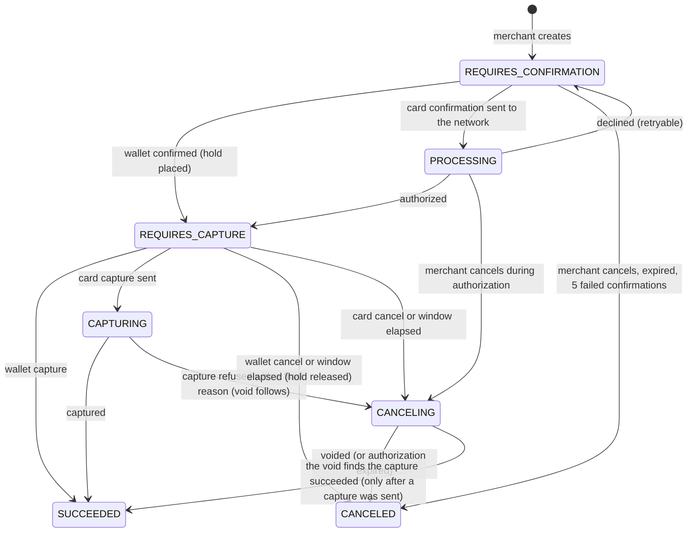
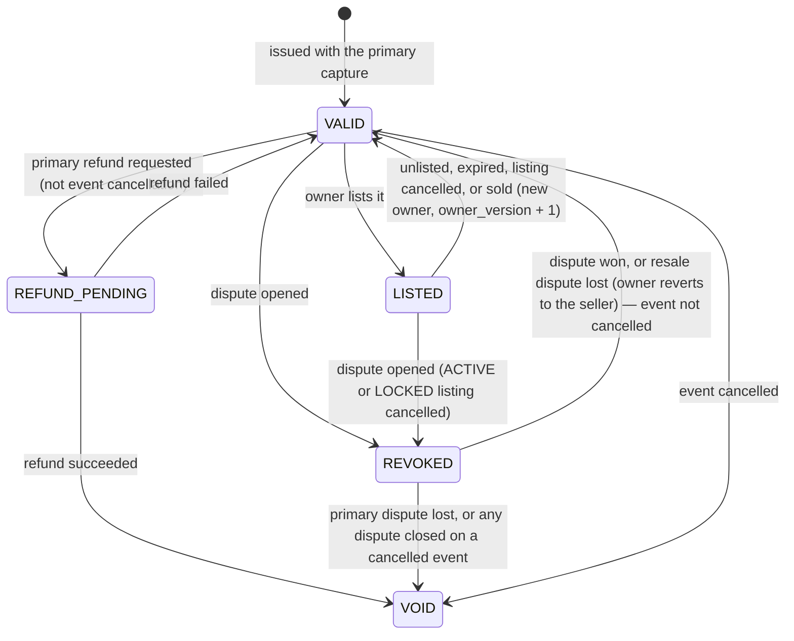

# Bastion — Technical Design

| Field | Value |
| --- | --- |
| Document | Technical Design Specification |
| Status | Draft v4.1, for owner review |
| Last updated | 2026-10-26 |
| Related | [PRD](01-prd.md) · [Architecture](02-architecture.md) · [Invariants](04-invariants.md) |

This document says **how** Bastion is built: schemas, algorithms, SQL, scripts, interfaces, configuration and tests. It is normative: code that disagrees with it is a bug in one of them, and the fix updates both. Requirement keywords follow RFC 2119. Invariant codes (M1–M7, W1–W3, I1–I5, X1–X2), secondary checks (S1–S18), concurrency tests (CC1–CC12) and chaos scenarios (C1–C22) are defined in [Invariants](04-invariants.md).

| Part | Sections |
| --- | --- |
| I — Shared foundations | §1–§7 |
| II — Bastion Pay | §8–§18: data model, ledger, customers and authentication, limits, funding, transfers, Payment Intents (wallet and card), merchants, webhook delivery, safeguarding, concurrency |
| III — Bastion Tickets | §19–§28: data model, ledger, state machines, waiting room, inventory, reservation and payment saga, refunds, disputes and cancellation, resale, organizer money, concurrency |
| IV — Interfaces and operations | §29–§35: APIs, simulators, auditor, observability, configuration, testing, runbooks |

---

# Part I — Shared foundations

## 1. Conventions

### 1.1 Money

- Amounts are `int64` minor units stored as `bigint`; currency VND (exponent 0); every amount has a `currency char(3)`.
- Basis points are integer-only: `floor(amount × bps / 10 000)`, with `amount ≤ 9.2 × 10¹⁴`.
- No floating point on any money path, including tests.

### 1.2 Identifiers

- Internal IDs are UUIDv7 stored as `uuid`; partner references are `text` with `UNIQUE` constraints; public IDs carry a prefix in the API (`pi_`, `re_`, `dp_`, `tk_`, `ls_`).

### 1.3 Time

- The database clock decides: expiry, leases, countdowns, locks, limit periods and windows use `now()` inside SQL; status guards decide races, time predicates only eligibility.
- Business periods use `(now() AT TIME ZONE 'Asia/Ho_Chi_Minh')::date`.
- `timestamptz` everywhere; `track_commit_timestamp = on` in both databases (W3 detection).

### 1.4 Naming

- Databases `bastion_pay` and `bastion_tickets`; one schema per module; statuses `UPPER_SNAKE`; ledger kinds `lower_snake`.

### 1.5 Errors

| SQLSTATE | Meaning | Handling |
| --- | --- | --- |
| `23505` | Duplicate effect | "Already done"; never retried |
| `23514` | A guard or bound was hit | Domain error; `guard_bypass_total` if a guarded `UPDATE` should have prevented it |
| `40001` / `40P01` | Serialization failure / deadlock | Whole-transaction retry ≤ 3, jittered; `deadlocks_total` alerts |
| `55P03` | `lock_timeout` | API `503`; worker next tick |

Modules export sentinel errors; each API maps them to problem types (§29.6).

## 2. Repository layout and boundaries

```
bastion/
├── cmd/  pay-api/ pay-worker/ tickets-api/ tickets-worker/ relay/ auditor/ bastionctl/ pspsim/ banksim/
├── internal/
│   ├── platform/  db, redisx, config, logx, metrics, tracing, ids, money, httpx, resilience, crypto, jobs
│   ├── kit/       ledger, idempotency, fsm, outbox, webhookin
│   ├── pay/       customers, limits, funding, transfers, intents, merchants, webhooks, safeguarding, httpapi
│   ├── tickets/   catalog, waitingroom, inventory, orders, resale, payments (payclient), payouts, settlement, httpapi
│   ├── audit/     pay, tickets and cross-company checks (imports platform only)
│   └── sim/       psp, bank
├── db/{pay,tickets}/{migrations,queries}/
├── deploy/  scripts/  test/{integration,property,model,concurrency,chaos,load}/  docs/  Taskfile.yml
```

- `internal/archtest` fails the build on forbidden imports (Architecture §7).
- Module APIs take `pgx.Tx` so callers compose transactions.
- **Lock, then mutate, then post:** a transaction takes row locks in its product's lock order (§18.1, §28.1), mutates, then flushes one ledger batch.
- Tickets' `payments` defines hook interfaces (`Lock` + `Apply`) that `orders` implements, so a recorded payment fact applies order, ticket and ledger effects in one transaction.

## 3. Ledger kit

Each product runs its own instance, with its own chart (§9, §20) and hash chain.

### 3.1 Schema

```sql
CREATE TABLE ledger.accounts (
  id uuid PRIMARY KEY, code text NOT NULL, owner_id uuid, shard smallint NOT NULL DEFAULT 0,
  currency char(3) NOT NULL, normal_side text NOT NULL CHECK (normal_side IN ('debit','credit')),
  posted bigint NOT NULL DEFAULT 0,
  pending_dr bigint NOT NULL DEFAULT 0 CHECK (pending_dr >= 0),
  pending_cr bigint NOT NULL DEFAULT 0 CHECK (pending_cr >= 0),
  lower_bound bigint,                                                    -- on the available balance
  UNIQUE NULLS NOT DISTINCT (code, owner_id, shard, currency),
  CONSTRAINT within_bound CHECK (lower_bound IS NULL OR
    (CASE normal_side WHEN 'credit' THEN -posted - pending_dr ELSE posted - pending_cr END) >= lower_bound),  -- M4
  CONSTRAINT bounded_accounts_unsharded CHECK (lower_bound IS NULL OR shard = 0)
);
CREATE TABLE ledger.entries (
  id uuid PRIMARY KEY, kind text NOT NULL, phase text NOT NULL CHECK (phase IN ('pending','posted')),
  currency char(3) NOT NULL, reference_type text NOT NULL, reference_id uuid NOT NULL,
  pending_expires_at timestamptz,
  xact_id xid8 NOT NULL DEFAULT pg_current_xact_id(),
  created_at timestamptz NOT NULL DEFAULT now(),
  UNIQUE (kind, reference_id),                                           -- M6
  CHECK ((phase = 'pending') = (pending_expires_at IS NOT NULL))
);
CREATE TABLE ledger.postings (
  entry_id uuid NOT NULL REFERENCES ledger.entries(id), seq smallint NOT NULL,
  account_id uuid NOT NULL REFERENCES ledger.accounts(id),
  amount bigint NOT NULL CHECK (amount <> 0),                            -- + debit, − credit
  PRIMARY KEY (entry_id, seq)
);
CREATE TABLE ledger.pending_resolutions (
  pending_entry_id uuid PRIMARY KEY REFERENCES ledger.entries(id),
  outcome text NOT NULL CHECK (outcome IN ('POSTED','VOIDED','EXPIRED')),
  posted_amount bigint NOT NULL DEFAULT 0 CHECK (posted_amount >= 0),
  resolving_entry_id uuid REFERENCES ledger.entries(id),
  resolved_at timestamptz NOT NULL DEFAULT now(),
  CHECK ((outcome = 'POSTED') = (resolving_entry_id IS NOT NULL))
);
CREATE TABLE ledger.unsealed (entry_id uuid PRIMARY KEY);
CREATE TABLE ledger.seals (seq bigint GENERATED ALWAYS AS IDENTITY PRIMARY KEY,
  entry_id uuid NOT NULL UNIQUE REFERENCES ledger.entries(id),
  entry_hash bytea NOT NULL, chain_hash bytea NOT NULL, sealed_at timestamptz NOT NULL DEFAULT now());
```

| Trigger (`SECURITY DEFINER`) | Effect |
| --- | --- |
| `postings_apply` | Applies a posting to `posted` (posted entries) or `pending_dr`/`pending_cr` (pending entries); `within_bound` fires immediately |
| `resolutions_apply` | Releases the pending amounts of a resolved hold |
| `entry_balanced`, `posting_balanced` (deferred) | At commit: ≥ 2 postings (2 if pending), Σ = 0 (M1) |
| `reject_mutation` | Rejects updates and deletes on entries, postings, resolutions, seals (M3) |

Application roles cannot update balance columns: **balances change only through these triggers** (M2).

### 3.2 Balances

```
posted(a)     = Σ amount    of postings of a in posted entries
pending_dr(a) = Σ amount    of postings of a with amount > 0 in unresolved pending entries
pending_cr(a) = Σ (−amount) of postings of a with amount < 0 in unresolved pending entries
available(a)  = −posted − pending_dr   (credit-normal)   |   posted − pending_cr   (debit-normal)
```

Outgoing holds reduce availability; incoming holds never add to it. A hold has two postings and resolves once (`POSTED` ≤ held amount, `VOIDED`, `EXPIRED`).

### 3.3 Go API

```go
type Posting struct { Account AccountRef; Amount int64 }
type Entry struct {
    Kind, ReferenceType string; ReferenceID uuid.UUID; Currency string
    Postings []Posting; PendingUntil *time.Time
}
func (s *Service) NewBatch(tx pgx.Tx) *Batch          // one per transaction
func (b *Batch) Lock(ctx context.Context, refs ...AccountRef) (map[AccountRef]Balance, error)
func (b *Batch) Post(e Entry)
func (b *Batch) Resolve(pendingID uuid.UUID, o Outcome, amount int64, kind string, ref uuid.UUID)
func (b *Batch) Flush(ctx context.Context) ([]uuid.UUID, error)
var ErrBoundViolated, ErrAlreadyPosted, ErrAlreadyResolved error
```

`Flush` validates (Σ = 0; holds two-legged), resolves shards (`hash(entry_id) mod N`) and lazy owner accounts, locks all accounts once `ORDER BY id FOR UPDATE` (the last lock level of each product), inserts entries, resolutions and postings sorted by account, inserts `unsealed`, and maps `23514 within_bound` → `ErrBoundViolated`, `23505 (kind, reference_id)` → `ErrAlreadyPosted`. Callers that may hit a bound and continue flush inside a savepoint.

### 3.4 Sharding, sealing, rebuild

- Unbounded hot accounts have N shards; `ledger.account_balances` sums them; bounded accounts cannot be sharded.
- The sealer (250 ms singleton) appends `(entry_hash, chain_hash)` rows in sealing order; the auditor re-verifies.
- `bastionctl rebuild-balances --product` recomputes M2 in one snapshot and diffs.

## 4. Idempotency kit

### 4.1 Contract and schema

| Aspect | Rule |
| --- | --- |
| Header | `Idempotency-Key`, 1–255 printable characters |
| Scope | `'<role>:<principal_id>:<operation>'` |
| Fingerprint | `SHA-256(method ‖ "\n" ‖ path ‖ "\n" ‖ JCS(body))` |
| Retention | 24 h; replays carry `Idempotent-Replayed: true` |

```sql
CREATE TABLE idem.keys (
  scope text NOT NULL, key text NOT NULL CHECK (length(key) BETWEEN 1 AND 255),
  request_hash bytea NOT NULL, status text NOT NULL CHECK (status IN ('IN_PROGRESS','COMPLETED')),
  resource_type text, resource_id uuid, response_code int, response_body jsonb,
  locked_until timestamptz NOT NULL, created_at timestamptz NOT NULL DEFAULT now(), expires_at timestamptz NOT NULL,
  PRIMARY KEY (scope, key), CHECK (status <> 'COMPLETED' OR response_code IS NOT NULL)
);
CREATE INDEX keys_by_resource ON idem.keys (resource_type, resource_id) WHERE status = 'IN_PROGRESS';
```

### 4.2 Protocol

1. Look up on the primary; an existing key follows the decision table.
2. New key: run side-effect-free preconditions (authentication, validation, PIN/OTP, admission token, breakers); a failure stores nothing.
3. Claim with `INSERT … ON CONFLICT DO NOTHING RETURNING` and a 30 s lease; with 100 identical concurrent requests exactly one wins, the others wait on the unique index entry.
4. The first business transaction binds the resource; the transaction that produces a deterministic outcome completes the key **in the same transaction**; whoever records an outcome later (resolver, webhook, driver) completes the key bound to that resource.
5. A request that ends before any durable effect deletes its claim.

| Existing record | Condition | Response |
| --- | --- | --- |
| Any | `request_hash` differs | `422 idempotency-key-reused` |
| `COMPLETED` | — | Stored response, replay header |
| `IN_PROGRESS`, no resource | lease live / expired | `409` + `Retry-After` / guarded takeover and restart |
| `IN_PROGRESS`, resource bound | — | `409` with `Location` |

Never stored: `5xx`, timeouts, `503`, `400`, `401/403`, time-dependent outcomes.

### 4.3 Derived keys for outbound calls

| Caller → partner | Operation | Key |
| --- | --- | --- |
| Pay → bank | Verification, debit, transfer | `verify:{link}`, `cashin:{id}`, `cashout:{id}`, `settlement:{id}`, `sweep:{id}` |
| Pay → card network | Top-up charge | `topup:{id}` |
| Pay → card network | Authorize (per attempt), capture, void an intent; refund; evidence | `auth:{intent}:{attempt}`, `capture:{intent}`, `void:{intent}`, `refund:{refund}`, `evidence:{dispute}` |
| Tickets → Pay | Create, capture, cancel intent; refund; funding; disbursement; evidence | `pi:{payment}`, `capture:{payment}`, `cancel:{payment}`, `refund:{refund}`, `funding:{funding}`, `disburse:{payout}`, `evidence:{dispute}` |
| Tickets → bank | Organizer payout, funding transfer | `payout:{id}`, `fundxfer:{funding}` |

## 5. State machine kit

`fsm.states` and `fsm.edges` define every graph (mirrored in Go and checked by a test). Trigger `fsm.guard(object_type)` enforces initial states and legal edges (`P0001 illegal_transition`) and appends `fsm.state_events (object_type, object_id, from_status, to_status, xact_id, at)`. Application code uses guarded `UPDATE … WHERE status IN (…)`; stale transitions become counted no-ops.

## 6. Calls across boundaries

### 6.1 Three-phase template

1. Persist the intent and its derived key; commit.
2. Call with no transaction open; timeout `min(per-call timeout, remaining deadline)`.
3. Record exactly what was observed with status-guarded updates.

### 6.2 Outcome classes

| Signal | Class | Action |
| --- | --- | --- |
| `2xx` with a result | success | Record |
| Business rejection (decline, insufficient funds, domain `402/409/422`) | declined | Record the rejection |
| Other `400/404/409/422` | invalid | Record failure; alert |
| `429`, connection refused | retryable | Back off; same key |
| Timeout, reset after send, `5xx` | **unknown** | `*_UNKNOWN` or `PROCESSING`; resolver looks up with the same key |
| `202 processing` from Bastion Pay; a card capture refused for a reason the network retries on its own | pending | Wait for webhook or poll |
| Breaker open | not attempted | No state change; fail fast |

### 6.3 Retries, budgets, breakers, rate limits

| Mechanism | Setting |
| --- | --- |
| Retry layer | The orchestrator only (driver, resolver, processor) |
| Attempts / backoff | ≤ 3 per invocation; full jitter `rand(0, min(2 s, 100 ms × 2ⁿ))` |
| Budget | Retries ≤ 10% of first attempts over 10 s |
| Breaker | Per dependency; 10 s window; ≥ 20 calls and ≥ 50% unknown/retryable opens it for 5 s; 3 probes |
| Rate limits | Shared token buckets in Redis (GCRA), local fallback `rate / instances` |

### 6.4 Resolvers

Each product's resolver (2 s) claims objects in unknown or in-flight states with expired leases (`SKIP LOCKED`, `next_attempt_at <= now()`), looks them up by key, and records results through the same functions as the synchronous path. "Not found" → resubmit with the same key. Backoff 1 s → 5 min; alert after 15 min (S9); exception after 24 h.

### 6.5 Incoming webhooks (`kit/webhookin`)

1. Verify `X-Signature: t=…,v1=HMAC-SHA256(secret, t + "." + body)` against every active secret; reject if `|now − t| > 5 min`.
2. One transaction: `INSERT INTO outbox.inbox (consumer, event_id) ON CONFLICT DO NOTHING`; duplicates commit and return `200`; otherwise the recorder runs `Lock` steps in lock order, applies status-guarded changes, flushes one ledger batch.
3. Return `200` as soon as it commits; heavy work is done by jobs.
4. Stale transitions are counted no-ops (`webhook_stale_total`); errors return `500` so the sender retries.

## 7. Outbox and event streams

Outbox rows are written with the change; one relay per database publishes them to the product's Redis stream (at least once); consumers commit effect + inbox together and `XACK` after commit; `XAUTOCLAIM` after 60 s; DLQ after 5 deliveries. No invariant depends on an event; merchant webhooks are a separate system (§16).

---

# Part II — Bastion Pay

## 8. Data model

### 8.1 Schemas (`bastion_pay`)

| Schema | Tables |
| --- | --- |
| `customers` | `customers`, `wallets`, `linked_accounts`, `otp_challenges` |
| `limits` | `policies`, `usage` |
| `funding` | `cashins`, `topups`, `cashouts`, `topup_chargebacks` |
| `transfers` | `p2p` |
| `intents` | `payment_intents`, `card_operations`, `refunds`, `disputes` |
| `merchants` | `merchants`, `api_keys`, `sweeps`, `settlements`, `settlement_lines`, `fundings`, `disbursements` |
| `webhooks` | `events`, `deliveries` |
| `safeguarding` | `surplus_floor`, `capital_movements`, `bank_statements`, `bank_statement_lines`, `psp_batches`, `psp_lines`, `exceptions` |
| kits | `ledger`, `idem`, `fsm`, `outbox`, `ops` |

### 8.2 Core DDL

```sql
-- customers
CREATE TABLE customers.customers (
  id uuid PRIMARY KEY, phone text NOT NULL UNIQUE, full_name text NOT NULL,
  national_id_hash bytea NOT NULL UNIQUE, pin_hash bytea,
  pin_attempts int NOT NULL DEFAULT 0 CHECK (pin_attempts BETWEEN 0 AND 5), pin_locked_until timestamptz
);
CREATE TABLE customers.wallets (
  id uuid PRIMARY KEY, customer_id uuid UNIQUE REFERENCES customers.customers(id), merchant_id uuid UNIQUE,
  status text NOT NULL,                                             -- §10.1
  CHECK ((customer_id IS NULL) <> (merchant_id IS NULL))
);
CREATE TABLE customers.linked_accounts (
  id uuid PRIMARY KEY, customer_id uuid NOT NULL REFERENCES customers.customers(id),
  bank_code text NOT NULL, account_masked text NOT NULL, mandate_token text,
  status text NOT NULL, verified_at timestamptz, UNIQUE (bank_code, mandate_token)
);
CREATE TABLE customers.otp_challenges (
  id uuid PRIMARY KEY, customer_id uuid NOT NULL,
  purpose text NOT NULL CHECK (purpose IN ('LINK_ACCOUNT','CASHOUT')), subject_id uuid NOT NULL,
  code_hash bytea NOT NULL, attempts int NOT NULL DEFAULT 0 CHECK (attempts BETWEEN 0 AND 3),
  expires_at timestamptz NOT NULL, consumed_at timestamptz
);

-- limits
CREATE TABLE limits.usage (
  customer_id uuid NOT NULL, period text NOT NULL CHECK (period IN ('DAY','MONTH')), period_start date NOT NULL,
  cap bigint NOT NULL CHECK (cap > 0),
  used bigint NOT NULL DEFAULT 0 CHECK (used >= 0), reserved bigint NOT NULL DEFAULT 0 CHECK (reserved >= 0),
  PRIMARY KEY (customer_id, period, period_start),
  CONSTRAINT within_cap CHECK (used + reserved <= cap)               -- W2
);

-- funding
CREATE TABLE funding.cashins (id uuid PRIMARY KEY, customer_id uuid NOT NULL, linked_account_id uuid NOT NULL,
  amount bigint NOT NULL CHECK (amount > 0), status text NOT NULL, bank_debit_id text UNIQUE,
  created_at timestamptz NOT NULL DEFAULT now(), lease_until timestamptz NOT NULL, next_attempt_at timestamptz);
CREATE TABLE funding.topups (id uuid PRIMARY KEY, customer_id uuid NOT NULL, amount bigint NOT NULL CHECK (amount > 0),
  card_token text NOT NULL, status text NOT NULL, floor_reserved bool NOT NULL DEFAULT false,
  psp_charge_id text UNIQUE, lease_until timestamptz NOT NULL, next_attempt_at timestamptz);
CREATE TABLE funding.cashouts (id uuid PRIMARY KEY, customer_id uuid NOT NULL, linked_account_id uuid NOT NULL,
  amount bigint NOT NULL CHECK (amount > 0), status text NOT NULL, hold_entry_id uuid NOT NULL,
  bank_transfer_id text UNIQUE, created_at timestamptz NOT NULL DEFAULT now(),
  lease_until timestamptz NOT NULL, next_attempt_at timestamptz);
CREATE TABLE funding.topup_chargebacks (id uuid PRIMARY KEY, topup_id uuid NOT NULL REFERENCES funding.topups(id),
  psp_dispute_id text NOT NULL UNIQUE, amount bigint NOT NULL CHECK (amount > 0),
  taken_from_wallet bigint NOT NULL CHECK (taken_from_wallet >= 0), to_debt bigint NOT NULL CHECK (to_debt >= 0),
  status text NOT NULL, CHECK (taken_from_wallet + to_debt = amount));

-- transfers
CREATE TABLE transfers.p2p (id uuid PRIMARY KEY, from_wallet uuid NOT NULL, to_wallet uuid NOT NULL,
  amount bigint NOT NULL CHECK (amount > 0), limit_day date NOT NULL, limit_month date NOT NULL,
  status text NOT NULL, created_at timestamptz NOT NULL DEFAULT now(), CHECK (from_wallet <> to_wallet));

-- intents
CREATE TABLE intents.payment_intents (
  id uuid PRIMARY KEY, merchant_id uuid NOT NULL, merchant_reference text NOT NULL,
  amount bigint NOT NULL CHECK (amount > 0), currency char(3) NOT NULL,
  allowed_methods text[] NOT NULL,                                  -- {'wallet','card'}
  method text CHECK (method IN ('wallet','card')),                  -- set at confirmation
  status text NOT NULL,                                             -- §14.1
  cancel_reason text, client_secret_hash bytea NOT NULL, confirm_expires_at timestamptz NOT NULL,
  failed_confirmations int NOT NULL DEFAULT 0 CHECK (failed_confirmations BETWEEN 0 AND 5),
  attempt_seq int NOT NULL DEFAULT 0 CHECK (attempt_seq >= 0),        -- card attempts started (§14.4)
  payer_customer_id uuid,                                           -- wallet payments
  card_token text, psp_payment_id text UNIQUE, auth_expires_at timestamptz,   -- card payments
  hold_entry_id uuid, capture_before timestamptz, limit_day date, limit_month date,
  amount_capturable bigint NOT NULL DEFAULT 0, amount_captured bigint NOT NULL DEFAULT 0,
  fee_amount bigint NOT NULL DEFAULT 0, amount_refunded bigint NOT NULL DEFAULT 0,
  amount_refund_pending bigint NOT NULL DEFAULT 0, amount_disputed bigint NOT NULL DEFAULT 0,
  card_funds_released_at timestamptz,                              -- card: moved from pending to balance
  CHECK (amount_capturable BETWEEN 0 AND amount),
  CHECK (amount_captured BETWEEN 0 AND amount),                                                  -- M5
  CHECK (amount_refunded + amount_refund_pending + amount_disputed <= amount_captured),          -- M5
  CHECK (fee_amount BETWEEN 0 AND amount_captured)
);
CREATE UNIQUE INDEX one_live_intent_per_reference ON intents.payment_intents (merchant_id, merchant_reference)
  WHERE status <> 'CANCELED';                                       -- M5
CREATE INDEX intents_confirm_due ON intents.payment_intents (confirm_expires_at) WHERE status = 'REQUIRES_CONFIRMATION';
CREATE INDEX intents_capture_due ON intents.payment_intents (capture_before) WHERE status = 'REQUIRES_CAPTURE';

CREATE TABLE intents.card_operations (                              -- every call to the card network for an intent
  id uuid PRIMARY KEY, payment_intent_id uuid NOT NULL REFERENCES intents.payment_intents(id),
  op text NOT NULL CHECK (op IN ('AUTHORIZE','CAPTURE','VOID')), psp_key text NOT NULL UNIQUE,
  attempt_no int NOT NULL CHECK (attempt_no >= 1),                  -- AUTHORIZE: its attempt; CAPTURE/VOID: the authorized attempt
  amount bigint NOT NULL, status text NOT NULL,                     -- PENDING → SUCCEEDED | FAILED | UNKNOWN → …
  psp_reference text, lease_until timestamptz NOT NULL, next_attempt_at timestamptz,
  UNIQUE (payment_intent_id, op, attempt_no)
);
CREATE UNIQUE INDEX one_live_authorization ON intents.card_operations (payment_intent_id)
  WHERE op = 'AUTHORIZE' AND status <> 'FAILED';                    -- at most one attempt pending, unknown or authorized (M5)
CREATE UNIQUE INDEX one_capture_one_void ON intents.card_operations (payment_intent_id, op)
  WHERE op IN ('CAPTURE','VOID');                                   -- M5

CREATE TABLE intents.refunds (
  id uuid PRIMARY KEY, payment_intent_id uuid NOT NULL REFERENCES intents.payment_intents(id),
  merchant_id uuid NOT NULL, method text NOT NULL, amount bigint NOT NULL CHECK (amount > 0),
  status text NOT NULL,                                             -- wallet: SUCCEEDED; card: §14.7
  credited_to text CHECK (credited_to IN ('WALLET','UNCLAIMED','CARD')),
  psp_refund_id text UNIQUE, hold_entry_id uuid, lease_until timestamptz, next_attempt_at timestamptz
);

CREATE TABLE intents.disputes (
  id uuid PRIMARY KEY, payment_intent_id uuid NOT NULL REFERENCES intents.payment_intents(id),
  merchant_id uuid NOT NULL, psp_dispute_id text NOT NULL UNIQUE,
  amount bigint NOT NULL CHECK (amount > 0), fee bigint NOT NULL CHECK (fee >= 0),
  reason text NOT NULL, status text NOT NULL,                       -- §14.8
  evidence_due_by timestamptz NOT NULL, evidence jsonb, opened_at timestamptz NOT NULL, closed_at timestamptz
);
CREATE UNIQUE INDEX one_open_dispute_per_intent ON intents.disputes (payment_intent_id)
  WHERE status IN ('OPENED','UNDER_REVIEW');

-- merchants
CREATE TABLE merchants.merchants (
  id uuid PRIMARY KEY, name text NOT NULL, status text NOT NULL,
  mdr_wallet_bps int NOT NULL, mdr_card_bps int NOT NULL, dispute_fee bigint NOT NULL,
  refund_credit_limit bigint NOT NULL CHECK (refund_credit_limit >= 0),
  settlement_reserve bigint NOT NULL DEFAULT 0 CHECK (settlement_reserve >= 0),
  min_settlement bigint NOT NULL, incoming_shards smallint NOT NULL DEFAULT 1,
  settlement_bank_account text NOT NULL, webhook_url text NOT NULL, webhook_secrets text[] NOT NULL
);
CREATE TABLE merchants.settlements (
  id uuid PRIMARY KEY, merchant_id uuid NOT NULL, settlement_date date NOT NULL,
  amount bigint NOT NULL CHECK (amount > 0), status text NOT NULL, hold_entry_id uuid NOT NULL,
  bank_transfer_id text UNIQUE, cutoff_xact xid8 NOT NULL,
  lease_until timestamptz NOT NULL, next_attempt_at timestamptz, UNIQUE (merchant_id, settlement_date)
);
CREATE TABLE merchants.fundings (
  id uuid PRIMARY KEY, merchant_id uuid NOT NULL, amount bigint NOT NULL CHECK (amount > 0),
  bank_reference text NOT NULL UNIQUE, status text NOT NULL, expires_at timestamptz NOT NULL, bank_credit_id text UNIQUE
);
CREATE TABLE merchants.disbursements (
  id uuid PRIMARY KEY, merchant_id uuid NOT NULL, recipient_wallet_id uuid NOT NULL,
  amount bigint NOT NULL CHECK (amount > 0), merchant_reference text NOT NULL,
  status text NOT NULL,                                             -- SUCCEEDED (single transaction)
  created_at timestamptz NOT NULL DEFAULT now(), UNIQUE (merchant_id, merchant_reference)
);

-- webhooks
CREATE TABLE webhooks.events (id uuid PRIMARY KEY, merchant_id uuid NOT NULL, type text NOT NULL,
  object_id uuid NOT NULL, payload jsonb NOT NULL, created_at timestamptz NOT NULL DEFAULT now());
CREATE TABLE webhooks.deliveries (event_id uuid PRIMARY KEY REFERENCES webhooks.events(id),
  merchant_id uuid NOT NULL, status text NOT NULL, attempts int NOT NULL DEFAULT 0,
  next_attempt_at timestamptz NOT NULL, last_http_status int, last_error text);
CREATE INDEX deliveries_due ON webhooks.deliveries (next_attempt_at) WHERE status = 'PENDING';

-- safeguarding
CREATE TABLE safeguarding.surplus_floor (id smallint PRIMARY KEY CHECK (id = 1),
  amount bigint NOT NULL, updated_at timestamptz NOT NULL DEFAULT now());     -- §17.2: guards, not a CHECK
CREATE TABLE safeguarding.bank_statements (
  id uuid PRIMARY KEY, account_role text NOT NULL CHECK (account_role IN ('ESCROW','OPERATING')),
  statement_date date NOT NULL, opening_balance bigint NOT NULL, closing_balance bigint NOT NULL,
  cutoff_at timestamptz NOT NULL, raw bytea NOT NULL, sha256 bytea NOT NULL,
  ledger_movement bigint, status text NOT NULL, w1_checked_at timestamptz, w1_margin bigint,
  UNIQUE (account_role, statement_date)
);
CREATE TABLE safeguarding.bank_statement_lines (
  statement_id uuid NOT NULL REFERENCES safeguarding.bank_statements(id), line_no int NOT NULL,
  bank_reference text NOT NULL, direction text NOT NULL CHECK (direction IN ('CREDIT','DEBIT')),
  amount bigint NOT NULL CHECK (amount > 0), booked_at timestamptz NOT NULL, counterparty_reference text,
  match_status text NOT NULL, matched_type text, matched_id uuid, PRIMARY KEY (statement_id, line_no)
);
CREATE TABLE safeguarding.exceptions (
  id uuid PRIMARY KEY, source text NOT NULL CHECK (source IN ('BANK','PSP')), batch_id uuid, line_no int,
  ref_type text, ref_id uuid, kind text NOT NULL, amount_delta bigint NOT NULL,
  reason text NOT NULL CHECK (length(reason) > 0), status text NOT NULL, resolution_entry_id uuid
);
```

`safeguarding.psp_batches` and `psp_lines` follow the statement shape (raw file + checksum; lines with `type`, `psp_reference`, `amount`, `fee`, `match_status`; batch `net_transferred`, `expected_net`, `status`).

### 8.3 Roles

`pay_owner` (schemas, `SECURITY DEFINER` functions, migrations); `pay_app` (`SELECT`, `INSERT`; `UPDATE` only on status, counter and lease columns; no `UPDATE`/`DELETE` on ledger tables, `fsm.state_events`, `ops.actions`, raw files, `transfers.p2p`, `merchants.disbursements`); `pay_auditor` (read-only); `pay_ops` (`pay_app` + ops functions, all logged).

## 9. Ledger: chart and entry templates

### 9.1 Chart of accounts (Bastion Pay)

| Code | Owner | Class | Normal | Lower bound | Shards | E-wallet liability (W1) |
| --- | --- | --- | --- | --- | --- | --- |
| `CUSTOMER_WALLET` | customer | liability | credit | `0` | no | ✔ |
| `MERCHANT_INCOMING` | merchant | liability (wallet captures) | credit | none | yes | ✔ |
| `MERCHANT_CARD_PENDING` | merchant | liability (card captures awaiting network settlement) | credit | none | yes | ✘ (backed by `PSP_RECEIVABLE`) |
| `MERCHANT_BALANCE` | merchant | liability (available) | credit | `−refund_credit_limit` | no | ✔ (positive part) |
| `MERCHANT_DEBT` | merchant | asset | debit | none | no | — |
| `UNCLAIMED_FUNDS` | system | liability | credit | none | no | ✔ |
| `SAFEGUARD_BANK` | system | asset (escrow) | debit | none | no | — |
| `PSP_RECEIVABLE` | system | asset (card float) | debit | none | no | — |
| `PAY_OPERATING_BANK` | system | asset | debit | none | no | — |
| `CUSTOMER_DEBT` | customer | asset | debit | none | no | — |
| `PAY_CAPITAL` | system | equity | credit | none | no | — |
| `PAY_FEE_REVENUE` | system | revenue (MDR, dispute fees) | credit | none | yes | — |
| `PSP_FEES` | system | expense | debit | none | no | — |
| `CREDIT_LOSSES` | system | expense | debit | none | no | — |
| `SETTLEMENT_ADJUSTMENTS` | system | expense (±) | debit | none | no | — |

### 9.2 Entry templates

`A` amount, `C` captured, `F` MDR = `floor(C × mdr_bps / 10 000)` for the payment's method, `R` refund, `D` disputed, `S` settlement, `d` debt repaid.

| # | Kind | Event | Phase | Postings (Dr +, Cr −) | Floor |
| --- | --- | --- | --- | --- | --- |
| P1 | `cashin` | Bank confirmed a debit | posted | Dr `SAFEGUARD_BANK` A · Cr `CUSTOMER_DEBT(c)` d · Cr `CUSTOMER_WALLET(c)` A−d | — |
| P2 | `topup` | Card charge succeeded | posted | Dr `PSP_RECEIVABLE` A · Cr `CUSTOMER_WALLET(c)` A | −A (reserved before) |
| P3–P5 | `cashout_hold` / `_post` / `_return` | Cash-out | pending → posted; return | Dr `CUSTOMER_WALLET` · Cr `SAFEGUARD_BANK`; return mirrors | — |
| P6 | `p2p` | Transfer | posted | Dr `CUSTOMER_WALLET(s)` · Cr `CUSTOMER_WALLET(r)` | — |
| P7 | `pi_wallet_hold` | Wallet confirmation | pending | Dr `CUSTOMER_WALLET(c)` A · Cr `MERCHANT_INCOMING(m)` A | — |
| P8 | `pi_wallet_capture` | Capture (resolves P7) | posted | Dr `CUSTOMER_WALLET(c)` C · Cr `MERCHANT_INCOMING(m)` C | — |
| P9 | `pi_wallet_fee` | With P8 | posted | Dr `MERCHANT_INCOMING(m)` F · Cr `PAY_FEE_REVENUE` F | — |
| P10 | `pi_card_capture` | Card capture confirmed | posted | Dr `PSP_RECEIVABLE` C · Cr `MERCHANT_CARD_PENDING(m)` C | — |
| P11 | `pi_card_fee` | With P10 | posted | Dr `MERCHANT_CARD_PENDING(m)` F · Cr `PAY_FEE_REVENUE` F | — |
| P12 | `incoming_sweep` | Sweeper | posted | Dr `MERCHANT_INCOMING(m, i)` xᵢ … · Cr `MERCHANT_DEBT(m)` d · Cr `MERCHANT_BALANCE(m)` Σxᵢ−d | — |
| P13 | `card_funds_release` | The card settlement includes the capture | posted | Dr `MERCHANT_CARD_PENDING(m)` C−F · Cr `MERCHANT_DEBT(m)` d · Cr `MERCHANT_BALANCE(m)` C−F−d | − (C−F−d), with P27 |
| P14 | `wallet_refund` | Merchant refund (wallet) | posted | Dr `MERCHANT_BALANCE(m)` R · Cr `CUSTOMER_WALLET(c)` R (or `UNCLAIMED_FUNDS`) | — |
| P15–P16 | `card_refund_hold` / `_post` | Merchant refund (card) | pending → posted | Dr `MERCHANT_BALANCE(m)` R · Cr `PSP_RECEIVABLE` R | — |
| P17 | `dispute_debit` | Card dispute opened | posted | Dr `MERCHANT_BALANCE(m)` x · Dr `MERCHANT_DEBT(m)` e · Cr `PSP_RECEIVABLE` D | — |
| P18 | `dispute_fee` | With P17 | posted | Dr `MERCHANT_BALANCE(m)` x′ · Dr `MERCHANT_DEBT(m)` e′ · Cr `PAY_FEE_REVENUE` fee | — |
| P19 | `dispute_reversal` | Dispute won | posted | Dr `PSP_RECEIVABLE` D · Cr `MERCHANT_DEBT(m)` d · Cr `MERCHANT_BALANCE(m)` D−d | — |
| P20–P22 | `settlement_hold` / `_post` / `_return` | Merchant settlement | pending → posted; return | Dr `MERCHANT_BALANCE(m)` S · Cr `SAFEGUARD_BANK` S; return mirrors | — |
| P23 | `merchant_funding` | Bank credit with a funding reference | posted | Dr `SAFEGUARD_BANK` A · Cr `MERCHANT_DEBT(m)` d · Cr `MERCHANT_BALANCE(m)` A−d | — |
| P24 | `disbursement` | Merchant → customer | posted | Dr `MERCHANT_BALANCE(m)` A · Cr `CUSTOMER_WALLET(c)` A | — |
| P25–P26 | `topup_chargeback` / `_reversal` | Dispute on a top-up | posted | Dr `CUSTOMER_WALLET(c)` x · Dr `CUSTOMER_DEBT(c)` e · Cr `PSP_RECEIVABLE` A; reversal mirrors | — |
| P27 | `psp_settlement` | Card settlement batch posted | posted | Dr `SAFEGUARD_BANK` net · Dr `PSP_FEES` fees · Cr `PSP_RECEIVABLE` cleared · ± `SETTLEMENT_ADJUSTMENTS` | +net |
| P28 | `capital_injection` | Capital into escrow | posted | Dr `SAFEGUARD_BANK` · Cr `PAY_CAPITAL` | +A |
| P29 | `revenue_sweep_hold` / `_post` | Escrow → operating | pending → posted | Dr `PAY_OPERATING_BANK` · Cr `SAFEGUARD_BANK` | −A (guarded) |
| P30 | `debt_writeoff` | Ops writes off customer or merchant debt | posted | Dr `CREDIT_LOSSES` · Cr `CUSTOMER_DEBT` / `MERCHANT_DEBT` | — |
| P31 | `exception_correction` | Ops resolves an exception | posted | Case-specific | case-specific |

`x = min(D, available(MERCHANT_BALANCE) + refund_credit_limit)`, read under the account lock; forced debits never violate the bound. Debt is repaid first from sweeps, card releases, fundings and dispute reversals.

### 9.3 Worked examples

**Wallet payment** of 13,118,000 VND (MDR 150 bps → F = 196,770):

```
P7  pi_wallet_hold (pending)  Dr CUSTOMER_WALLET(fan)    +13,118,000  Cr MERCHANT_INCOMING(tix#3) −13,118,000
P8  pi_wallet_capture         Dr CUSTOMER_WALLET(fan)    +13,118,000  Cr MERCHANT_INCOMING(tix#3) −13,118,000  (P7 POSTED)
P9  pi_wallet_fee             Dr MERCHANT_INCOMING(tix#3)   +196,770  Cr PAY_FEE_REVENUE#1           −196,770
P12 incoming_sweep            Dr MERCHANT_INCOMING(tix#3) +12,921,230 Cr MERCHANT_BALANCE(tix)    −12,921,230
```

**Card payment** of the same amount (MDR 250 bps → F = 327,950):

```
(authorization: no ledger entry; the money is held on the card by the network)
P10 pi_card_capture     Dr PSP_RECEIVABLE              +13,118,000  Cr MERCHANT_CARD_PENDING(tix#1) −13,118,000
P11 pi_card_fee         Dr MERCHANT_CARD_PENDING(tix#1)   +327,950  Cr PAY_FEE_REVENUE#2              −327,950
… next day, the card settlement file includes the capture (network fee 150 bps = 196,770) …
P27 psp_settlement      Dr SAFEGUARD_BANK +12,921,230 · Dr PSP_FEES +196,770 · Cr PSP_RECEIVABLE −13,118,000
P13 card_funds_release  Dr MERCHANT_CARD_PENDING(tix#1) +12,790,050  Cr MERCHANT_BALANCE(tix)    −12,790,050
floor += 12,921,230 − 12,790,050 = +131,180 (Bastion Pay's margin on the card payment)
```

## 10. Customers, authentication and wallet status

### 10.1 Wallet state machine

`PENDING_VERIFICATION → ACTIVE` (first verified link); `ACTIVE → FROZEN` (ops, debt); `FROZEN → ACTIVE` (ops, debt repaid); `ACTIVE | FROZEN → CLOSED` (ops; balance 0, no holds, no debt). Merchant wallets start `ACTIVE`. Credits are accepted in `ACTIVE` and `FROZEN`; customer-initiated debits require `ACTIVE` (W3); refunds to `CLOSED` wallets go to `UNCLAIMED_FUNDS`.

**Freeze vs. debit:** every customer-initiated debit takes `SELECT … FROM customers.wallets WHERE id = $w AND status = 'ACTIVE' FOR SHARE`; a freeze is `UPDATE … SET status = 'FROZEN' WHERE id = $w AND status = 'ACTIVE'` and waits for in-flight debits. Debits committed before the freeze stand; later ones fail the guard.

### 10.2 PIN

Argon2id (`m = 64 MiB, t = 1, p = 4`). Verification runs **before** the debit transaction in its own short transaction:

```sql
UPDATE customers.customers
   SET pin_attempts     = CASE WHEN pin_locked_until <= now() THEN 1 ELSE pin_attempts + 1 END,
       pin_locked_until = CASE WHEN pin_locked_until <= now() THEN NULL ELSE pin_locked_until END
 WHERE id = $c AND pin_hash IS NOT NULL AND (pin_attempts < 5 OR pin_locked_until <= now())
RETURNING pin_hash, pin_attempts;                       -- 0 rows → 423 pin-locked
```

Constant-time compare in Go; success resets `pin_attempts = 0`; failure at 5 sets `pin_locked_until = now() + 30 min`. 50 concurrent guesses therefore verify at most 5 times (CC9).

### 10.3 OTP

Challenges bound to a purpose and subject, SHA-256 with a pepper, 5 min, 3 attempts; verification increments attempts with a guard and consumes with `consumed_at IS NULL`; delivery through `GET /pay/v1/dev/otp/{challenge}` in non-production builds.

### 10.4 Bank linking

Insert `PENDING` → `banksim` holder verification (`verify:{link}`; mismatch → `REVOKED`) → OTP → mandate token, `VERIFIED`, and wallet `PENDING_VERIFICATION → ACTIVE` in the same transaction for the first link.

## 11. Limits

- Caps: 20,000,000 VND/day, 100,000,000 VND/month per customer (`limits.policies`). P2P sends and **wallet** payments count; card payments, cash-in, cash-out to own account, refunds and disbursements received do not.
- Both period rows are locked in a fixed order (`DAY` before `MONTH`) and updated with `used + reserved + $a <= cap`; `CHECK within_cap` is the backstop.

```sql
SELECT period FROM limits.usage
 WHERE customer_id = $c AND (period, period_start) IN (('DAY', $d), ('MONTH', $m))
 ORDER BY period FOR UPDATE;
UPDATE limits.usage SET reserved = reserved + $a                    -- or used = used + $a
 WHERE customer_id = $c AND (period, period_start) IN (('DAY', $d), ('MONTH', $m))
   AND used + reserved + $a <= cap
RETURNING period;                                                    -- fewer than 2 → LIMIT_EXCEEDED
```

- A wallet payment stores `limit_day`/`limit_month` at confirmation; capture converts `reserved → used` on those rows, cancellation releases them, even across midnight.

## 12. Funding

### 12.1 Cash-in

`CREATED → SUCCEEDED | FAILED | PROCESSING | DEBIT_UNKNOWN`; `PROCESSING | DEBIT_UNKNOWN → SUCCEEDED | FAILED`. Tx 1: claim, wallet `ACTIVE` (share), linked account `VERIFIED` and owned, insert `CREATED`. Call `banksim POST /v1/debits` (`cashin:{id}`). Tx 2 (response, webhook or resolver): guarded `SUCCEEDED`; ledger batch `Lock` debt and wallet, `d = min(A, debt)`, post P1; complete the key. **The wallet is credited only in Tx 2.**

### 12.2 Card top-up

`CREATED → CHARGING → SUCCEEDED | FAILED | CHARGE_UNKNOWN`. Tx 1: claim, wallet `ACTIVE`, insert, **reserve the floor** with `UPDATE safeguarding.surplus_floor SET amount = amount − $A WHERE id = 1 AND amount >= $A` (0 rows → `503 topups-temporarily-unavailable`). Call `pspsim POST /v1/charges` (`topup:{id}`). Success → P2. Failure → release the floor in the same transaction. Unknown → resolver; the floor stays reserved.

### 12.3 Cash-out

PIN and OTP first. Tx 1: claim, wallet `ACTIVE` (share), linked account `VERIFIED`, insert, P3 hold (`ErrBoundViolated` → `402 insufficient-balance`). Three-phase transfer from escrow (`cashout:{id}`); `transfer.paid` → P4; `transfer.failed` → void; `transfer.returned` → P5. States `CREATED → INITIATED | FAILED | SUBMIT_UNKNOWN → …; INITIATED → PAID | FAILED; PAID → RETURNED`.

### 12.4 Top-up chargebacks

On `dispute.created` for a top-up charge: insert the chargeback (2); freeze the wallet if a shortfall exists (3); ledger `Lock`, `x = min(A, available)`, `e = A − x`, P25. Won → P26 (unfreezing is an ops decision); lost → closed. Later cash-ins repay `CUSTOMER_DEBT` first.

## 13. Peer-to-peer transfers

```sql
BEGIN;
-- (1) bind the key; (2) INSERT INTO transfers.p2p (…, 'SUCCEEDED')
SELECT id FROM customers.wallets WHERE id = ANY($both) AND status = 'ACTIVE' ORDER BY id FOR SHARE;  -- (3) < 2 → 409
-- (4) sender limits: lock DAY, MONTH; used += A with the cap guard → 422 limit-exceeded
-- (6) ledger batch: P6; ErrBoundViolated → 402 insufficient-balance
COMMIT;
```

Opposite transfers take **share** locks on wallets (no conflict) and lock ledger accounts in id order inside the batch, so they cannot deadlock (CC1).

## 14. Payment Intents

### 14.1 State machine



- `PROCESSING`, `CAPTURING` and `CANCELING` cover card calls in flight, their unknown outcomes and captures the network is still retrying; the matching `card_operations` row holds `PENDING` or `UNKNOWN`, and the resolver (§14.9) drives it. Merchants see these three as `processing`.
- **Attempts.** Every card confirmation is an attempt: an `AUTHORIZE` operation numbered by `attempt_seq` with key `auth:{pi}:{n}`. `one_live_authorization` allows at most one attempt that is pending, unknown or authorized; a new attempt starts only after the previous one **definitively** failed. `one_capture_one_void` allows one capture and one void per intent, both against the authorized attempt (M5).
- **`CANCELED` is final.** Pay emits `payment_intent.canceled` only when the network confirms that the authorization can no longer be captured (voided or expired). Until then a late capture success is still recorded (`CANCELING → SUCCEEDED`); after it, a capture reported by the network is a partner contract breach handled as an exception (§14.9), never a state change.

### 14.2 Create (merchant)

Validate amount, allowed methods, `confirm_expires_at ≤ now() + 24 h`; insert with a random 256-bit client secret (hash stored). `one_live_intent_per_reference` rejects a second live intent for the same reference with `409 intent-exists` and the existing id.

### 14.3 Wallet confirmation

PIN first (§10.2). Then, in lock order:

```sql
BEGIN;
-- (1) bind the customer's key
UPDATE intents.payment_intents
   SET status = 'REQUIRES_CAPTURE', method = 'wallet', payer_customer_id = $c,
       capture_before = now() + interval '15 minutes', amount_capturable = amount,
       limit_day = $d, limit_month = $m
 WHERE id = $pi AND status = 'REQUIRES_CONFIRMATION' AND 'wallet' = ANY(allowed_methods)
   AND confirm_expires_at > now() AND client_secret_hash = $h
RETURNING merchant_id, amount;                                    -- (2) 0 rows → 409 intent-not-confirmable
SELECT 1 FROM customers.wallets WHERE customer_id = $c AND status = 'ACTIVE' FOR SHARE;   -- (3)
-- (4) limits: reserve
-- (6) ledger: P7 hold expiring at capture_before + 1 min
-- webhook event payment_intent.requires_capture + delivery; complete the key 200
COMMIT;
```

On a wallet, limit or bound failure the transaction rolls back; a small transaction increments `failed_confirmations` (cancelling at 5 with a webhook) and stores the `402/409/422` response.

### 14.4 Card confirmation (authorization)

1. **Tx 1:** bind the key; the attempt number is allocated by the same guarded statement that claims the intent, so two concurrent confirmations cannot both get one (the second re-evaluates `status` after the first commits and matches 0 rows → `409 intent-not-confirmable`):
   ```sql
   UPDATE intents.payment_intents
      SET status = 'PROCESSING', method = 'card', card_token = $t, attempt_seq = attempt_seq + 1
    WHERE id = $pi AND status = 'REQUIRES_CONFIRMATION' AND 'card' = ANY(allowed_methods)
      AND confirm_expires_at > now() AND client_secret_hash = $h
   RETURNING attempt_seq;                                   -- n
   INSERT INTO intents.card_operations (…, op, attempt_no, psp_key, status)
   VALUES (…, 'AUTHORIZE', $n, 'auth:' || $pi || ':' || $n, 'PENDING');   -- one_live_authorization is the backstop
   ```
2. **Call** `pspsim POST /v1/authorizations` (`auth:{pi}:{n}`), timeout 2 s.
3. **Tx 2** (from the response, a `pspsim` webhook or the resolver; **operation row first**):
   ```sql
   UPDATE intents.card_operations SET status = $outcome, psp_reference = $ref
    WHERE psp_key = $key AND status IN ('PENDING','UNKNOWN')
   RETURNING attempt_no;     -- 0 rows: duplicate or stale message → stop; if it contradicts the recorded outcome → exception + page
   UPDATE intents.payment_intents SET …
    WHERE id = $pi AND status IN ('PROCESSING','CANCELING') AND attempt_seq = $n;
   ```
   - Authorized: operation `SUCCEEDED`; intent `PROCESSING → REQUIRES_CAPTURE`, `psp_payment_id`, `auth_expires_at`, `amount_capturable = amount`, `capture_before = now() + 15 min`; webhook `payment_intent.requires_capture`; key `200`. If the intent is `CANCELING` (merchant cancelled meanwhile), insert the `VOID` operation instead.
   - Declined: operation `FAILED`; intent `PROCESSING → REQUIRES_CONFIRMATION` (or `CANCELING → CANCELED`), `failed_confirmations += 1`; key `402 card-declined`. The customer may confirm again, with the same or another card, as a new attempt.
   - Unknown: operation `UNKNOWN`; intent stays `PROCESSING`, which blocks any new attempt; key not completed; the customer gets `202 processing`. The resolver looks up `auth:{pi}:{n}` and **never** turns an unknown attempt into `FAILED` on "not found": it resubmits with the same key, so a late original and the resubmission are one authorization (C17).

Because at most one attempt is not `FAILED`, an operation row that matches `status IN ('PENDING','UNKNOWN')` is by construction the current attempt; the `attempt_seq` guard is a second, free check. A duplicate `authorization.declined` for attempt 1 delivered while attempt 2 is in flight therefore changes nothing (C20).

Card payments do not touch limits or the ledger until capture: the money is held by the network, not by Bastion Pay.

### 14.5 Capture

| Method | Transaction(s) |
| --- | --- |
| Wallet | One transaction: guard `status = 'REQUIRES_CAPTURE' AND capture_before > now() AND $c <= amount_capturable`; `SUCCEEDED`, `amount_captured`, `fee_amount`; limits `reserved −= amount`, `used += C` on the stored rows; `Resolve(P7, POSTED, C)` (P8) + P9 on a random incoming shard; webhook `payment_intent.succeeded`; `200` with `fee` |
| Card | Tx 1: same guard plus `auth_expires_at > now() + 1 hour`; `REQUIRES_CAPTURE → CAPTURING`; insert `CAPTURE` operation (`attempt_no` of the authorized attempt). Call `capture:{pi}`. Tx 2 (operation row first, as in §14.4) by outcome class (§6.2): success → `SUCCEEDED` + P10 + P11 + webhook, `200`; **final refusal** → operation `FAILED`, intent `CAPTURING → CANCELING`, insert `VOID`, webhook `payment_intent.capture_failed` (informational, with the reason), `402 capture-refused`; **pending** (the network will retry the capture) or unknown → stays `CAPTURING`, `202 processing`; resolver, then webhook |

A capture retried with the same key replays; with a new key on a `SUCCEEDED` intent → `409 intent-already-captured`.

**Classifying capture refusals.** Only reasons after which the capture can never succeed are final: authorization expired, authorization voided, "cannot be re-captured". A technical refusal that the network retries on its own (Adyen reports these and later sends a successful capture with reason "Transaction Recaptured") is classified as **pending**: the intent stays `CAPTURING` until the network reports success or a final refusal. The adapter maps partner reason codes to these classes in one table, unit-tested per code. Wallet captures are local transactions and are always final.

### 14.6 Cancel and expiry

| Case | Guard | Effect |
| --- | --- | --- |
| Merchant cancel, wallet | `status IN ('REQUIRES_CONFIRMATION','REQUIRES_CAPTURE')` | `CANCELED`; `Resolve(P7, VOIDED)` if held; limits released; webhook |
| Merchant cancel, card | `status IN ('REQUIRES_CONFIRMATION','PROCESSING','REQUIRES_CAPTURE')` | Unconfirmed → `CANCELED`; otherwise `CANCELING`, `VOID` operation (`void:{pi}`), then `CANCELED` + webhook. A cancel during `PROCESSING` waits for the authorization outcome and voids it if it succeeded |
| Confirmation deadline (job) | `REQUIRES_CONFIRMATION AND confirm_expires_at <= now()` | `CANCELED (expired)`; webhook |
| Capture window (job) | `REQUIRES_CAPTURE AND capture_before <= now()` | Wallet: `CANCELED`, void, limits released. Card: `CANCELING` → void |
| Capture refused (final) | `CAPTURING` | `CANCELING` → void (§14.5); "already expired" or "already voided" counts as voided; "already captured" → `SUCCEEDED` |

Capture and the window job use opposite time guards on the same row; confirmation and cancellation race on the intent's status; exactly one wins each race.

### 14.7 Refunds

- **Wallet:** one transaction: `UPDATE payment_intents SET amount_refunded = amount_refunded + $r WHERE id = $pi AND merchant_id = $m AND status = 'SUCCEEDED' AND amount_refunded + amount_refund_pending + amount_disputed + $r <= amount_captured`; insert refund `SUCCEEDED`; P14 (`ErrBoundViolated` → `422 merchant-insufficient-balance`); webhook `refund.succeeded`; `201`.
- **Card:** Tx 1: same guard on `amount_refund_pending`; insert refund `PROCESSING`; P15 hold (bound applies). Call `pspsim POST /v1/refunds` (`refund:{id}`). Success: pending → refunded, `Resolve(P15, POSTED)` (P16), webhook `refund.succeeded`. Failure: pending reversed, void, webhook `refund.failed`. Unknown: resolver. The merchant gets `202` with the refund object.

### 14.8 Disputes

States: `OPENED → UNDER_REVIEW → WON | LOST`; `OPENED → LOST` (no evidence by the deadline).

- **Opened** (`pspsim` webhook `dispute.created` for an intent's charge; one transaction in lock order): insert the dispute (`D = amount_captured − amount_refunded − amount_refund_pending`, `evidence_due_by = now() + 7 days`); `amount_disputed += D` (2); ledger `Lock` the merchant balance, compute `x`, `e`, post P17 and P18 (6); webhook `dispute.created`.
- **Evidence** (`POST /pay/v1/disputes/{id}/evidence`, key `evidence:{dispute}` to the network): `OPENED → UNDER_REVIEW` with a guard on `evidence_due_by > now()`.
- **Closed:** won → P19, `amount_disputed −= D`, webhook `dispute.closed (won)`; lost → webhook `dispute.closed (lost)`. The fee is not returned.
- **Deadline job:** `OPENED` past `evidence_due_by` → `LOST` (the network closes it the same way).
- **Refund and dispute on the same payment.** Both change the same intent row under one `CHECK`, so whichever commits first limits the other: a dispute after a (pending) refund covers only the remainder, and a refund after a dispute finds no room (`422 refund-exceeds-captured`). Bastion therefore never returns the same money twice. A real network can still open a dispute for money already refunded (Stripe: cardholders "can still initiate a dispute… even if a refund has been processed"); `pspsim` does not, by contract. If a dispute's network amount exceeds the remainder, the merchant is charged the remainder only, and the excess is recorded as an exception (`DISPUTE_OVER_REFUNDED`) for ops to contest with the refund as evidence.

### 14.9 Card operation resolver

Claims `card_operations` in `PENDING` (lease expired) or `UNKNOWN`, and `CAPTURE` operations the network is still retrying, looks them up by `psp_key`, and records the outcome through the same Tx 2 functions as §14.4–§14.6 (operation row first). A capture found `SUCCEEDED` at the network is recorded even if the capture window has since elapsed: the network's fact wins, and the intent goes `CAPTURING → SUCCEEDED` (or `CANCELING → SUCCEEDED` if the void found it captured).

**Late success after `CANCELED`** (a `capture.succeeded` webhook or a settlement `CAPTURE` line for an intent whose capture was recorded as finally refused and whose authorization was voided): the operation-row guard matches 0 rows and nothing changes state. The contradiction is recorded in `safeguarding.exceptions` (source `PSP`, kind `CAPTURE_AFTER_CANCEL`) and pages; M7a cannot reconcile the batch until ops returns the money to the cardholder (P31). The merchant never sees the money, so neither the intent nor the merchant's order changes. `pspsim` never does this unless the fault `capture_after_cancel` is injected (C21).

## 15. Merchants

### 15.1 Incoming sweep

`incoming-sweeper` (1 s per merchant, singleton): one batch locks the incoming shards, the debt and the balance accounts in id order, reads each shard's posted balance, and posts P12 (debt repaid first). Pending holds stay on the shards. S1 alerts if the oldest unswept capture is older than 5 s.

### 15.2 Card funds release

When a card settlement batch is posted (§17.4), every matched `CAPTURE` line for a merchant intent releases that intent's net in the **same transaction**: P13 (debt first), `card_funds_released_at = now()` with a guard on `IS NULL`. Card funds are never available before the network has paid Bastion Pay (S18).

### 15.3 Funding

`POST /pay/v1/fundings` creates `AWAITING_FUNDS` with a unique reference (`MF` + 10 base32 characters) valid 3 days. `banksim` `account.credited` on escrow with that reference → P23, `RECEIVED` (guarded), webhook `funding.received`. Unknown or expired references become reconciliation exceptions and are returned by ops.

### 15.4 Disbursements

`POST /pay/v1/disbursements` `{recipient_phone, amount, merchant_reference}` with a key; `GET /pay/v1/recipients?phone=` returns a masked name for confirmation. One transaction: insert the disbursement (`UNIQUE (merchant_id, merchant_reference)`); recipient wallet `ACTIVE` or `FROZEN` (`CLOSED` or unknown → `422 recipient-unavailable`); ledger `Lock` the merchant balance and require `available ≥ amount` (no credit, AD-35; else `422 disbursement-exceeds-balance`); P24; webhook `disbursement.succeeded`; `201`.

### 15.5 Settlement

States `CREATED → INITIATED | FAILED | SUBMIT_UNKNOWN → …; INITIATED → PAID | FAILED; PAID → RETURNED`.

- **Batcher** (daily 01:00, singleton), per `ACTIVE` merchant in one transaction: final sweep; `S = available(MERCHANT_BALANCE) − settlement_reserve`; if `S ≥ min_settlement`, insert the settlement (`UNIQUE (merchant_id, settlement_date)`), post P20, record `cutoff_xact`, and write the **report**: opening balance; one line per wallet capture, card funds release, fee, refund, dispute debit, dispute fee, dispute reversal, funding and disbursement since the last cut-off; closing balance; settled amount; current pending card funds and debt.
- **Processor:** transfer from escrow (`settlement:{id}`); paid → P21 + `settlement.paid` with the report URL; failed → void + `settlement.failed`; returned → P22 + `settlement.returned`.
- **Kill switch:** skipped while any Pay M or W invariant is failing.

## 16. Webhook delivery

- Every merchant-visible change inserts an event and a `PENDING` delivery in the same transaction.
- `webhook-dispatcher` (200 ms) claims due deliveries (`SKIP LOCKED`, ≤ 16 in flight per merchant) and posts them with `X-Event-Id`, `X-Event-Type`, `X-Signature` (one signature per active secret), timeout 5 s.
- `2xx` → `DELIVERED`; otherwise backoff with ±20% jitter: 10 s, 30 s, 1 min, 5 min, 15 min, 30 min, 1 h, 2 h, 4 h, 8 h, then every 8 h; `FAILED` after 72 h; ops replay.
- Events are snapshots; order is not guaranteed; receivers can always `GET` the object.
- Types: `payment_intent.requires_capture`, `.succeeded`, `.capture_failed`, `.canceled`; `refund.succeeded`, `refund.failed`; `dispute.created`, `dispute.closed`; `funding.received`, `funding.expired`; `disbursement.succeeded`; `settlement.paid`, `.failed`, `.returned`.

## 17. Safeguarding and reconciliation

### 17.1 Accounts at the bank

Escrow (`SAFEGUARD_BANK`): customer and merchant e-wallet money, Pay's capital buffer, unswept revenue. Operating (`PAY_OPERATING_BANK`): Pay's own money.

### 17.2 The surplus floor

`S = posted(SAFEGUARD_BANK) − e-wallet liabilities` (§9.1). Most operations move escrow and liabilities together (cash-in, cash-out, P2P, wallet payments, refunds, sweeps, settlements, fundings, disbursements) and leave S unchanged. The rest:

| Operation | Effect on S | Floor update |
| --- | --- | --- |
| Card top-up | −A | −A, **refusable**: `WHERE amount >= A` |
| Revenue sweep | −A | −A, **refusable** |
| Capital injection | +A | +A |
| Card settlement posted (P27 + P13 in one transaction) | +net − Σ released | **forced**: `amount + net − released`; if the result is negative → page SEV-1 and halt top-ups, sweeps and merchant settlements |
| Card captures (P10–P11) | 0 (pending funds are not e-wallet money) | — |
| MDR on wallet captures, debt repayments, dispute and refund debits | ≥ 0 | Not counted until the true-up (conservative) |

The floor is a lower bound of S: every decrement is applied in the same transaction as its cause, and increments are applied the same way or deferred. **True-up** (after each statement, on demand): lock the floor row, compute S from the ledger in one statement, set the floor to it. Operations that decrease S hold the floor lock; those that increase it without the lock can only make the computed S smaller than reality (S15).

### 17.3 Escrow statement reconciliation

`bank-statement-importer` (daily): store the escrow and operating statements immutably; match each line by reference:

| Line | Matches |
| --- | --- |
| Debit credited to escrow | `funding.cashins.bank_debit_id` |
| Transfers out | `funding.cashouts`, `merchants.settlements`, revenue sweeps |
| Credit with an `MF…` reference | `merchants.fundings` |
| Card settlement credit | `safeguarding.psp_batches` |
| Returns | the returned cash-out or settlement |
| Capital | `safeguarding.capital_movements` |

Unmatched lines and ledger bank movements missing for over a day become exceptions; the ledger movement equals the statement's net movement plus Σ exception deltas (M7b). Then **W1**: `closing_balance ≥ e-wallet liabilities from postings committed before the cut-off`; record `w1_margin`; true-up.

### 17.4 Card settlement reconciliation

`psp-settlement-importer` (hourly): batch lines `CHARGE` (top-up), `CAPTURE` (intent), `REFUND`, `CHARGEBACK`, `CHARGEBACK_REVERSAL`, `FEE`, `DISPUTE_FEE`, matched by reference to top-ups, card operations, refunds and disputes. Posting, in one transaction: P27; P13 for every matched intent capture; the forced floor update; exceptions with `Σ amount_delta = net_transferred − expected_net` (M7a). Captures and charges older than 72 h without a line → `MISSING_FROM_SETTLEMENT`.

### 17.5 Exceptions

`safeguarding.exceptions` (§8.2) records source, batch, line, reference, kind, `amount_delta` and a mandatory reason; ops resolves through `POST /pay/v1/ops/exceptions/{id}/resolve`, optionally with P31; every resolution is logged.

## 18. Concurrency and jobs (Bastion Pay)

### 18.1 Lock order

| Level | Rows | Order |
| --- | --- | --- |
| 1 | `idem.keys` | primary key |
| 2a | The operation row: `payment_intents`, `cashins`, `topups`, `cashouts`, `topup_chargebacks`, `settlements`, `fundings`, `disbursements` (at most one existing row; new rows exempt) | id |
| 2b | Children of that intent: `card_operations`, `refunds`, `disputes` | id |
| 3 | `customers.wallets` | id (`FOR SHARE` for debits and P2P; exclusive for status changes) |
| 4 | `limits.usage` | (customer, period), `DAY` before `MONTH` |
| 5 | `safeguarding.surplus_floor` | single row |
| 6 | `ledger.accounts` | id, once, through one batch |

PIN and OTP counters live in their own short transactions; merchant rows are read without locks except by ops.

### 18.2 Jobs

| Job | Cadence | Coordination |
| --- | --- | --- |
| `pay-resolver` (bank, top-ups) and `card-operation-resolver` | 2 s | `SKIP LOCKED` |
| `intent-expirer` | 1 s | `SKIP LOCKED` |
| `dispute-deadline` | 1 min | `SKIP LOCKED` |
| `incoming-sweeper` | 1 s per merchant | singleton per merchant |
| `settlement-batcher` / `settlement-processor` | daily / 5 s | singleton / `SKIP LOCKED` |
| `funding-expirer` | 1 min | `SKIP LOCKED` |
| `webhook-dispatcher` | 200 ms | `SKIP LOCKED`, per-merchant concurrency |
| `bank-statement-importer` / `psp-settlement-importer` / `safeguarding-trueup` | daily / hourly / after statements | singleton |
| `ledger-sealer`, `ledger-pending-expirer`, `idempotency-gc`, `outbox-gc` | 250 ms / 1 min / hourly | singleton / `SKIP LOCKED` |

---

# Part III — Bastion Tickets

## 19. Data model

### 19.1 Schemas (`bastion_tickets`)

| Schema | Tables |
| --- | --- |
| `catalog` | `organizers`, `fans`, `events`, `zones`, `seat_map_rows` |
| `inventory` | `zone_inventory`, `seats`, `fan_quota`, `reservations`, `reservation_seats`, `commits`, `uncommits` |
| `orders` | `orders`, `order_lines`, `tickets`, `ticket_transfers` |
| `resale` | `listings` |
| `payments` | `payments`, `captures`, `refunds`, `disputes`, `fundings`, `external_calls` |
| `payouts` | `organizer_payouts`, `seller_payouts` |
| `settlement` | `pay_settlements`, `pay_settlement_lines`, `bank_statements`, `bank_statement_lines`, `exceptions` |
| kits | `ledger`, `idem`, `fsm`, `outbox`, `ops` |

### 19.2 Core DDL

```sql
-- catalog
CREATE TABLE catalog.events (
  id uuid PRIMARY KEY, organizer_id uuid NOT NULL REFERENCES catalog.organizers(id),
  title text NOT NULL, venue text NOT NULL, starts_at timestamptz NOT NULL, ends_at timestamptz NOT NULL,
  onsale_at timestamptz NOT NULL, offsale_at timestamptz NOT NULL,
  per_fan_limit int NOT NULL CHECK (per_fan_limit BETWEEN 1 AND 10), status text NOT NULL,
  serving_checkpoint bigint NOT NULL DEFAULT 0, next_number_checkpoint bigint NOT NULL DEFAULT 0,
  prequeue_seed bytea, cancelled_at timestamptz, refunds_completed_at timestamptz, funds_released_at timestamptz,
  CHECK (onsale_at < offsale_at AND offsale_at <= starts_at AND starts_at < ends_at)
);
CREATE TABLE catalog.zones (
  id uuid PRIMARY KEY, event_id uuid NOT NULL REFERENCES catalog.events(id), code text NOT NULL,
  kind text NOT NULL CHECK (kind IN ('GA','SEATED')), capacity int NOT NULL CHECK (capacity > 0),
  unit_price bigint NOT NULL CHECK (unit_price > 0), unit_service_fee bigint NOT NULL CHECK (unit_service_fee >= 0),
  status text NOT NULL, UNIQUE (event_id, code)
);

-- inventory
CREATE TABLE inventory.zone_inventory (
  event_id uuid NOT NULL, zone_id uuid NOT NULL, capacity int NOT NULL CHECK (capacity >= 0),
  reserved int NOT NULL DEFAULT 0 CHECK (reserved >= 0), sold int NOT NULL DEFAULT 0 CHECK (sold >= 0),
  PRIMARY KEY (event_id, zone_id),
  CONSTRAINT no_oversell CHECK (reserved + sold <= capacity)                     -- I1
) WITH (fillfactor = 50);
CREATE TABLE inventory.seats (
  id uuid PRIMARY KEY, event_id uuid NOT NULL, zone_id uuid NOT NULL, label text NOT NULL, rank int NOT NULL,
  status text NOT NULL, reservation_id uuid, UNIQUE (event_id, label),
  CONSTRAINT holder_matches_status CHECK ((status = 'AVAILABLE') = (reservation_id IS NULL))   -- I1
) WITH (fillfactor = 70);
CREATE INDEX seats_available ON inventory.seats (event_id, zone_id, rank, id) WHERE status = 'AVAILABLE';
CREATE INDEX seats_by_reservation ON inventory.seats (reservation_id) WHERE reservation_id IS NOT NULL;
CREATE TABLE inventory.fan_quota (
  fan_id uuid NOT NULL, event_id uuid NOT NULL, limit_qty int NOT NULL CHECK (limit_qty > 0),
  reserved_qty int NOT NULL DEFAULT 0 CHECK (reserved_qty >= 0),
  purchased_qty int NOT NULL DEFAULT 0 CHECK (purchased_qty >= 0),
  updated_at timestamptz NOT NULL DEFAULT now(), PRIMARY KEY (fan_id, event_id),
  CONSTRAINT within_limit CHECK (reserved_qty + purchased_qty <= limit_qty)     -- I3
);
CREATE INDEX quota_recent ON inventory.fan_quota (event_id, updated_at);
CREATE TABLE inventory.reservations (
  id uuid PRIMARY KEY, order_id uuid NOT NULL, order_line_id uuid NOT NULL UNIQUE,
  fan_id uuid NOT NULL, event_id uuid NOT NULL, zone_id uuid NOT NULL, qty int NOT NULL CHECK (qty > 0),
  status text NOT NULL, created_at timestamptz NOT NULL DEFAULT now(),
  expires_at timestamptz NOT NULL, resolved_at timestamptz,
  CHECK (expires_at <= created_at + interval '12 minutes')                       -- BR-T04
);
CREATE INDEX reservations_due ON inventory.reservations (expires_at) WHERE status = 'HELD';
CREATE INDEX reservations_by_order ON inventory.reservations (order_id);
CREATE TABLE inventory.reservation_seats (reservation_id uuid NOT NULL REFERENCES inventory.reservations(id),
  seat_id uuid NOT NULL REFERENCES inventory.seats(id), PRIMARY KEY (reservation_id, seat_id));
CREATE TABLE inventory.commits (reservation_id uuid PRIMARY KEY REFERENCES inventory.reservations(id),
  order_line_id uuid NOT NULL UNIQUE, qty int NOT NULL CHECK (qty > 0), created_at timestamptz NOT NULL DEFAULT now());
CREATE TABLE inventory.uncommits (reservation_id uuid PRIMARY KEY REFERENCES inventory.commits(reservation_id),
  qty int NOT NULL CHECK (qty > 0), ops_action_id uuid NOT NULL, created_at timestamptz NOT NULL DEFAULT now());

-- orders
CREATE TABLE orders.orders (
  id uuid PRIMARY KEY, kind text NOT NULL CHECK (kind IN ('PRIMARY','RESALE')),
  fan_id uuid NOT NULL, event_id uuid NOT NULL, organizer_id uuid NOT NULL,
  idem_scope text NOT NULL, idem_key text NOT NULL, currency char(3) NOT NULL,
  amount_total bigint NOT NULL CHECK (amount_total > 0), status text NOT NULL,   -- §21.5
  cancel_reason text, reserved_until timestamptz NOT NULL, lease_owner uuid, lease_until timestamptz,
  UNIQUE (idem_scope, idem_key), CHECK ((lease_owner IS NULL) = (lease_until IS NULL))
);
CREATE INDEX orders_driven ON orders.orders (lease_until) WHERE status IN ('AUTHORIZED','COMMITTED','CAPTURING','CANCELLING');
CREATE INDEX orders_by_event ON orders.orders (event_id, kind, status);

CREATE TABLE orders.order_lines (
  id uuid PRIMARY KEY, order_id uuid NOT NULL REFERENCES orders.orders(id),
  event_id uuid NOT NULL, zone_id uuid NOT NULL, qty int NOT NULL CHECK (qty > 0),
  unit_price bigint NOT NULL CHECK (unit_price > 0),             -- face value (primary) or listing price (resale)
  unit_service_fee bigint NOT NULL CHECK (unit_service_fee >= 0),
  fee_bps int NOT NULL CHECK (fee_bps BETWEEN 0 AND 10000),       -- commission (primary) or resale fee (resale)
  unit_fee bigint NOT NULL CHECK (unit_fee BETWEEN 0 AND unit_price),
  listing_id uuid, ticket_id uuid,                                -- resale lines only
  status text NOT NULL,                                           -- §21.6
  refunded_qty int NOT NULL DEFAULT 0 CHECK (refunded_qty >= 0),
  refund_pending_qty int NOT NULL DEFAULT 0 CHECK (refund_pending_qty >= 0),
  disputed_qty int NOT NULL DEFAULT 0 CHECK (disputed_qty >= 0),                 -- disputed units whose tickets were revoked
  disputed_resold_qty int NOT NULL DEFAULT 0 CHECK (disputed_resold_qty >= 0),   -- disputed units the payer had resold (tickets stay valid)
  party_funds text CHECK (party_funds IN ('HELD','AVAILABLE')),   -- organizer (primary) or seller (resale)
  party_net_held bigint NOT NULL DEFAULT 0 CHECK (party_net_held >= 0),   -- this line's share of ORGANIZER_HELD / SELLER_PAYABLE
  CHECK (refunded_qty + refund_pending_qty + disputed_qty + disputed_resold_qty <= qty),
  CHECK (unit_fee = (unit_price * fee_bps) / 10000),
  CHECK ((listing_id IS NULL) = (ticket_id IS NULL))
);

CREATE TABLE orders.tickets (
  id uuid PRIMARY KEY, order_id uuid NOT NULL REFERENCES orders.orders(id),
  order_line_id uuid NOT NULL REFERENCES orders.order_lines(id), unit_no int NOT NULL CHECK (unit_no > 0),
  event_id uuid NOT NULL, zone_id uuid NOT NULL, seat_id uuid,
  face_value bigint NOT NULL CHECK (face_value > 0),
  owner_fan_id uuid NOT NULL, owner_version int NOT NULL DEFAULT 1 CHECK (owner_version >= 1),
  status text NOT NULL,                                           -- §21.7
  refund_id uuid, issued_at timestamptz NOT NULL DEFAULT now(),
  UNIQUE (order_line_id, unit_no)                                 -- issued once (X1, M6)
);
CREATE UNIQUE INDEX one_live_ticket_per_seat ON orders.tickets (seat_id)
  WHERE seat_id IS NOT NULL AND status <> 'VOID';                 -- I1
CREATE INDEX tickets_by_owner ON orders.tickets (owner_fan_id, event_id);

CREATE TABLE orders.ticket_transfers (                            -- ownership history (I5)
  ticket_id uuid NOT NULL REFERENCES orders.tickets(id), to_version int NOT NULL,
  kind text NOT NULL CHECK (kind IN ('SALE','UNWIND')),
  from_fan_id uuid NOT NULL, to_fan_id uuid NOT NULL, resale_order_id uuid NOT NULL,
  created_at timestamptz NOT NULL DEFAULT now(),
  PRIMARY KEY (ticket_id, to_version), CHECK (from_fan_id <> to_fan_id)
);

-- resale
CREATE TABLE resale.listings (
  id uuid PRIMARY KEY, event_id uuid NOT NULL, ticket_id uuid NOT NULL,
  seller_fan_id uuid NOT NULL, seller_owner_version int NOT NULL, payout_phone text NOT NULL,
  price bigint NOT NULL CHECK (price > 0), face_value bigint NOT NULL,
  status text NOT NULL,                                           -- §21.4
  buyer_order_id uuid, locked_until timestamptz, closes_at timestamptz NOT NULL,
  created_at timestamptz NOT NULL DEFAULT now(),
  CONSTRAINT price_cap CHECK (price <= face_value),               -- I5
  CHECK ((status IN ('LOCKED','SELLING','SOLD')) = (buyer_order_id IS NOT NULL AND locked_until IS NOT NULL))
);
CREATE UNIQUE INDEX one_open_listing_per_ticket ON resale.listings (ticket_id)
  WHERE status IN ('ACTIVE','LOCKED','SELLING');                  -- I5
CREATE INDEX listings_active ON resale.listings (event_id, price) WHERE status = 'ACTIVE';
CREATE INDEX listings_lock_due ON resale.listings (locked_until) WHERE status = 'LOCKED';

-- payments (Tickets' side of Bastion Pay)
CREATE TABLE payments.payments (
  id uuid PRIMARY KEY, order_id uuid NOT NULL, amount bigint NOT NULL CHECK (amount > 0), currency char(3) NOT NULL,
  status text NOT NULL,                                           -- §21.8
  method text CHECK (method IN ('wallet','card')),                -- learned from Pay
  pay_intent_id text UNIQUE, client_secret text, confirm_by timestamptz NOT NULL,
  amount_captured bigint NOT NULL DEFAULT 0, fee_amount bigint NOT NULL DEFAULT 0,
  amount_refunded bigint NOT NULL DEFAULT 0, amount_refund_pending bigint NOT NULL DEFAULT 0,
  amount_disputed bigint NOT NULL DEFAULT 0,
  lease_until timestamptz NOT NULL, next_attempt_at timestamptz,
  CHECK (amount_captured BETWEEN 0 AND amount),
  CHECK (amount_refunded + amount_refund_pending + amount_disputed <= amount_captured)
);
CREATE UNIQUE INDEX one_live_payment_per_order ON payments.payments (order_id) WHERE status <> 'CANCELED';
CREATE TABLE payments.captures (id uuid PRIMARY KEY, payment_id uuid NOT NULL UNIQUE REFERENCES payments.payments(id),
  amount bigint NOT NULL CHECK (amount > 0), status text NOT NULL CHECK (status IN ('PENDING','SUCCEEDED','FAILED')));
-- X1/X2 guard: BEFORE INSERT trigger raises unless amount = Σ qty × (unit_price + unit_service_fee)
--   over the order's COMMITTED lines.
CREATE TABLE payments.refunds (
  id uuid PRIMARY KEY, payment_id uuid NOT NULL REFERENCES payments.payments(id), order_line_id uuid NOT NULL,
  qty int NOT NULL CHECK (qty > 0), amount bigint NOT NULL CHECK (amount > 0),
  party_amount bigint NOT NULL CHECK (party_amount >= 0), fee_amount bigint NOT NULL CHECK (fee_amount >= 0),
  service_fee_amount bigint NOT NULL CHECK (service_fee_amount >= 0),
  reason_code text NOT NULL CHECK (reason_code IN ('ORGANIZER','OPS','EVENT_CANCELLED')),
  status text NOT NULL, pay_refund_id text UNIQUE, hold_entry_id uuid NOT NULL,
  lease_until timestamptz NOT NULL, next_attempt_at timestamptz,
  CHECK (amount = party_amount + fee_amount + service_fee_amount)
);
CREATE TABLE payments.disputes (
  id uuid PRIMARY KEY, payment_id uuid NOT NULL REFERENCES payments.payments(id),
  pay_dispute_id text NOT NULL UNIQUE, amount bigint NOT NULL, fee bigint NOT NULL,
  status text NOT NULL, evidence_due_by timestamptz NOT NULL, revoked_ticket_ids uuid[] NOT NULL
);
CREATE TABLE payments.fundings (
  id uuid PRIMARY KEY, event_id uuid, amount bigint NOT NULL CHECK (amount > 0),
  pay_funding_id text UNIQUE, bank_reference text UNIQUE, bank_transfer_id text UNIQUE,
  status text NOT NULL, hold_entry_id uuid, lease_until timestamptz NOT NULL, next_attempt_at timestamptz
);

-- payouts
CREATE TABLE payouts.organizer_payouts (id uuid PRIMARY KEY, organizer_id uuid NOT NULL, payout_date date NOT NULL,
  amount bigint NOT NULL CHECK (amount > 0), status text NOT NULL, hold_entry_id uuid NOT NULL,
  bank_transfer_id text UNIQUE, lease_until timestamptz NOT NULL, next_attempt_at timestamptz,
  UNIQUE (organizer_id, payout_date));
CREATE TABLE payouts.seller_payouts (id uuid PRIMARY KEY, seller_fan_id uuid NOT NULL, event_id uuid NOT NULL,
  amount bigint NOT NULL CHECK (amount > 0), payout_phone text NOT NULL, status text NOT NULL,
  hold_entry_id uuid NOT NULL, pay_disbursement_id text UNIQUE,
  lease_until timestamptz NOT NULL, next_attempt_at timestamptz, UNIQUE (seller_fan_id, event_id));
```

Settlement tables mirror Pay's statement shapes (§8.2) for Pay settlement reports and Tickets' own bank statements. Roles: `tickets_owner`, `tickets_app`, `tickets_auditor`, `tickets_ops`, with the same rules as Pay; `orders.ticket_transfers` is insert-only.

## 20. Ledger: chart and entry templates

### 20.1 Chart of accounts (Bastion Tickets)

| Code | Owner | Class | Normal | Lower bound | Shards |
| --- | --- | --- | --- | --- | --- |
| `PAY_RECEIVABLE` | system | asset (Tickets' money at Pay; may be negative) | debit | none | yes |
| `TIX_BANK` | system | asset | debit | none | no |
| `ORGANIZER_HELD` | organizer | liability | credit | none (S2) | allowed |
| `ORGANIZER_AVAILABLE` | organizer | liability | credit | `−overdraft_limit` | no |
| `SELLER_PAYABLE` | fan | liability (resale proceeds) | credit | `0` | no |
| `PLATFORM_COMMISSION` | system | revenue | credit | none | yes |
| `PLATFORM_SERVICE_FEES` | system | revenue | credit | none | yes |
| `PLATFORM_RESALE_FEES` | system | revenue | credit | none | yes |
| `PAYMENT_FEES` | system | expense (Pay MDR) | debit | none | yes |
| `DISPUTE_FEES` | system | expense | debit | none | no |
| `CREDIT_LOSSES` | system | expense | debit | none | no |
| `SETTLEMENT_ADJUSTMENTS` | system | expense (±) | debit | none | no |

"Party" below means the organizer (primary lines) or the seller (resale lines); "fee" means commission (primary) or resale fee (resale).

### 20.2 Entry templates

| # | Kind | Event | Phase | Postings (Dr +, Cr −) |
| --- | --- | --- | --- | --- |
| T1 | `primary_capture` | Primary capture recorded | posted | Dr `PAY_RECEIVABLE` C−F · Dr `PAYMENT_FEES` F · Cr `ORGANIZER_HELD(o)` Σnet · Cr `PLATFORM_COMMISSION` Σcom · Cr `PLATFORM_SERVICE_FEES` Σsvc |
| T2 | `resale_capture` | Resale capture recorded | posted | Dr `PAY_RECEIVABLE` C−F · Dr `PAYMENT_FEES` F · Cr `SELLER_PAYABLE(s)` price−rfee · Cr `PLATFORM_RESALE_FEES` rfee · Cr `PLATFORM_SERVICE_FEES` svc |
| T3 | `refund_hold` | Refund requested | pending | Dr party account r_party · Cr `PAY_RECEIVABLE` r_party |
| T4 | `refund_post` | Pay confirmed (resolves T3) | posted | same accounts |
| T5 | `refund_platform` | With T4 | posted | Dr fee account r_fee · Dr `PLATFORM_SERVICE_FEES` r_svc · Cr `PAY_RECEIVABLE` r_fee + r_svc |
| T6 | `dispute_open` | `dispute.created` from Pay | posted | Dr fee account com · Dr `PLATFORM_SERVICE_FEES` svc · Dr `SELLER_PAYABLE(·)` x₁ · Dr `ORGANIZER_HELD/AVAILABLE(o)` x₂ · Dr `CREDIT_LOSSES` e · Dr `DISPUTE_FEES` fee · Cr `PAY_RECEIVABLE` D + fee |
| T7 | `dispute_reversal` | Dispute won | posted | Mirror of T6 without `DISPUTE_FEES` (Cr `PAY_RECEIVABLE` side = D) |
| T8 | `funds_release` | Show ended + delay, per primary line | posted | Dr `ORGANIZER_HELD(o)` · Cr `ORGANIZER_AVAILABLE(o)` |
| T9 | `organizer_payout_hold` / `_post` / `_return` | Organizer payout by bank | pending → posted; return | Dr `ORGANIZER_AVAILABLE(o)` · Cr `TIX_BANK`; return mirrors |
| T10 | `seller_payout_hold` / `_post` | Seller payout by Pay disbursement | pending → posted | Dr `SELLER_PAYABLE(s)` · Cr `PAY_RECEIVABLE` |
| T11 | `pay_settlement_received` | Bank credit matched to a Pay settlement | posted | Dr `TIX_BANK` · Cr `PAY_RECEIVABLE` |
| T12 | `funding_hold` / `_post` | Funding transfer to Pay | pending → posted | Dr `PAY_RECEIVABLE` · Cr `TIX_BANK` |
| T13 | `exception_correction` | Ops resolves an exception | posted | Case-specific |

**Dispute allocation (T6).** `D` is the disputed gross. The platform reverses its fees for the disputed units (`com`, `svc`). The remaining net `D − com − svc` is recovered in this order: (1) for primary tickets the payer has resold, the **payer's own** `SELLER_PAYABLE` (x₁, up to its available balance); for resale orders, the **seller's** `SELLER_PAYABLE`; (2) for primary orders, the organizer's held or available funds within the overdraft (x₂); (3) `CREDIT_LOSSES` (e). Balances are read under the account lock (`Batch.Lock`).

### 20.3 Worked examples

**Primary** (same order as §9.3, paid by wallet, F = 196,770):

| Line | Unit fee | Amount | Commission | Service | Organizer net |
| --- | --- | --- | --- | --- | --- |
| VIP × 2 | 250,000 | 10,060,000 | 500,000 | 60,000 | 9,500,000 |
| GA × 2 | 74,950 | 3,058,000 | 149,900 | 60,000 | 2,848,100 |

```
T1 primary_capture  Dr PAY_RECEIVABLE +12,921,230 · Dr PAYMENT_FEES +196,770
                    Cr ORGANIZER_HELD(o) −12,348,100 · Cr PLATFORM_COMMISSION −649,900 · Cr PLATFORM_SERVICE_FEES −120,000
```

**Resale** of one GA ticket (face 1,499,000) at 1,400,000, resale fee 500 bps = 70,000, buyer pays 1,430,000 by card (MDR 250 bps = 35,750):

```
T2 resale_capture   Dr PAY_RECEIVABLE +1,394,250 · Dr PAYMENT_FEES +35,750
                    Cr SELLER_PAYABLE(seller) −1,330,000 · Cr PLATFORM_RESALE_FEES −70,000 · Cr PLATFORM_SERVICE_FEES −30,000
```

**Cancellation** of that event: the ticket is voided, and two independent refunds run in any order. The resale line (T3–T5: seller payable 1,330,000, resale fee 70,000, service 30,000) refunds the resale buyer 1,430,000. The primary line (organizer net 1,424,050, commission 74,950, service 30,000) refunds the seller's original purchase, 1,529,000. The seller never received the 1,330,000, which was still held. Everyone is back where they started; the platform keeps only its MDR losses.

## 21. State machines

### 21.1 Event and zone

`DRAFT → PUBLISHED → PREQUEUE → ON_SALE → SALES_CLOSED → COMPLETED`; any pre-show state → `CANCELLED`. Zones `ACTIVE ⇄ SUSPENDED`.

### 21.2 Seat

`AVAILABLE → HELD`; `HELD → AVAILABLE | SOLD`; `SOLD → AVAILABLE` (uncommit only).

### 21.3 Reservation

`HELD → COMMITTED` (`expires_at > now()`) `| RELEASED | EXPIRED` (`expires_at <= now()`).

### 21.4 Listing

```mermaid
stateDiagram-v2
    [*] --> ACTIVE: owner lists a VALID ticket
    ACTIVE --> LOCKED: a buyer locks it (8 min)
    LOCKED --> ACTIVE: lock ended, purchase cancelled
    LOCKED --> SELLING: payment authorized (requires locked_until > now()) — the sale's commit point
    SELLING --> SOLD: capture recorded; ownership transferred in the same transaction
    SELLING --> CANCELLED: capture refused and authorization voided
    ACTIVE --> CANCELLED: seller withdraws, event cancelled, ticket disputed
    LOCKED --> CANCELLED: event cancelled, ticket disputed (the buyer's order is released by the lock sweeper)
    ACTIVE --> EXPIRED: closes_at reached
```



Open = `ACTIVE`, `LOCKED` or `SELLING`. A `SELLING` listing is touched only by its own buyer order (Tx G or the capture-refused compensation, both under that order's lease): withdrawals, expirers, disputes and event cancellation all leave it alone.

### 21.5 Order (both kinds)

```mermaid
stateDiagram-v2
    [*] --> RESERVED: primary: seats reserved · resale: listing locked
    RESERVED --> PAYMENT_PENDING: checkout
    RESERVED --> CANCELLED: countdown or lock ended, released, event cancelled
    PAYMENT_PENDING --> AUTHORIZED: Pay reports requires_capture
    PAYMENT_PENDING --> RESERVED: intent cancelled, hold still live
    PAYMENT_PENDING --> CANCELLED: intent cancelled, hold gone
    PAYMENT_PENDING --> CANCELLING: hold expired or event cancelled while the intent is open
    AUTHORIZED --> COMMITTED: primary: seats committed · resale: listing SELLING
    AUTHORIZED --> CANCELLING: cannot commit
    COMMITTED --> CAPTURING
    CAPTURING --> COMPLETED: capture recorded; tickets issued or ownership transferred
    CAPTURING --> CANCELLED: intent cancelled after a final capture refusal (uncommit or listing cancelled)
    CANCELLING --> CANCELLED
```



Tickets changes an order in `CAPTURING` only on a **terminal** intent event: `payment_intent.succeeded` (Tx G) or `payment_intent.canceled` (§24.7). `payment_intent.capture_failed` is informational; until Pay reports the authorization dead, the seats stay committed, so a late capture success can still complete the order.

### 21.6 Order line

`RESERVED → COMMITTED | CANCELLED`; `COMMITTED → CANCELLED` only when the order is cancelled after a refused capture (primary: uncommit; resale: listing cancelled).

### 21.7 Ticket



Live = not `VOID`. Only `VALID` tickets verify at the gate (extension) and only `VALID` tickets can be listed or refunded. A ticket stays `LISTED` and owned by the seller while its listing is `SELLING`, so neither the seller nor the buyer has a QR during the sale. A sale (Tx G) or an unwind (lost resale dispute, §26.6) changes the **owner** and increments `owner_version`; nothing else changes the owner.

### 21.8 Payment (Tickets' record)

`CREATING → REQUIRES_CONFIRMATION | CREATE_UNKNOWN | CANCELED`; `CREATE_UNKNOWN → REQUIRES_CONFIRMATION | CANCELED`; `REQUIRES_CONFIRMATION → AUTHORIZED | CANCELED | CANCELING`; `AUTHORIZED → CAPTURING | CANCELING`; `CAPTURING → SUCCEEDED | CAPTURE_UNKNOWN | CANCELED`; `CAPTURE_UNKNOWN → SUCCEEDED | CANCELED`; `CANCELING → CANCELED | CANCEL_UNKNOWN`; `CANCEL_UNKNOWN → CANCELED`. A `202 processing` or `402 capture-refused` from Pay keeps `CAPTURING` (or `CANCELING`) until the terminal webhook or a poll.

### 21.9 Other objects

| Object | Transitions |
| --- | --- |
| Refund | `REQUESTED → PROCESSING → SUCCEEDED | FAILED | REFUND_UNKNOWN | AWAITING_FUNDS | PENDING_AT_PAY`; `PENDING_AT_PAY | REFUND_UNKNOWN → SUCCEEDED | FAILED`; `AWAITING_FUNDS → PROCESSING` |
| Dispute | `OPENED → UNDER_REVIEW → WON | LOST`; `OPENED → LOST` |
| Funding | `REQUESTING → AWAITING_TRANSFER | REQUEST_UNKNOWN → …; AWAITING_TRANSFER → TRANSFER_PENDING | TRANSFER_UNKNOWN; TRANSFER_PENDING → RECEIVED | FAILED` |
| Organizer payout | `CREATED → INITIATED | FAILED | SUBMIT_UNKNOWN`; `INITIATED → PAID | FAILED`; `PAID → RETURNED` |
| Seller payout | `CREATED → SUCCEEDED | FAILED | AWAITING_FUNDS | DISBURSE_UNKNOWN`; `AWAITING_FUNDS → CREATED`; `DISBURSE_UNKNOWN → SUCCEEDED | FAILED` |

## 22. Waiting room

### 22.1 Redis state

| Key (`tix:` prefix, `{E}` hash tag) | Purpose |
| --- | --- |
| `wr:{E}:state` | `SCHEDULED`, `PREQUEUE`, `ON_SALE`, `PAUSED`, `SOLD_OUT`, `CLOSED` |
| `wr:{E}:next`, `wr:{E}:serving` | Last queue number; serving counter |
| `wr:{E}:pos` (hash), `wr:{E}:prequeue` (set) | Fan → number; pre-queue members |
| `wr:{E}:admitted:{minute}`, `wr:{E}:converted:{minute}` | Admissions and conversions (TTL 15 min) |
| `wr:{E}:stats:{epoch_s}` | Per-second outcomes and latency buckets (TTL 60 s) |

`serving` and `next` are checkpointed to `catalog.events` every tick, so a Redis loss resumes from the checkpoint.

### 22.2 Join, status and admit

- **Join** (one Lua call): existing `pos[fan]` is returned (idempotent); in `PREQUEUE` the fan is added to the set without a number; in `ON_SALE` or `PAUSED`, `n = INCR next`, `HSET pos fan n`. The signed queue ticket embeds `n` once known.
- **Status:** `position = n − serving`, `serving`, `estimated_wait_s = position / rate`, `poll_after_ms` (1–10 s, growing with position), state. Poll timing never changes position.
- **Admit:** `n ≤ serving` and `ON_SALE` → admission token (10 min), `admitted:{minute} += 1`; `n > serving` or `PAUSED` → `409 not-your-turn` with `poll_after_ms` ("tickets may be released" when paused); `SOLD_OUT`/`CLOSED` → `409 event-not-on-sale`.

### 22.3 Pre-queue shuffle

At `onsale_at` the controller reads the pre-queue set, shuffles it with Fisher–Yates driven by a 256-bit `crypto/rand` seed stored in `catalog.events.prequeue_seed` (anyone with the seed and the set can reproduce the order), assigns 1…P, sets `next = P`, and switches to `ON_SALE`. Later arrivals are FIFO; pre-queue queue tickets are re-signed with their number on the next status call.

### 22.4 Controller

```
every 1 s, per event (advisory-lock singleton):
  goodput   = requests reaching a deterministic outcome per second (reservations, checkouts), last 10 s
  latency   = reservation p99, checkout p99; err = 5xx ratio; lock_wait = PostgreSQL lock-wait p99
  avail     = Σ zones (capacity − reserved − sold);  held = Σ zones reserved            (PostgreSQL)
  inflight  = Σ admitted(last 10 min) − Σ converted(last 10 min)                         (Redis)
  if avail = 0 and held = 0: state = SOLD_OUT; stop
  if avail = 0:              state = PAUSED;   skip     # countdowns may still release tickets
  state = ON_SALE
  if latency within target and err < 1% and lock_wait < 100 ms and the Pay breaker is closed:
      rate = min(rate + step, rate_max)                 # additive increase
  else:
      rate = max(rate / 2, rate_min)                    # multiplicative decrease
  advance  = min(floor(rate + carry), max(0, 3 × avail − inflight)); carry = frac(rate + carry)
  serving += advance; checkpoint(serving, next)
```

- **Initial rate from Little's Law:** the checkout path sustains C = 64 concurrent requests of W ≈ 0.25 s → λ ≈ 250/s; the controller starts at 50%.
- **Inventory cap:** at most three admitted-but-undecided fans per remaining ticket, so most fans learn "sold out" while queued instead of after admission.

### 22.5 Signed token formats

- **Queue ticket / admission token:** JWT `HS256` (algorithm fixed), `kid` header, `TIX_TOKEN_KEYS` (first signs, all verify). Claims: `typ=queue|admission`, `evt`, `sub`, `n`, `iat`, and `exp = iat + 10 min` for admission. Reservations check `sub` and `evt`.
- **Ticket QR payload:** `base64url(ticket_id ‖ event_id ‖ owner_version ‖ kid ‖ HMAC-SHA256(k, ticket_id ‖ event_id ‖ owner_version)[0:16])`, computed on demand for `VALID` tickets only, for their current owner. A transfer increments `owner_version`, so every older copy fails verification.
- **Pay credentials:** merchant API keys are random 256-bit secrets stored as SHA-256; webhook secrets rotate with overlap.

### 22.6 Fairness measurement

Pre-queue admission order is checked for uniformity (deciles of join order vs. admission order, χ² with p > 0.01). For post-open fans, `|admission_rank − arrival_rank|` must be within one controller batch for 99% of fans.

## 23. Inventory and the admission filter

### 23.1 PostgreSQL operations

| Operation | Zone counter | Seats | Quota | Reservation |
| --- | --- | --- | --- | --- |
| reserve(q) | `reserved += q`, guard `reserved + sold + q <= capacity` | q seats `AVAILABLE → HELD` | `reserved_qty += q` | new `HELD` + `reservation_seats` |
| commit(q) | `reserved −= q`, `sold += q` | `HELD → SOLD` | `reserved_qty −= q`, `purchased_qty += q` | `HELD → COMMITTED` (`expires_at > now()`) + `commits` |
| release(q) | `reserved −= q` | `HELD → AVAILABLE` | `reserved_qty −= q` | `HELD → RELEASED` |
| expire(q) | `reserved −= q` | `HELD → AVAILABLE` | `reserved_qty −= q` | `HELD → EXPIRED` (`expires_at <= now()`) |
| uncommit(q) *(capture refused, Tx X)* | `sold −= q` | `SOLD → AVAILABLE` | `purchased_qty −= q` | `uncommits` row (reason `capture_refused`) |

Every operation applies to all reservations of an order in one transaction (all-or-nothing). Resale changes only quotas (§26), never zone counters or seats.

### 23.2 Seat selection

**Seat pick:**

```sql
SELECT id, status FROM inventory.seats
 WHERE id = ANY($seat_ids) AND event_id = $event
 ORDER BY zone_id, id FOR UPDATE;                     -- fewer rows → 400 unknown seat
UPDATE inventory.seats SET status = 'HELD', reservation_id = $res
 WHERE id = ANY($seat_ids) AND zone_id = $zone AND status = 'AVAILABLE'
RETURNING id;                                         -- fewer than qty → SEATS_UNAVAILABLE → ROLLBACK
```

A plain `UPDATE … WHERE id = ANY(…)` locks in scan order; two fans picking overlapping seats in different orders would deadlock. With one global order the later transaction waits, re-reads the seat and fails the `AVAILABLE` guard; the response lists the seats that were taken.

**Best available:**

```sql
UPDATE inventory.seats SET status = 'HELD', reservation_id = $res
 WHERE id IN (SELECT id FROM inventory.seats
              WHERE event_id = $event AND zone_id = $zone AND status = 'AVAILABLE'
              ORDER BY rank, id LIMIT $qty
              FOR UPDATE SKIP LOCKED)
RETURNING id;                                         -- fewer than qty → retry once, then SOLD_OUT
```

`SKIP LOCKED` lets 1,000 fans take 1,000 different seat sets instead of queueing on the same top seats, never waits (so it cannot deadlock), and may report a false shortfall while other transactions hold seats they later release; the zone then shows `LIMITED`, not `SOLD_OUT`. Adjacency is an extension. After either mode, `reservation_seats` rows are inserted; the zone counter is updated after the seats (level 8 after 7), so the hottest row is held for the shortest time.

### 23.3 Redis keys

| Key (`tix:inv:{E}:` prefix) | Type | Meaning |
| --- | --- | --- |
| `stock:{zone}` | integer | Estimated `available − live claims` |
| `fan:{fan}` | integer | Estimated `reserved_qty + purchased_qty + live claims` |
| `claims:{zone}` | sorted set | `K|fan|qty` scored by expiry (ms) |
| `claim:{K}` | hash, TTL 30 s | Claim record for idempotency key K |
| `returned:{reservation_id}` | string, TTL 24 h | Give-back marker |

### 23.4 Lua — `admit`

```lua
-- KEYS[1] wr state  KEYS[2] claim:{K}  KEYS[3] fan:{fan}; per zone i: KEYS[4+2i] stock, KEYS[5+2i] claims
-- ARGV[1] K, ARGV[2] fan, ARGV[3] expiry_ms, ARGV[4] claim_ttl_ms, ARGV[5] per_fan_limit, ARGV[6] total_qty
-- per zone i: ARGV[7+2i] zone, ARGV[8+2i] qty
if redis.call('EXISTS', KEYS[2]) == 1 then return 'OK' end                 -- same key: no double claim
if redis.call('GET', KEYS[1]) ~= 'ON_SALE' then return 'NOT_ON_SALE' end
if tonumber(redis.call('GET', KEYS[3]) or '0') + tonumber(ARGV[6]) > tonumber(ARGV[5]) then return 'LIMIT' end
local n = (#KEYS - 3) / 2
for i = 0, n - 1 do                                                        -- 1) check every zone
  if tonumber(redis.call('GET', KEYS[4+2*i]) or '0') < tonumber(ARGV[8+2*i]) then
    return 'SOLD_OUT:' .. ARGV[7+2*i]
  end
end
for i = 0, n - 1 do                                                        -- 2) then apply everything
  redis.call('DECRBY', KEYS[4+2*i], ARGV[8+2*i])
  redis.call('ZADD',   KEYS[5+2*i], ARGV[3], ARGV[1] .. '|' .. ARGV[2] .. '|' .. ARGV[8+2*i])
  redis.call('HSET',   KEYS[2], ARGV[7+2*i], ARGV[8+2*i])
end
redis.call('INCRBY', KEYS[3], ARGV[6])
redis.call('PEXPIRE', KEYS[2], ARGV[4])
return 'OK'
```

### 23.5 Lua — `confirm`, `giveback_claim`, `giveback_reservation`

| Script | Called when | Effect |
| --- | --- | --- |
| `confirm(K)` | After Tx B commits | `ZREM` each claim member; `DEL` the claim; counters unchanged (PostgreSQL now counts the tickets) |
| `giveback_claim(K)` | Tx B rejected, or the request aborted before Tx B | For each member that `ZREM` actually removes: `INCRBY stock`, `DECRBY fan`; then `DEL`. Idempotent because `ZREM` returns 1 once |
| `giveback_reservation(rid, zone, fan, qty)` | After a release or expiry commits | `SET returned:{rid} NX`; if set: `INCRBY stock`, `DECRBY fan` |

All best effort; the reconciler corrects anything lost.

### 23.6 Reconciler

Singleton per event; every 1 s on sale, 30 s otherwise:

```
1. From PostgreSQL:
     avail[zone] = capacity − reserved − sold
     quota[fan]  = reserved_qty + purchased_qty           (rows with updated_at > cursor)
2. Lua reconcile(E, now_ms, avail, quota):
     for each zone:
        purged = ZRANGEBYSCORE claims -inf now_ms; ZREMRANGEBYSCORE claims -inf now_ms
        for each purged member (K|fan|qty): DECRBY fan:{fan} qty
        live = Σ qty of remaining members
        SET stock:{zone} = max(0, avail[zone] − live)
     for each fan in quota: SET fan:{fan} = quota[fan] + Σ live claims of that fan
3. Advance the cursor; export reconcile_drift_units = Σ |old − new|.
```

After `FLUSHALL` (C7), missing keys read as 0, so the system under-admits until the first reconcile, which is safe.

### 23.7 Safety argument

| Drift source | Direction | Consequence | Bounded by |
| --- | --- | --- | --- |
| Crash after `admit`, before Tx B | Redis under-counts | False sold-out | Claim TTL (30 s) + one reconcile |
| Crash after Tx B, before `confirm` | Redis double-counts the claim | False sold-out | Claim TTL + one reconcile |
| Lost `giveback_*` | Redis under-counts | False sold-out | One reconcile |
| Reconcile racing in-flight requests | ± in-flight tickets | Over-admission rejected by PostgreSQL; under-admission self-corrects | One interval |
| Redis wiped | Under-counts | Requests rejected briefly | First reconcile (≤ 1 s) |

**Over-admission costs a PostgreSQL transaction; under-admission costs a moment of false "sold out"; neither can break an invariant.**

### 23.8 Seat maps and the event lifecycle

- Seat maps come from per-instance snapshots (single-flight, 2 s) plus a 1 s edge cache; a stale map can only cause `409 seats-unavailable`.

| Transition | Trigger | Actions |
| --- | --- | --- |
| `DRAFT → PUBLISHED` | Ops | Validate seat counts; freeze zones; create `zone_inventory` and `inventory.seats`; seed Redis (`stock = capacity`, `SCHEDULED`) |
| `PUBLISHED → PREQUEUE` | `onsale_at − 30 min` | Pre-queue joins accepted |
| `PREQUEUE → ON_SALE` | `onsale_at` | Shuffle (§22.3); controller and reconciler start |
| `ON_SALE → SALES_CLOSED` | `offsale_at` or ops | New reservations refused; held reservations may still be paid; resale continues |
| `SALES_CLOSED → COMPLETED` | `ends_at` | Payout delays start (§27) |
| any pre-show → `CANCELLED` | Ops | §25.4 |

Each transition locks only the event row, in a transaction that locks nothing else.

## 24. Reservation and payment saga

### 24.1 Overview

| Trigger | Step | Transaction | Order after | External call |
| --- | --- | --- | --- | --- |
| Reserve request | Claim, admit, reserve | Tx A → Redis → Tx B | `RESERVED` | — |
| Checkout request | Claim, start | Tx A′ → Tx C | `PAYMENT_PENDING` | — |
| Checkout request | Create intent | Pay → Tx D | `PAYMENT_PENDING` | `pi:{P}` |
| Webhook or poll | Record authorization | Tx R | `AUTHORIZED` | — |
| Payment driver | Commit seats (primary) or the listing (resale, `SELLING`, §26.4) | Tx E | `COMMITTED` | — |
| Payment driver | Capture intent | Tx F | `CAPTURING` | — |
| Driver, resolver or webhook | Capture recorded; tickets issued (primary) or ownership transferred (resale) | Pay → Tx G | `COMPLETED` | `capture:{P}` |
| Webhook or poll | Intent cancelled after a final capture refusal | Tx X (§24.7) | `CANCELLED` | — |

**Fencing:** Tx E and Tx F require `lease_owner = $me`; recording transactions are guarded only by status. Every transition into a driven state (`AUTHORIZED`, `CANCELLING`) sets a system `lease_owner` and `lease_until = now()`, so the driver can claim it immediately.

### 24.2 Tx A → admit → Tx B

**Tx A** claims key K after verifying the admission token; the deadline (2 s) starts. **Admit** runs `admit` (§23.4): `SOLD_OUT`/`LIMIT` → complete the key with the stored `409`; `NOT_ON_SALE` → delete the claim, `409` unstored; `OK` → continue.

**Tx B — reserve, the race arbiter:**

```sql
BEGIN;  -- READ COMMITTED
UPDATE idem.keys SET resource_type = 'order', resource_id = $order
 WHERE scope = $scope AND key = $key AND status = 'IN_PROGRESS' AND resource_id IS NULL;      -- (1)

INSERT INTO orders.orders (id, kind, fan_id, event_id, organizer_id, idem_scope, idem_key, currency,
                           amount_total, status, reserved_until)
VALUES ($order, 'PRIMARY', $fan, $event, $org, $scope, $key, 'VND', $total, 'RESERVED', now() + interval '8 minutes');
INSERT INTO inventory.reservations (id, order_id, order_line_id, fan_id, event_id, zone_id, qty, status, expires_at)
VALUES (…, 'HELD', now() + interval '8 minutes');            -- one per line
INSERT INTO orders.order_lines (…) VALUES (…);               -- one per zone: price, service fee, commission snapshot

INSERT INTO inventory.fan_quota (fan_id, event_id, limit_qty) VALUES ($fan, $event, $limit) ON CONFLICT DO NOTHING;
UPDATE inventory.fan_quota SET reserved_qty = reserved_qty + $total_qty, updated_at = now()
 WHERE fan_id = $fan AND event_id = $event AND reserved_qty + purchased_qty + $total_qty <= limit_qty
RETURNING 1;                                                  -- (6) 0 rows → PURCHASE_LIMIT → ROLLBACK

-- (7) seats for each seated line (§23.2), then reservation_seats rows

UPDATE inventory.zone_inventory SET reserved = reserved + $qty
 WHERE event_id = $event AND zone_id = $zone AND reserved + sold + $qty <= capacity
RETURNING 1;                                                  -- (8) per zone, zone order; 0 rows → SOLD_OUT → ROLLBACK

UPDATE idem.keys SET status = 'COMPLETED', response_code = 201, response_body = $snapshot
 WHERE scope = $scope AND key = $key;                         -- (1) already held
COMMIT;
```

On commit: `confirm(K)`, `converted:{minute} += 1`, `201`. On `SOLD_OUT`, `SEATS_UNAVAILABLE` or `PURCHASE_LIMIT`: roll back, `giveback_claim(K)`, store `409` in a small transaction.

### 24.3 Why exactly `capacity` tickets sell and no seat sells twice

1. The zone `UPDATE` takes the row lock; competitors queue behind it.
2. When the holder commits, a waiter re-fetches the newest committed version and re-evaluates the `WHERE` clause (`READ COMMITTED` EvalPlanQual), so the guard compares against the real value.
3. The waiter that would exceed `capacity` matches 0 rows and gets `SOLD_OUT`; `CHECK no_oversell` aborts any path that skipped the guard (`guard_bypass_total`).
4. Seats change from `AVAILABLE` only under a guard after being locked; `holder_matches_status` ties each taken seat to one reservation; `one_live_ticket_per_seat` blocks a second live ticket.
5. The same mechanism on the quota row serializes a fan's parallel reservations (CC4).

| Rejected alternative | Why |
| --- | --- |
| Read in Go, then write | Lost update: two readers see 999 and both write 1,000; two fans get one seat |
| `SERIALIZABLE` | Mass `40001` aborts on the hot zone row (Phase 7 benchmark) |
| Redis as the only check | Oversell and double booking after Redis loss |
| Advisory lock per zone | Serializes fans who want different seats |

### 24.4 Checkout: Tx A′ → Tx C → Pay → Tx D

```sql
-- Tx C
BEGIN;
UPDATE idem.keys SET resource_type = 'payment', resource_id = $P
 WHERE scope = $scope AND key = $key AND status = 'IN_PROGRESS' AND resource_id IS NULL;       -- (1)
UPDATE orders.orders SET status = 'PAYMENT_PENDING', lease_owner = $me, lease_until = now() + interval '30 seconds'
 WHERE id = $order AND fan_id = $fan AND status = 'RESERVED' RETURNING kind, amount_total;      -- (2)
-- (3) primary: extend reservations ≥ 4 min, ≤ 12 min total; every line must still be HELD and unexpired
UPDATE inventory.reservations
   SET expires_at = least(greatest(expires_at, now() + interval '4 minutes'), created_at + interval '12 minutes')
 WHERE order_id = $order AND status = 'HELD' AND expires_at > now() RETURNING expires_at;
-- (3) resale: the listing lock must be live and extended the same way (§26.3)
INSERT INTO payments.payments (id, order_id, amount, currency, status, confirm_by, lease_until)
VALUES ($P, $order, $total, 'VND', 'CREATING', $min_expiry - interval '30 seconds', now() + interval '30 seconds');  -- (9)
COMMIT;
```

Call `POST /pay/v1/payment_intents` (`pi:{P}`; `allowed_methods = ['wallet','card']`; `merchant_reference = order_id`; `confirm_expires_at = confirm_by`). **Tx D:** payment `REQUIRES_CONFIRMATION` with `pay_intent_id` and `client_secret`; lease cleared; key `201`. Unknown → `CREATE_UNKNOWN`, `202`; the resolver looks up `pi:{P}`. A second checkout of the same order returns the live payment (`one_live_payment_per_order`). A cancelled event → `409 event-cancelled`.

### 24.5 Authorization: Tx R

The recorder for `payment_intent.requires_capture` (or the poller), in lock order: order `PAYMENT_PENDING → AUTHORIZED` with `lease_until = now()` (2); payment `→ AUTHORIZED`, `method` (9). If the order is already `CANCELLING`, only the payment is recorded and the driver cancels the intent. `payment_intent.canceled` → payment `CANCELED`; an order in `PAYMENT_PENDING` goes back to `RESERVED` if its hold is still live, else `CANCELLED`; an order in `CAPTURING` is compensated by Tx X (§24.7).

The **intent poller** (5 s) retrieves intents of `PAYMENT_PENDING` orders whose `confirm_by` has passed or whose last poll is older than 10 s, and records the same facts if a webhook was lost.

### 24.6 Tx E (primary) and the expirer

```sql
BEGIN;
UPDATE orders.orders SET lease_until = now() + interval '30 seconds'
 WHERE id = $order AND status = 'AUTHORIZED' AND lease_owner = $me RETURNING 1;                 -- (2)
UPDATE inventory.reservations SET status = 'COMMITTED', resolved_at = now()
 WHERE order_id = $order AND status = 'HELD' AND expires_at > now()
RETURNING id, order_line_id, zone_id, qty;            -- (3) fewer than lines → ROLLBACK; order → CANCELLING
INSERT INTO inventory.commits … ;
UPDATE orders.order_lines SET status = 'COMMITTED' WHERE order_id = $order;                       -- (4)
UPDATE inventory.fan_quota SET reserved_qty = reserved_qty - $n, purchased_qty = purchased_qty + $n
 WHERE fan_id = $fan AND event_id = $event;                                                       -- (6)
UPDATE inventory.seats SET status = 'SOLD'
 WHERE id IN (SELECT id FROM inventory.seats WHERE reservation_id = ANY($res) ORDER BY zone_id, id FOR UPDATE);  -- (7)
UPDATE inventory.zone_inventory SET reserved = reserved - $q, sold = sold + $q WHERE …;            -- (8) zone order
UPDATE orders.orders SET status = 'COMMITTED' WHERE id = $order;
COMMIT;
```

The **reservation expirer** (1 s) works order by order, order row first:

```sql
SELECT DISTINCT order_id FROM inventory.reservations WHERE status = 'HELD' AND expires_at <= now() LIMIT 500;
-- per order, one transaction:
SELECT status FROM orders.orders WHERE id = $order FOR UPDATE SKIP LOCKED;          -- (2) skip if a driver holds it
UPDATE inventory.reservations SET status = 'EXPIRED', resolved_at = now()
 WHERE order_id = $order AND status = 'HELD' AND expires_at <= now()
RETURNING id, order_line_id, zone_id, qty;                                           -- (3)
-- lines CANCELLED (4); quota reserved −= q (6); seats AVAILABLE in (zone_id, id) order (7); zones reserved −= q (8)
-- RESERVED → CANCELLED (reservation_expired); PAYMENT_PENDING → CANCELLING; AUTHORIZED left for Tx E to fail
COMMIT;  -- then giveback_reservation per row
```

Both sides need the order and the reservation rows; whichever commits first changes the reservations' status and the other matches 0 rows. **An expired reservation is never committed** (I4). The 30 s gap between the intent's confirmation deadline and the countdown makes the race rare; a delayed webhook can still lose it, and then the authorization is voided (C4).

### 24.7 Tx F → Pay capture → Tx G

**Tx F:** order `COMMITTED → CAPTURING` (fenced); payment `AUTHORIZED → CAPTURING`; insert `payments.captures` (`PENDING`), whose trigger checks the amount against the committed lines (X1, X2).

**Call** `POST /pay/v1/payment_intents/{pi}/capture` (`capture:{P}`): `200` → Tx G; `202 processing` (card capture in flight, or being retried by the network) or `402 capture-refused` (Pay is voiding the authorization) → stay `CAPTURING` and wait for `payment_intent.succeeded` or `payment_intent.canceled`; unknown → `CAPTURE_UNKNOWN`, resolver.

**Tx G** (from the response, the resolver or the webhook; status-guarded; in lock order): complete the checkout key (1); order `CAPTURING → COMPLETED` (2) — 0 rows → rollback; lines `party_funds = 'HELD'` (4); primary: insert tickets, one per unit, seated lines taking their seats from `reservation_seats`, `owner_fan_id = fan`, `owner_version = 1` (5) — resale: listing `SELLING → SOLD` (3), guarded ownership transfer and quotas (5, 6), §26.4; payment `SUCCEEDED`, `amount_captured`, `fee_amount`, `method` (9); capture `SUCCEEDED` (10); ledger batch T1 or T2 (12); outbox `order.completed`.

`UNIQUE (order_line_id, unit_no)` and the guarded `CAPTURING → COMPLETED` make issuance happen at most once, whichever path records the capture.

**Tx X — capture refused** (`payment_intent.canceled` for an order in `CAPTURING`, from the webhook or the poller; status-guarded; in lock order). Pay sends it only after the network confirmed the authorization dead (§14.1), so no capture can follow and the compensation is safe:

- **Primary:** order `CAPTURING → CANCELLED` (`capture_refused`) (2); every commit is reversed with an **uncommit** row (3); lines `COMMITTED → CANCELLED` (4); quota `purchased_qty −= q` (6); seats `SOLD → AVAILABLE` in `(zone_id, id)` order (7); zones `sold −= q` (8); payment `CANCELED` (9); capture `FAILED` (10); after commit, `giveback_reservation` returns the units to Redis.
- **Resale:** order `CAPTURING → CANCELLED` (2); listing `SELLING → CANCELLED`, `buyer_order_id` and `locked_until` cleared (3); line `CANCELLED` (4); ticket `LISTED → VALID`, owner and version unchanged (5); buyer quota `reserved_qty −= 1` (6); payment `CANCELED` (9); capture `FAILED` (10). The seller may list again.
- Outbox `order.cancelled` (the fan is told the payment could not be completed and was not charged).

`payment_intent.capture_failed` alone changes nothing: a refusal the network retries is reported by Pay as `processing`, and even after a final refusal the void may still find the capture succeeded, in which case the next event is `payment_intent.succeeded` and Tx G completes the order. The uncommit was an ops-only operation in v4.0; v4.1 runs it automatically (G9), and the released seats return to sale like expired ones: the fan was never charged.

### 24.8 Cancel path

`CANCELLING`: the driver calls `POST /pay/v1/payment_intents/{pi}/cancel` (`cancel:{P}`); `202` (card void in flight) waits for `payment_intent.canceled`. On `CANCELED`: one transaction releases `HELD` reservations (3 → 4 → 6 → 7 → 8) or, for a resale, the listing if it is still `LOCKED` by this order (→ `ACTIVE`, or `CANCELLED` if the event is cancelled) and the line and buyer quota if not yet released (line `RESERVED → CANCELLED` is the guard, so the release happens once whoever does it); sets the order `CANCELLED`; and completes an open checkout key with `409 reservation-expired`.

### 24.9 Responses

| Request | Outcome | HTTP | Stored |
| --- | --- | --- | --- |
| Reserve | Reserved | `201` order, seats, `reserved_until` | yes |
| Reserve | Sold out, limit, seats unavailable, zone suspended | `409` | yes |
| Reserve | No admission token / not on sale | `403` / `409` | no |
| Checkout | Intent created | `201` intent id, client secret, `confirm_by` | yes |
| Checkout | Hold expired, order not payable, event cancelled | `409` | yes |
| Checkout | Pay outcome unknown | `202` | no |
| Checkout | Pay breaker open, overloaded | `503` | no (claim deleted) |

### 24.10 Recovery matrix

| Order | Payment | Action |
| --- | --- | --- |
| `RESERVED` | none or `CANCELED` | Fan's turn; the expirer ends it |
| `PAYMENT_PENDING` | `CREATING` (lease expired), `CREATE_UNKNOWN` | Resolver: look up `pi:{P}`; not found → resubmit |
| `PAYMENT_PENDING` | `REQUIRES_CONFIRMATION` | Poller |
| `AUTHORIZED` | `AUTHORIZED` | Tx E |
| `COMMITTED` | `AUTHORIZED` | Tx F |
| `CAPTURING` | `CAPTURING` (lease expired), `CAPTURE_UNKNOWN` | Resolver: look up `capture:{P}`; `processing` or `capture-refused` → keep waiting for a terminal event |
| `CAPTURING` | `SUCCEEDED` | Not reachable (Tx G records both); alert |
| `CAPTURING` | intent `CANCELED` at Pay | Tx X (§24.7) |
| `CANCELLING` | not `CANCELED` | §24.8 |

### 24.11 Special cases

| Case | Mechanism | Covered by |
| --- | --- | --- |
| Client retries after a lost response | Stored response | M6, CC2 |
| 100 identical concurrent requests | Unique index + lease | M6, CC2 |
| 5,000 fans for 1,000 GA tickets | Waiting room + Redis + row lock + guard + `CHECK` | I1, CC3 |
| 1,000 fans on the same 4 seats; 2,000 best-available | Ordered seat locks; `SKIP LOCKED` | I1, CC7 |
| One fan, many tabs | Quota row lock | I3, CC4 |
| Low balance, wrong PIN, card declined | Intent stays open; order stays `PAYMENT_PENDING`; the fan may retry with another card (a new attempt) | M5, C20 |
| Card authorization times out after success | Lookup `auth:{pi}:{n}` at Pay; no new attempt while unknown | M5, C17 |
| Card capture returns `processing` | Webhook or poll | X1 |
| Capture refused (final, or retried and recaptured by the network) | Wait for the terminal event; Tx G or Tx X | X1, X2, C21 |
| Duplicate or reordered webhooks | Inbox + guards + FSM trigger | I4, C2 |
| Crash between Redis and PostgreSQL | Claim TTL + reconciler | I2, C3 |
| Countdown ends during payment | Grace + one reservation row decides | I4, C4 |
| Partition between Tickets and Pay during capture | `CAPTURE_UNKNOWN` → lookup | M5, X1, C14 |
| Pay brownout | Breaker; reservations kept; admission halves | C11 |
| `kill -9` anywhere | Leases + recovery matrix | C12 |
| Event cancelled mid on-sale | §25.5 | C13 |

## 25. Refunds, disputes and event cancellation

### 25.1 Refund request

`POST /v1/organizer/orders/{order}/lines/{line}/refunds` `{ticket_ids, note}` (key). **Refunds with reason `EVENT_CANCELLED`** are created only by the cancellation job (§25.5), for primary and resale lines alike, by units rather than tickets: they move money only and change **no ticket**, because the job voids the event's tickets separately. **Resale lines** can be refunded only for that reason. Other primary refunds, one transaction in lock order: bind key (1); read the order (2); line `refund_pending_qty += q` with `refunded_qty + refund_pending_qty + disputed_qty + disputed_resold_qty + q <= qty` (4); tickets locked by id, `VALID → REFUND_PENDING`, all q must change — `LISTED` tickets get `409 ticket-listed` (5); payment `amount_refund_pending += R` with `amount_refunded + amount_refund_pending + amount_disputed + R <= amount_captured` (9); insert refund `REQUESTED` (10); T3 hold on the party account (12) — `ErrBoundViolated` on `ORGANIZER_AVAILABLE` → `422 organizer-insufficient-balance`; key `202`.

### 25.2 Refund processing

`refund-processor` (1 s, `SKIP LOCKED`, rate-limited) calls `POST /pay/v1/refunds` (`refund:{R}`):

| Pay answer | Tickets records |
| --- | --- |
| `201` (wallet: done) | `SUCCEEDED`; line pending → refunded; tickets `REFUND_PENDING → VOID` (not for `EVENT_CANCELLED`); payment pending → refunded; line `party_net_held −= r_party`; `Resolve(T3, POSTED)` (T4) + T5 |
| `202` (card: in progress) | `PENDING_AT_PAY`; finished by `refund.succeeded` / `refund.failed` |
| `422 merchant-insufficient-balance` | `AWAITING_FUNDS`; resumed after `funding.received` |
| `422 refund-exceeds-captured` (a dispute took the room first) | `FAILED`, reason `disputed`; pending reversed; tickets back to `VALID` (not for `EVENT_CANCELLED`); `Resolve(T3, VOIDED)`; not retried and not counted as a failure: the dispute arrives as `dispute.created` and removes those units from the refundable ones |
| Other `4xx`, `refund.failed` | `FAILED`; tickets back to `VALID` (not for `EVENT_CANCELLED`); pending reversed; `Resolve(T3, VOIDED)` |
| Unknown | `REFUND_UNKNOWN`; resolver |

### 25.3 Disputes

**`dispute.created`** (webhook recorder). A dispute is applied only to tickets in stable states. When the payer is reselling a disputed ticket, the listing row decides between the dispute and the sale, and Tx E (`LOCKED → SELLING`) is the sale's commit point: before it the dispute wins, after it the sale wins.

1. **Preconditions** (read without locks): the payment is `SUCCEEDED` at Tickets, and no ticket still owned by the payer has a `SELLING` listing. Otherwise answer `409` and let Pay redeliver (§16: 10 s, 30 s, 1 min, …). The first case is a webhook arriving before the capture was recorded (Pay's events are not ordered); in the second the sale ends within seconds, either completed (the ticket then counts as resold) or cancelled after a refused capture (the ticket is then the payer's and is revoked).
2. **One transaction in lock order:** the order (2); the open listings on tickets still owned by the payer (3, by id); lines (4); tickets (5, by id); payment (9). **Re-validate** after locking: every `LISTED` ticket of the payer has its listing among the locked ones, and none of them is `SELLING`; otherwise roll back and start again from step 1 (a listing was created, locked or committed meanwhile).
3. Insert the dispute (10) with `D` and `fee` from Pay; payment `amount_disputed += D`.
4. `ACTIVE` and `LOCKED` listings → `CANCELLED` (`buyer_order_id`, `locked_until` cleared). A buyer who held the lock loses it: their Tx E matches 0 rows and the lock sweeper releases their order (§26.5). Tickets **still owned by the payer** → `REVOKED`, counted in the line's `disputed_qty`; tickets the payer resold stay `VALID` with their current owners, counted in `disputed_resold_qty`. Record `revoked_ticket_ids`.
5. Ledger batch: `Lock` the seller payables and organizer accounts involved; post T6 with the allocation of §20.2.
6. `dispute-evidence` job: submit order, ownership-transfer and admission records through `POST /pay/v1/disputes/{id}/evidence` (`evidence:{dispute}`) before the deadline.

The deferral cannot starve: a `SELLING` listing ends with its capture, while `ACTIVE` and `LOCKED` listings are cancelled by the dispute itself, so a payer cannot keep a disputed ticket in flight by relisting it. Because nothing but its own order touches a `SELLING` listing, Tx G's ownership guard never meets a revoked ticket (C22). Pay has already debited the merchant when the dispute opened, so only Tickets' books wait.

**`dispute.closed` won:** T7; `amount_disputed −= D`; `disputed_qty` and `disputed_resold_qty` restored; revoked tickets → `VALID`, or `VOID` if the event is cancelled (the restored units then become refundable, §25.5). **Lost:** primary: revoked tickets → `VOID`. Resale: if the event is not cancelled, the revoked ticket goes back to the seller (§26.6): the buyer got the money back, and the seller has the ticket back and lost the proceeds already recovered by T6; if the event is cancelled, → `VOID`.

### 25.4 Funding Bastion Pay

Insert a funding `REQUESTING` → `POST /pay/v1/fundings` (`funding:{F}`) → `AWAITING_TRANSFER` with the bank reference → T12 hold → `banksim POST /v1/transfers` from Tickets' account to Pay's escrow (`fundxfer:{F}`) → `TRANSFER_PENDING` → `funding.received` → `RECEIVED`, post T12, resume `AWAITING_FUNDS` refunds and seller payouts. Failed transfer → `FAILED`, void, alert.

### 25.5 Event cancellation

**Ops action:** event → `CANCELLED` (pre-show guard), `ops.actions`, outbox `event.cancelled`, Redis state `CLOSED`.

**Job `event-cancellation`** (5 s per cancelled event that still has a non-terminal order, an open listing, a live ticket other than `REVOKED`, or a line with refundable units). Every step is idempotent and re-run each cycle; **tickets and money are handled separately, and refunds are independent of each other**:

1. **Close listings:** `ACTIVE` → `CANCELLED` (ticket `VALID`); `LOCKED` → `CANCELLED` (the lock sweeper releases the buyer's order, §26.5); `SELLING` → left to its order, which completes (the ticket moves to the buyer) or is compensated by Tx X (the ticket stays with the seller).
2. **Close orders:** primary `RESERVED` orders: release, `CANCELLED (event_cancelled)`; `PAYMENT_PENDING` orders → `CANCELLING`; orders between `AUTHORIZED` and `CAPTURING` finish; checkout refuses new ones.
3. **Void tickets:** every `VALID` ticket of the event → `VOID` (`event_cancelled`), with `purchased_qty −= 1` on the **current owner's** quota, in one transaction per ticket batch (tickets 5, quotas 6). `LISTED`, `REFUND_PENDING` and `REVOKED` tickets are picked up on a later cycle once their sale, refund or dispute settles.
4. **Pre-fund:** `need = Σ refundable amounts − (available at Pay + refund credit limit)` from `GET /pay/v1/balance`; if positive and no funding in flight, start one of `need`.
5. **Refund every line, in any order:** for each line of each `COMPLETED` order, primary or resale, the refundable units are `qty − refunded_qty − refund_pending_qty − disputed_qty − disputed_resold_qty`; if positive, create one `EVENT_CANCELLED` refund for them (§25.1, money only). The party is the organizer's held funds (primary) or the line's own seller payable (resale), so each refund touches only its own line's `party_net_held`; a resale line whose proceeds were partly recovered by a dispute on the seller's own payment funds the shortfall from `CREDIT_LOSSES`. Organizer and seller funds are always held before the show, so the overdraft never applies.
6. Lines with 3 failed refunds are reported (S13). When nothing is left: `refunds_completed_at`, outbox `event.refunds_completed`.

**Why no ordering and no ownership changes.** On a cancelled event no ticket will ever be used, so who holds it no longer matters; only money does. Each refund returns one payment to its own payer from money that is still held for that same sale, so refunds commute: they can run in parallel, complete in any order (card refunds finish asynchronously) and fail independently. For a chain A → B → C every fan ends at zero: C is refunded from B's held proceeds of that sale, B from A's held proceeds, and A's primary payment from the organizer. Ticketmaster has to return tickets to sellers and charge their cards because it has already paid them, and StubHub halted refunds in 2020 after paying sellers before events; holding proceeds until after the show (BR-T13) is what removes both problems.

## 26. Resale

### 26.1 Rules

| Rule | Value |
| --- | --- |
| Eligible ticket | `VALID`, owned by the requester, event in `ON_SALE` or `SALES_CLOSED`, `now() < starts_at − 2 h` |
| Price | `0 < price ≤ face_value` (`CHECK price_cap`) |
| Payout destination | A Bastion Pay phone confirmed through `GET /pay/v1/recipients` (masked name shown to the seller) |
| Open listings | At most one per ticket (`one_open_listing_per_ticket`) |
| Buyer lock | 8 minutes, one buyer; the buyer's quota counts it |
| Sale commit point | Tx E (`LOCKED → SELLING`); ownership moves in Tx G, with the capture |
| Resale fee | `floor(price × 500 / 10 000)`, paid by the seller; the buyer pays the service fee |
| Proceeds | `SELLER_PAYABLE`, held until `ends_at` + payout delay |

### 26.2 List and withdraw

- **List** (`POST /v1/tickets/{id}/listings`, key): lock the ticket (5) with `status = 'VALID' AND owner_fan_id = $fan`; `VALID → LISTED`; insert the listing `ACTIVE` with `seller_owner_version = owner_version`, `closes_at = starts_at − 2 h`.
- **Withdraw** (`DELETE /v1/listings/{id}`): `UPDATE resale.listings SET status = 'CANCELLED' WHERE id = $l AND seller_fan_id = $fan AND status = 'ACTIVE'` (3) — 0 rows while `LOCKED` → `409 listing-locked`; ticket `LISTED → VALID` (5).
- `listing-expirer` moves `ACTIVE` listings past `closes_at` to `EXPIRED` and their tickets back to `VALID`.

### 26.3 Lock (purchase start)

`POST /v1/listings/{id}/purchase` (key; no admission token; per-fan rate limit). One transaction:

```sql
BEGIN;
-- (1) bind key; (2) INSERT INTO orders.orders (kind 'RESALE', status 'RESERVED', reserved_until = now() + 8 min)
UPDATE resale.listings SET status = 'LOCKED', buyer_order_id = $order, locked_until = now() + interval '8 minutes'
 WHERE id = $l AND status = 'ACTIVE' AND closes_at > now() AND seller_fan_id <> $buyer
RETURNING ticket_id, price, face_value, seller_fan_id;      -- (3) 0 rows → 409 listing-unavailable
INSERT INTO orders.order_lines (…, qty, unit_price, unit_service_fee, fee_bps, unit_fee, listing_id, ticket_id, status)
VALUES (…, 1, $price, $svc, 500, floor($price * 500 / 10000), $l, $ticket, 'RESERVED');          -- (4)
-- (6) buyer quota: reserved_qty + 1 with the limit guard → 409 purchase-limit-reached
-- (1) complete the key 201
COMMIT;
```

Five hundred concurrent buyers all run the guarded `UPDATE` on the same listing row; the first to commit wins and the rest re-evaluate `status = 'ACTIVE'` on the new version and match 0 rows (CC12). Checkout (§24.4) then extends `locked_until` like a countdown (≥ 4 min, ≤ 12 min from the lock) and sets the intent deadline 30 s before it.

### 26.4 Commit (Tx E for resale), capture and transfer (Tx G)

**Tx E** is the sale's commit point. It reserves the listing for this buyer for good, but does not touch the ticket:

```sql
BEGIN;
UPDATE orders.orders SET lease_until = now() + interval '30 seconds'
 WHERE id = $order AND status = 'AUTHORIZED' AND lease_owner = $me RETURNING 1;                 -- (2)
UPDATE resale.listings SET status = 'SELLING'
 WHERE id = $l AND status = 'LOCKED' AND buyer_order_id = $order AND locked_until > now()
RETURNING ticket_id;                                        -- (3) 0 rows → ROLLBACK; order → CANCELLING
UPDATE orders.order_lines SET status = 'COMMITTED' WHERE id = $line;                              -- (4)
UPDATE orders.orders SET status = 'COMMITTED' WHERE id = $order;
COMMIT;
```

While the listing is `SELLING`, the ticket stays `LISTED` and owned by the seller: nobody has a usable QR (QR codes exist only for `VALID` tickets), the buyer cannot list it, and the seller cannot withdraw, refund or relist it.

**Tx F** is that of §24.7. **Tx G** (capture recorded) moves ownership in the same transaction that records the money, exactly as primary tickets are issued:

```sql
BEGIN;
-- (1) complete the checkout key
UPDATE orders.orders SET status = 'COMPLETED' WHERE id = $order AND status = 'CAPTURING';       -- (2) 0 rows → ROLLBACK
UPDATE resale.listings SET status = 'SOLD'
 WHERE id = $l AND status = 'SELLING' AND buyer_order_id = $order
RETURNING ticket_id, seller_fan_id, seller_owner_version;   -- (3)
UPDATE orders.order_lines SET party_funds = 'HELD', party_net_held = $price - $unit_fee WHERE id = $line;   -- (4)
UPDATE orders.tickets
   SET owner_fan_id = $buyer, owner_version = owner_version + 1, status = 'VALID'
 WHERE id = $ticket AND status = 'LISTED' AND owner_fan_id = $seller AND owner_version = $seller_owner_version
RETURNING owner_version;                                    -- (5) 0 rows → ROLLBACK; page (I5)
INSERT INTO orders.ticket_transfers (ticket_id, to_version, kind, from_fan_id, to_fan_id, resale_order_id)
VALUES ($ticket, $new_version, 'SALE', $seller, $buyer, $order);
-- (6) quotas in fan_id order: buyer reserved −1, purchased +1; seller purchased −1
-- (9) payment SUCCEEDED; (10) capture SUCCEEDED; (12) ledger batch T2; outbox order.completed
COMMIT;
```

Between Tx E and Tx G only this order touches the listing and the ticket (§21.4): withdrawals and expirers require `ACTIVE` or `LOCKED`, event cancellation lets the order finish, and a dispute on the seller's payment waits (§25.3). The ownership guard therefore cannot fail; a 0-row result is an invariant breach that pages, and the driver keeps the order in `CAPTURING` for investigation. If the capture is refused, Tx X cancels the listing and the ticket stays with the seller (§24.7). From the moment Tx G commits, the seller's QR copies fail verification (version mismatch); the buyer's QR is computed from the new version.

### 26.5 Lock expiry and the lock sweeper

`listing-lock-sweeper` (1 s) releases every resale order that still holds a line but no longer holds a live lock, whatever ended it (expiry, a dispute, event cancellation). It works order row first, like the reservation expirer:

```sql
SELECT o.id FROM orders.orders o
JOIN orders.order_lines l ON l.order_id = o.id AND l.status = 'RESERVED'
JOIN resale.listings li ON li.id = l.listing_id
WHERE o.kind = 'RESALE' AND o.status IN ('RESERVED','PAYMENT_PENDING')
  AND (li.status <> 'LOCKED' OR li.buyer_order_id IS DISTINCT FROM o.id OR li.locked_until <= now())
LIMIT 500;
-- per order, one transaction:
SELECT status FROM orders.orders WHERE id = $order FOR UPDATE SKIP LOCKED;                          -- (2)
UPDATE resale.listings SET status = 'ACTIVE', buyer_order_id = NULL, locked_until = NULL
 WHERE buyer_order_id = $order AND status = 'LOCKED' AND locked_until <= now();                      -- (3) expired lock only
-- line RESERVED → CANCELLED (4); buyer quota reserved −1 (6)
-- RESERVED → CANCELLED; PAYMENT_PENDING → CANCELLING; AUTHORIZED left for Tx E to fail
```

Tx E's `locked_until > now()` and the sweeper's `locked_until <= now()` both require `status = 'LOCKED'` on the same row: exactly one wins, and **an expired or cancelled lock never starts a sale** (I4, C19). A dispute or an event cancellation only has to cancel the listing; it never locks the buyer's order.

### 26.6 Unwinding a resale (lost dispute only)

Ownership goes back only when a resale buyer loses a dispute on that purchase while the event is not cancelled, and only if the buyer still owned the ticket when the dispute opened (the ticket is then `REVOKED`). If the buyer had resold it, it stays with its current owner and the loss is recovered from the buyer's own proceeds (§25.3). The unwind is therefore always a single hop, and its guard checks that hop:

```sql
UPDATE orders.tickets SET owner_fan_id = $seller, owner_version = owner_version + 1, status = 'VALID'
 WHERE id = $ticket AND status = 'REVOKED' AND owner_fan_id = $buyer AND owner_version = $sale_version
RETURNING owner_version;                                    -- (5) $sale_version = to_version of this order's SALE
```

In the same transaction: transfer row kind `UNWIND`; buyer quota `purchased −1`, seller `purchased +1` (without the limit guard: it restores a previous state). The seller payable and fees were already recovered by T6 when the dispute opened. **Refunds never unwind:** an `EVENT_CANCELLED` refund of a resale moves money only (§25.5), and resales cannot be refunded for any other reason.

### 26.7 Seller payouts

`seller-payouts` (hourly) per seller and completed event past the payout delay: `amount = Σ party_net_held` of the seller's `HELD` resale lines for that event (capped by `available(SELLER_PAYABLE(s))`); the lines move to `AVAILABLE` in the same transaction; insert `seller_payouts` `CREATED` (`UNIQUE (seller_fan_id, event_id)`) + T10 hold; call `POST /pay/v1/disbursements` (`disburse:{id}`, `merchant_reference = payout id`): `201` → `SUCCEEDED`, post T10; `422 disbursement-exceeds-balance` → `AWAITING_FUNDS` and a funding (§25.4); `422 recipient-unavailable` → `FAILED`, void, notify the seller to update their phone; unknown → resolver.

## 27. Organizer money and settlement reconciliation

### 27.1 Split

Primary lines snapshot `unit_price`, `unit_service_fee`, `fee_bps` (commission) and `unit_fee = floor(unit_price × bps / 10 000)` (`CHECK` enforced). Fan pays `unit_price + unit_service_fee`; organizer net `unit_price − unit_fee`; platform `unit_fee + unit_service_fee`; Pay's MDR → `PAYMENT_FEES`.

### 27.2 Funds release and organizer payouts

- **`party_net_held`.** Every transaction that credits or debits a party account for a line updates that line's `party_net_held` in the same transaction: capture `+= Σ net`; refund post `−= r_party`; dispute `−= x` recovered from this party; dispute reversal `+= x`. S17 checks that, per party, Σ `party_net_held` of `HELD` lines equals the posted held balance.
- `organizer-funds-release` (1 min) for completed events past `ends_at + payout_delay`: per primary line with `party_funds = 'HELD'` and no refund in flight, T8 for `party_net_held` (reference = line id), then `party_funds = 'AVAILABLE'`; finally `funds_released_at`.
- `organizer-payout-batcher` (daily): per organizer with available ≥ 100,000 and unflagged bank details: payout + T9 hold. `organizer-payout-processor`: three-phase bank transfer (`payout:{id}`); paid → post; failed → void; returned → reversal and flag. Halted while any Tickets M invariant fails.

### 27.3 Bastion Pay settlement reconciliation

On `settlement.paid`, import the report immutably and check:

| Check | Exception kind |
| --- | --- |
| Each wallet capture and card funds release matches a `SUCCEEDED` payment by intent id with the same gross and fee | `CAPTURE_MISMATCH`, `UNKNOWN_CAPTURE` |
| Each refund, dispute debit, dispute fee, dispute reversal, funding and disbursement matches a Tickets record | `*_MISMATCH`, `UNKNOWN_*` |
| Report arithmetic: opening + Σ credits − Σ debits = closing; settled = closing − reserve | `REPORT_ARITHMETIC` |
| Every Tickets record up to the cut-off appears in exactly one report (card captures after their release) | `MISSING_FROM_REPORT` (after 3 days) |
| The bank credit on Tickets' statement equals the settled amount | `BANK_AMOUNT_MISMATCH` |

A matched bank credit posts T11. Σ `amount_delta` explains every difference (M7c).

## 28. Concurrency and jobs (Bastion Tickets)

### 28.1 Lock order

| Level | Rows | Order |
| --- | --- | --- |
| 1 | `idem.keys` | primary key |
| 2 | `orders.orders` | id |
| 3 | `inventory.reservations` (primary) or `resale.listings` (resale) | id |
| 4 | `orders.order_lines` | id |
| 5 | `orders.tickets` | id |
| 6 | `inventory.fan_quota` | (fan_id, event_id) |
| 7 | `inventory.seats` | (zone_id, id); best available never waits |
| 8 | `inventory.zone_inventory` | zone_id |
| 9 | `payments.payments` | id |
| 10 | `payments.captures`, `refunds`, `disputes`, `fundings` | id |
| 11 | `payouts.organizer_payouts`, `payouts.seller_payouts` | id |
| 12 | `ledger.accounts` | id, once, through one batch |

`catalog.events` and `catalog.zones` are locked only in transactions that lock nothing else. Listing and withdrawing lock the listing (3) before the ticket (5); listing creation locks the ticket and inserts the listing (exempt).

### 28.2 Jobs

| Job | Cadence | Coordination |
| --- | --- | --- |
| `payment-driver` | 200 ms | `SKIP LOCKED` + lease |
| `intent-poller`, `tickets-resolver` | 5 s / 2 s | `SKIP LOCKED` |
| `reservation-expirer`, `listing-lock-sweeper`, `listing-expirer` | 1 s / 1 s / 1 min | per order or listing, `SKIP LOCKED` |
| `refund-processor`, `dispute-evidence` | 1 s / 1 min | `SKIP LOCKED`; rate limit |
| `event-cancellation` | 5 s per cancelled event | `SKIP LOCKED` on work items |
| `organizer-funds-release`, `organizer-payout-batcher`, `organizer-payout-processor` | 1 min / daily / 5 s | `SKIP LOCKED` / singleton |
| `seller-payouts` | hourly | `SKIP LOCKED` |
| `pay-settlement-importer`, `bank-statement-importer` | on webhook / daily | singleton |
| `event-scheduler`, `wr-controller`, `inventory-reconciler` | 1 s | singleton (per event) |
| `ledger-sealer`, `idempotency-gc`, `outbox-gc` | 250 ms / hourly | singleton / `SKIP LOCKED` |

---

# Part IV — Interfaces and operations

## 29. APIs

### 29.1 Conventions

REST/JSON; Pay under `/pay/v1`, Tickets under `/v1`. Customers and fans use bearer JWTs from development issuers; merchants use `Bearer sk_…` (hashed at rest); ops use role-scoped JWTs. Headers: `Idempotency-Key`, `X-Admission-Token`, `X-Request-Id`, `traceparent`; responses add `Idempotent-Replayed`, `Retry-After`, `Location`. Cursor pagination by UUIDv7.

### 29.2 Bastion Pay — customer API

| Method and path | Idempotency | Purpose |
| --- | --- | --- |
| `POST /pay/v1/customers` · `PUT /pay/v1/pin` | natural | Register; set PIN |
| `POST /pay/v1/linked-accounts` · `POST …/{id}/verify` | **required** · natural | Link; confirm with OTP |
| `GET /pay/v1/wallet` · `GET /pay/v1/transactions` | — | Balances, holds, limits; statement |
| `POST /pay/v1/cashins` · `POST /pay/v1/topups` | **required** | Cash-in; card top-up |
| `POST /pay/v1/transfers` | **required** | P2P (PIN) |
| `POST /pay/v1/cashouts` · `POST …/{id}/confirm` | **required** | Cash-out (PIN, then OTP) |
| `GET /pay/v1/payment_intents/{id}?client_secret=` | — | What the customer is about to pay |
| `POST /pay/v1/payment_intents/{id}/confirm` | **required** | `{payment_method: {type: wallet, pin} | {type: card, token}}` |

### 29.3 Bastion Pay — merchant API

| Method and path | Idempotency | Purpose |
| --- | --- | --- |
| `POST /pay/v1/payment_intents` · `GET …/{id}` · `GET …?idempotency_key=` | **required** · — | Create, retrieve, look up |
| `POST /pay/v1/payment_intents/{id}/capture` · `/cancel` | **required** | Capture (`200` or `202`); cancel (`200` or `202`) |
| `POST /pay/v1/refunds` · `GET /pay/v1/refunds/{id}` · `GET …?idempotency_key=` | **required** | Refund (wallet `201`, card `202`) |
| `GET /pay/v1/disputes/{id}` · `POST …/{id}/evidence` | — · **required** | Disputes |
| `GET /pay/v1/balance` | — | Incoming, card pending, balance, available, debt, credit limit, reserve |
| `POST /pay/v1/fundings` · `GET …/{id}` | **required** | Pre-fund |
| `GET /pay/v1/recipients?phone=` · `POST /pay/v1/disbursements` | — · **required** | Recipient check; disbursement |
| `GET /pay/v1/settlements` · `GET …/{id}/report` | — | Settlements and reports |

### 29.4 Bastion Pay — ops and partners

`POST /pay/v1/ops/wallets/{id}/freeze|unfreeze|close`, `/ops/capital`, `/ops/sweeps`, `/ops/merchants`, `/ops/debts/{id}/write-off`, `GET /ops/exceptions`, `POST /ops/exceptions/{id}/resolve`, `POST /ops/webhooks/{event}/replay`, `GET /ops/safeguarding`. Partners: `POST /pay/v1/webhooks/psp`, `/webhooks/bank`. Non-production: `GET /pay/v1/dev/otp/{challenge}`.

### 29.5 Bastion Tickets API

| Method and path | Role | Idempotency | Purpose |
| --- | --- | --- | --- |
| `GET /v1/events/{id}` · `…/zones/{zone}/seats` · `…/listings` | public | — | Event, seat map, resale listings (cacheable) |
| `POST /v1/events/{id}/queue` · `GET …/queue` · `POST …/admission` | fan | natural | Waiting room |
| `POST /v1/orders` | fan | **required** | Reserve (primary) |
| `POST /v1/listings/{id}/purchase` | fan | **required** | Lock a listing (resale order) |
| `POST /v1/orders/{id}/checkout` · `/cancel` | fan | **required** · natural | Create or return the intent; release |
| `GET /v1/orders/{id}` · `GET /v1/orders` · `GET /v1/tickets` | fan | — | Status, tickets, QR payloads |
| `POST /v1/tickets/{id}/listings` · `DELETE /v1/listings/{id}` | fan | **required** · natural | List; withdraw |
| `GET /v1/me/resale` | fan | — | Listings, sales, held proceeds, payouts |
| `POST /v1/organizer/events` · `PUT …/zones/{code}` · `PUT …/seat-map` | organizer | natural | Event setup |
| `POST /v1/organizer/orders/{id}/lines/{line}/refunds` | organizer | **required** | Refund tickets |
| `GET /v1/organizer/balance` · `/statement` · `/payouts` · `/events/{id}/sales` | organizer | — | Money and sales |
| `POST /v1/ops/events/{id}/publish` · `/close-sales` · `/cancel` · `GET /v1/ops/exceptions` · `POST …/{id}/resolve` | ops | natural / **required** | Lifecycle; exceptions |
| `POST /v1/webhooks/pay` · `/bank` | partner | inbox | Webhooks |

### 29.6 Problem types

| Type | Status | Product |
| --- | --- | --- |
| `validation-failed`, `idempotency-key-missing` | 400 | both |
| `unauthenticated`, `forbidden`, `admission-required` | 401, 403, 403 | both / Tickets |
| `insufficient-balance`, `card-declined`, `capture-refused` | 402 | Pay |
| `pin-incorrect`, `pin-locked`, `otp-incorrect`, `otp-expired` | 401, 423, 401, 410 | Pay |
| `wallet-not-active`, `intent-not-confirmable`, `intent-exists`, `intent-already-captured`, `payment-method-not-allowed` | 409 | Pay |
| `limit-exceeded`, `refund-exceeds-captured`, `merchant-insufficient-balance`, `disbursement-exceeds-balance`, `recipient-unavailable`, `dispute-evidence-closed` | 422 | Pay |
| `topups-temporarily-unavailable` | 503 | Pay |
| `idempotency-in-progress` / `idempotency-key-reused` | 409 / 422 | both |
| `event-not-on-sale`, `event-cancelled`, `not-your-turn`, `sold-out`, `seats-unavailable`, `zone-suspended`, `purchase-limit-reached`, `reservation-expired`, `order-not-payable`, `tickets-not-refundable`, `ticket-listed`, `listing-unavailable`, `listing-locked`, `resale-closed` | 409 | Tickets |
| `price-above-face-value`, `refund-exceeds-line`, `organizer-insufficient-balance` | 422 | Tickets |
| `rate-limited` | 429 | both |
| `overloaded`, `payment-provider-unavailable` | 503 | both / Tickets |

### 29.7 End-to-end example (card)

```http
POST /pay/v1/payment_intents/pi_0192a6ca…/confirm            (Pay, customer)
Idempotency-Key: 0192a6cb-…
{ "client_secret": "pi_0192a6ca…_secret_…", "payment_method": { "type": "card", "token": "tok_approve" } }

HTTP/1.1 200 OK
{ "id": "pi_0192a6ca…", "status": "REQUIRES_CAPTURE", "method": "card", "amount": 13118000 }
```

```http
POST /pay/v1/payment_intents/pi_0192a6ca…/capture            (Tickets → Pay)
Idempotency-Key: capture:0192a6c9-…
{ "amount": 13118000 }

HTTP/1.1 202 Accepted
{ "id": "pi_0192a6ca…", "status": "processing" }              # card capture in flight at the network
```

```http
POST /v1/webhooks/pay                                         (Pay → Tickets, a moment later)
X-Event-Type: payment_intent.succeeded
{ "data": { "id": "pi_0192a6ca…", "status": "SUCCEEDED", "amount_captured": 13118000, "fee": 327950 } }
```

## 30. Simulators

### 30.1 `pspsim`

| Endpoint | Semantics |
| --- | --- |
| `POST /v1/authorizations` (key) | Authorize a token (valid 7 days) or decline |
| `POST /v1/authorizations/{id}/capture` (key) | One capture ≤ authorized; remainder released; may answer `processing`; a refusal carries a reason that is either final or `recapture_scheduled` (the simulator retries and later reports the outcome) |
| `POST /v1/authorizations/{id}/void` (key) | Release; answers `already_captured`, `already_voided` or `expired` when applicable |
| `POST /v1/charges` (key) | Authorize + capture (top-ups) |
| `POST /v1/refunds` (key) | Σ refunds ≤ captured; asynchronous outcome; rate-limited |
| `POST /v1/disputes/{id}/evidence` (key) | Attach evidence; outcome later |
| `GET /v1/operations?idempotency_key=` | Lookup |
| `GET /v1/settlements`, `/{id}`, `/{id}/file` | Lines `CHARGE`, `CAPTURE`, `REFUND`, `CHARGEBACK`, `CHARGEBACK_REVERSAL`, `FEE`, `DISPUTE_FEE` |
| `POST /_admin/faults`, `/_admin/disputes`, `/_admin/settlements/run`, `/_admin/settlements/delay` | Control |
| Webhooks | `authorization.*`, `capture.*`, `void.succeeded`, `refund.*`, `charge.*`, `dispute.created`, `dispute.won`, `dispute.lost` |

Tokens: `tok_approve`, `tok_decline`, `tok_auth_timeout_after_success`, `tok_capture_processing`, `tok_capture_fail` (final refusal), `tok_capture_recapture` (refused for a technical reason, recaptured successfully after a configurable delay), `tok_dispute_after_60s`, `tok_refund_fail`, `tok_slow`. Faults (seeded YAML): latency per operation, `503` rates, timeouts after commit, duplicate/reordered/delayed webhooks, refund rate limit, settlement delay and corruption, and the contract breach `capture_after_cancel` (C21 only).

**Contract.** A declined authorization never becomes authorized; a final capture refusal never becomes a capture; a void answered as voided or expired is final; a dispute never exceeds the captured amount minus refunds accepted before it. Bastion's state machines rely on exactly these promises; a breach cannot be prevented, only detected, and it surfaces as a reconciliation exception (M7a) instead of a state change (C21).

### 30.2 `banksim`

Accounts with owner national IDs and balances; `POST /v1/verifications` (holder check, mandate after simulated bank OTP), `POST /v1/debits` (mandate pull; `succeeded`, `accepted` or `insufficient_funds`), `POST /v1/transfers` (push with reference; later paid, failed or returned), `GET /v1/operations?idempotency_key=`, `GET /v1/accounts/{id}/statements?date=`; webhooks `debit.*`, `transfer.paid|failed|returned`, `account.credited`. Every operation moves simulated money, so statements are consistent unless a corruption fault is injected. Test accounts: `acct_ok`, `acct_fail`, `acct_return_after_10s`, `acct_timeout_after_accept`, `acct_insufficient`.

## 31. Auditor

Independent (imports `platform` only), omniscient (read-only roles on both databases and Redis), incremental (cursors; full scans when quiescent), consistent (short `REPEATABLE READ READ ONLY` snapshots, 5 s timeout). Cross-company checks run in quiesce mode.

| Checks | Interval |
| --- | --- |
| M1, M4, W2, I1, I3, S1 | 5 s |
| M3, S3, S4, S14 | 10 s |
| M2 (incremental), M5, M6, W3, I2 (PostgreSQL), I4, I5, X1, X2, S2, S7, S9, S12, S15, S17, S18 | 30 s |
| W1, M7, S6, S11, S13 | After each statement, settlement file or report; daily |
| M2 full, I2 Redis convergence, S16 | Quiesce mode; after every load and chaos test |

Outputs: `GET /report[?quiesce=60s]`, `GET /status` (`pay: {money_ok, wallets_ok}`, `tickets: {money_ok, inventory_ok, by_event}`) for kill switches, `bastion_invariant_violations{product,code}`.

## 32. Observability

| Area | Metrics |
| --- | --- |
| HTTP | `http_requests_total`, `http_request_duration_seconds{product,route,status}` |
| Pay wallets | `wallet_debits_total{type,outcome}`, `limit_rejections_total{period}`, `pin_failures_total`, `pin_locks_total`, `wallets_frozen` |
| Pay payments | `intent_confirmations_total{method,outcome}`, `card_operations_total{op,outcome}`, `card_unknown_open{op}`, `disputes_open`, `merchant_debt_total` |
| Pay money | `safeguarding_surplus_floor`, `safeguarding_last_w1_margin`, `psp_receivable`, `merchant_card_pending`, `merchant_incoming_unswept_seconds`, `settlements_total{outcome}`, `disbursements_total{outcome}` |
| Pay webhooks | `webhook_oldest_pending_seconds`, `webhook_attempts`, `webhook_failed_total` |
| Partners | `partner_call_duration_seconds{partner,op,class}`, `partner_unknown_open`, `breaker_state{dependency}` |
| Tickets on-sale | `wr_queue_length`, `wr_admission_rate`, `wr_inflight`, `reservation_outcomes_total`, `checkout_outcomes_total`, `zone_available`, `seat_conflicts_total`, `reservations_expired_total`, `tickets_issued_total`, `reconcile_drift_units` |
| Tickets resale | `listings_active`, `listing_lock_conflicts_total`, `listing_locks_expired_total`, `resales_completed_total`, `seller_payable_total`, `seller_payouts_total{outcome}` |
| Tickets money | `cancellation_refunds_remaining{event}`, `refunds_awaiting_funds`, `disputes_open`, `credit_losses_total`, `payouts_total{outcome}` |
| Both | `outbox_oldest_unpublished_seconds`, `ledger_unsealed_oldest_seconds`, `deadlocks_total`, `guard_bypass_total`, `webhook_stale_total`, `bastion_invariant_violations{product,code}` |

Logs: `slog` JSON with request, trace and object IDs; PINs, OTPs, client secrets, API keys, card tokens and QR payloads are never logged. Traces propagate Tickets → Pay → card network and back through webhooks. Dashboards: **Bastion Pay**, **On-sale live**, **Resale**, **Refunds, disputes and cancellations**, **Ledgers and audit**.

## 33. Configuration

| Variable | Default | Notes |
| --- | --- | --- |
| `PAY_DB_URL`, `TIX_DB_URL`, `BASTION_REDIS_URL` | — | Required |
| `PAY_URL`, `TIX_PAY_API_KEY`, `TIX_PAY_WEBHOOK_SECRETS`, partner URLs and secrets | — | Integrations |
| `PAY_LIMIT_DAILY`, `PAY_LIMIT_MONTHLY`, `PAY_BUSINESS_TZ` | `20000000`, `100000000`, `Asia/Ho_Chi_Minh` | BR-P05 |
| `PAY_PIN_MAX_ATTEMPTS`, `PAY_PIN_LOCK`, `PAY_ARGON2_*`, `PAY_OTP_TTL`, `PAY_OTP_MAX_ATTEMPTS` | `5`, `30m`, `m=65536,t=1,p=4`, `5m`, `3` | BR-P06 |
| `PAY_CAPTURE_WINDOW`, `PAY_CARD_AUTH_VALIDITY`, `PAY_CARD_CAPTURE_MARGIN`, `PAY_INTENT_MAX_FAILED_CONFIRMATIONS` | `15m`, `168h`, `1h`, `5` | BR-P09 |
| `PAY_DEFAULT_MDR_WALLET_BPS`, `PAY_DEFAULT_MDR_CARD_BPS`, `PAY_DEFAULT_DISPUTE_FEE`, `PAY_DISPUTE_EVIDENCE_WINDOW` | `150`, `250`, `50000`, `168h` | BR-P07, BR-P12 |
| `PAY_SWEEP_INTERVAL`, `PAY_SETTLEMENT_TIME`, `PAY_MIN_SETTLEMENT`, `PAY_INITIAL_CAPITAL` | `1s`, `01:00`, `100000`, `5000000000` | |
| `PAY_WEBHOOK_MAX_AGE`, `PAY_WEBHOOK_TIMEOUT`, `PAY_WEBHOOK_MERCHANT_CONCURRENCY` | `72h`, `5s`, `16` | §16 |
| `TIX_RESERVATION_TTL`, `TIX_CHECKOUT_MIN_REMAINING`, `TIX_RESERVATION_MAX_LIFETIME`, `TIX_CONFIRM_MARGIN` | `8m`, `4m`, `12m`, `30s` | BR-T04 |
| `TIX_ADMISSION_TTL`, `TIX_PREQUEUE_WINDOW`, `TIX_ADMISSION_INVENTORY_FACTOR` | `10m`, `30m`, `3` | BR-T05 |
| `TIX_DEFAULT_SERVICE_FEE`, `TIX_DEFAULT_COMMISSION_BPS`, `TIX_DEFAULT_PER_FAN_LIMIT` | `30000`, `500`, `4` | |
| `TIX_RESALE_FEE_BPS`, `TIX_RESALE_LOCK_TTL`, `TIX_RESALE_CLOSE_BEFORE_SHOW` | `500`, `8m`, `2h` | BR-T11–T12 |
| `TIX_PAYOUT_DELAY_DAYS`, `TIX_OVERDRAFT`, `TIX_MIN_PAYOUT`, `TIX_REFUND_RATE` | `3`, `20000000`, `100000`, `50/s` | |
| `BASTION_LEASE_TTL`, `BASTION_IDEMPOTENCY_RETENTION`, `BASTION_UNKNOWN_ALERT_AFTER` | `30s`, `24h`, `15m` | Kits |
| `*_TOKEN_KEYS`, `TIX_TICKET_KEYS` | — | `kid:base64,…` |

## 34. Testing

### 34.1 Levels

| Level | Tooling | Scope | When |
| --- | --- | --- | --- |
| Unit | `go test` | Money math, periods, FSM tables, classification, signatures, shuffle, QR versions | Every commit |
| Integration | testcontainers | Modules with real stores, triggers, indexes, Lua | Every commit |
| Property | `rapid` | M1–M6 per ledger; W2; I5 over random operation sequences | Every commit (fixed seeds), nightly (random) |
| Model-based | `rapid` state machines | **Pay model:** wallets, limits, wallet and card intents, refunds, disputes, debt, card pending, settlements, disbursements, surplus. **Tickets model:** seats, quotas, orders, tickets, owners, listings, organizer and seller balances. Separately and together through a fake HTTP boundary | Every commit |
| Concurrency | `go test -race` | CC1–CC12 | Every commit |
| Chaos | Toxiproxy, `docker kill`, simulator faults, failpoints | C1–C22 | PR subset (C1, C2, C4, C5, C14, C17, C20, C21) + nightly full |
| Load | k6 arrival-rate | §34.3 | Phase 7 and releases |

### 34.2 Chaos harness

Each scenario in `test/chaos/` (build tag `chaos`) starts Compose with the `chaos` profile, injects the fault, drives traffic, calls `/report?quiesce=60s`, and asserts zero violations plus scenario checks (for example "pspsim saw exactly one successful authorization across the intent's attempts", "the listing has exactly one owner change"). Toxiproxy sits on Tickets → Pay, Pay → Tickets, Pay → PSP, Pay → bank, Tickets → bank. Failpoints (`BASTION_FAILPOINTS`, build tag `failpoints`) kill or pause a process at an exact step in either product.

### 34.3 Load tests (k6)

| Scenario | Shape | Assertions |
| --- | --- | --- |
| `wallet_mixed` | Cash-ins, top-ups, P2P (opposite pairs), cash-outs, disbursements, 10% duplicate keys, 5% near-limit customers | 0 violations; no wallet negative; no limit exceeded |
| `onsale_burst` | 50,000 fans in 60 s; reserve, check out, confirm (50% wallet, 50% card, 2% card captures `processing`); 10% let the countdown expire; 5% fail first (low balance, decline), retry | Sold ≤ capacity; no seat twice; tickets = paid units; p99 targets; fairness report |
| `resale_rush` | After sell-out, 1,000 listings; 500 buyers per hot listing; sellers withdrawing concurrently | One owner per ticket; one buyer per listing; X2 holds |
| `pay_brownout` | 60% errors and +500 ms on Tickets → Pay and Pay → PSP during an on-sale | Breakers; reservations kept; no `5xx` storm |
| `cancellation_refunds` | Sell out, resell 10%, settle Pay to Tickets' bank, cancel | Pre-funding; tickets voided; every line refunded once, in random order, within 20 min |
| `safeguarding_stress` | Card top-ups at high rate with card settlement delayed | Top-ups refused when the floor is used; W1 daily |

Each run writes `docs/benchmarks/YYYY-MM-DD-<scenario>.md` (environment, versions, seeds, configuration, k6 summary, auditor report, conclusions).

### 34.4 CI

```
lint (golangci-lint, govulncheck, archtest)
  → unit + integration + property (fixed seeds) + model + concurrency (-race)
  → chaos subset (C1, C2, C4, C5, C14, C17, C20, C21)
nightly: property (random seeds) + chaos C1–C22 + short onsale_burst + resale_rush + wallet_mixed
```

## 35. Developer workflow and runbooks

### 35.1 Tasks

`task up` / `task down`, `task migrate`, `task test`, `task chaos [-- C4]`, `task load -- onsale_burst`, `task demo` (seed bank accounts and customers, cash in, run a short on-sale with wallet and card, resell tickets, dispute one card payment, cancel a second event with resales, print safeguarding and auditor reports).

### 35.2 `bastionctl`

`rebuild-balances --product`, `verify-chain --product`, `reconcile-redis --event`, `replay-statement`, `replay-settlement`, `resolve-order`, `freeze-wallet`, `inject-capital`, `write-off-debt`, `replay-webhook`, `token`, `seed demo`.

### 35.3 Runbooks

| Alert | First actions |
| --- | --- |
| `bastion_invariant_violations{product=pay,code=W1}` or floor < 0 | SEV-1. Top-ups, sweeps and merchant settlements halt. Compare statement and ledger; inject capital. |
| `…{product=pay,code=M*\|W2\|W3}` | SEV-1. Settlements halt; samples; `rebuild-balances`; `verify-chain`. |
| `…{product=tickets,code=I*\|X1\|X2}` | Admission and resale purchases freeze for the event; inspect seats, owners, listings, captures. |
| `…{product=tickets,code=M*}` | Organizer and seller payouts halt. |
| `card_unknown_open` older than 15 min | Network health and breaker; resolver logs by `psp_key`. |
| `disputes_open` rising / `merchant_debt_total` > 0 | Evidence job alive? Merchant pre-funding needed? |
| `merchant_incoming_unswept_seconds > 5` | Sweeper alive? Shard contention? |
| `webhook_oldest_pending_seconds > 300` | Merchant endpoint up? Dispatcher alive? Tickets polls meanwhile. |
| `cancellation_refunds_remaining` flat | Refunds `AWAITING_FUNDS`? Funding stuck? Rate limit? |
| `listing_locks_expired_total` spiking | Bots locking listings? Tighten per-fan rate limits. |
| `deadlocks_total` rising | Compare the transaction with §18.1 or §28.1. |
